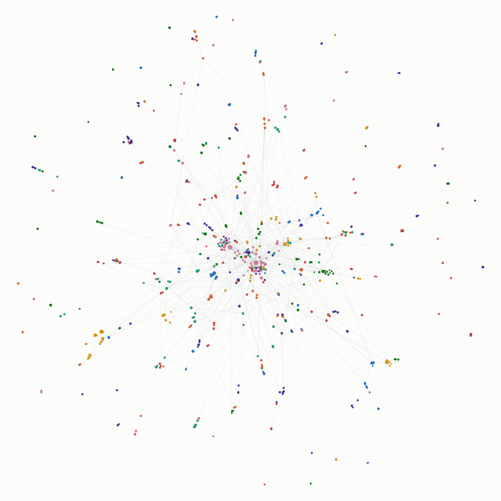
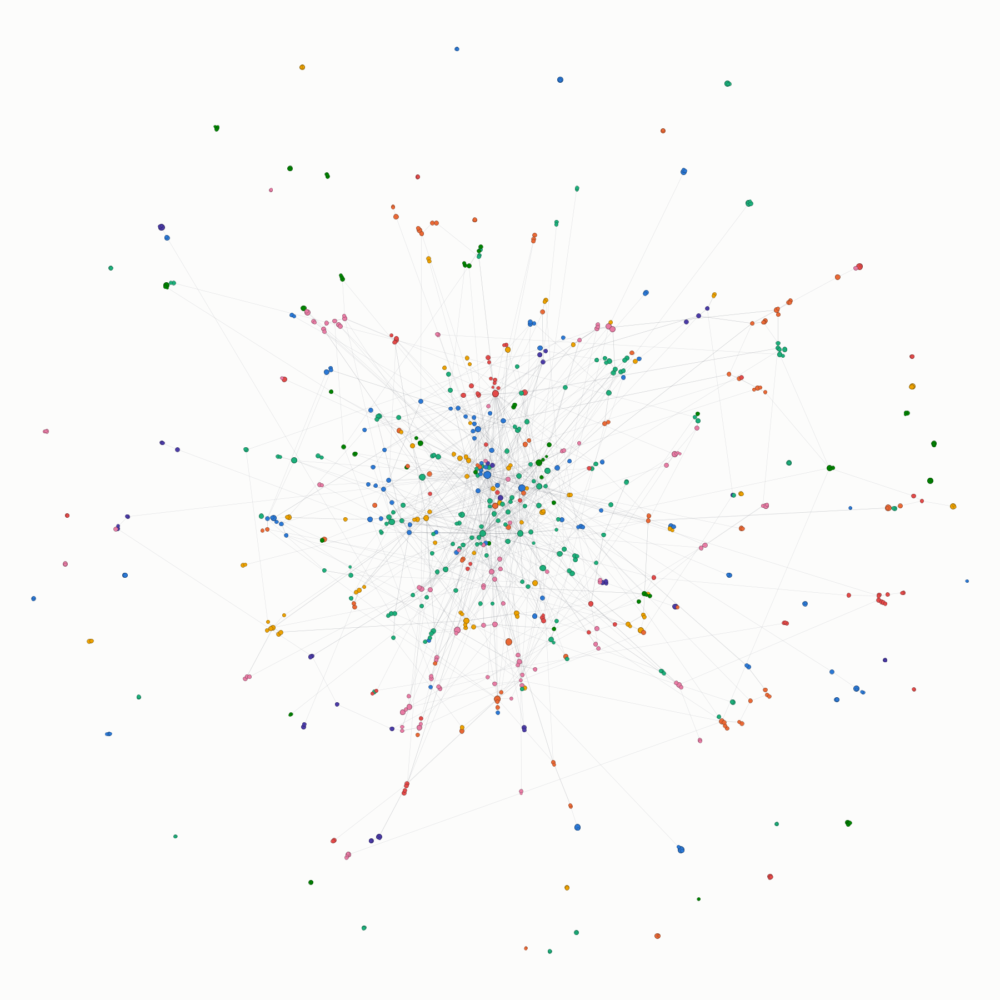
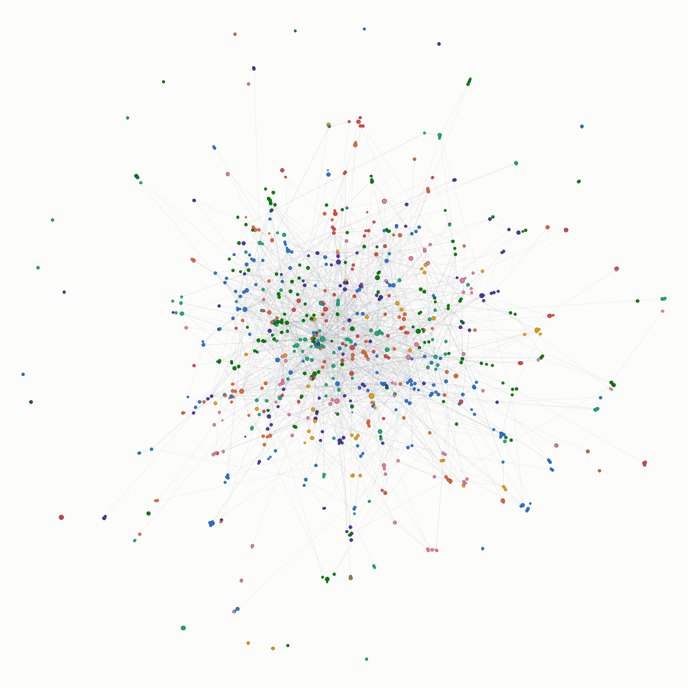
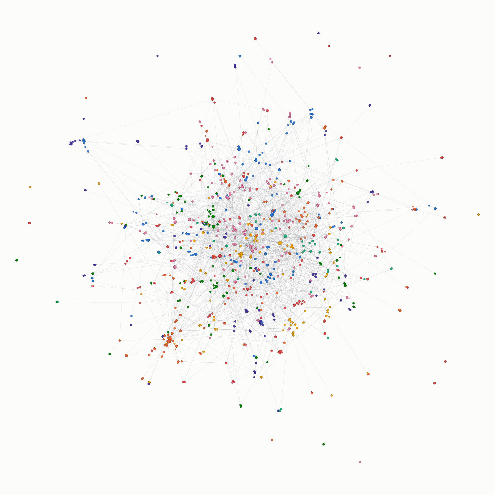
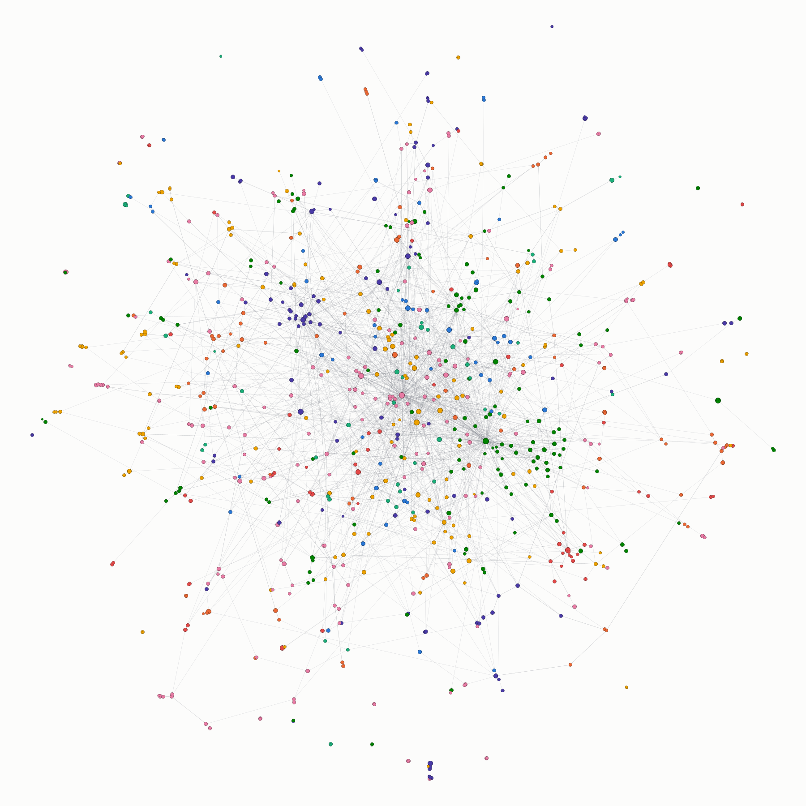
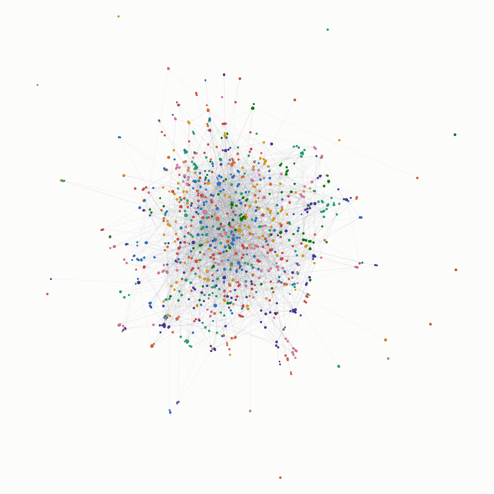
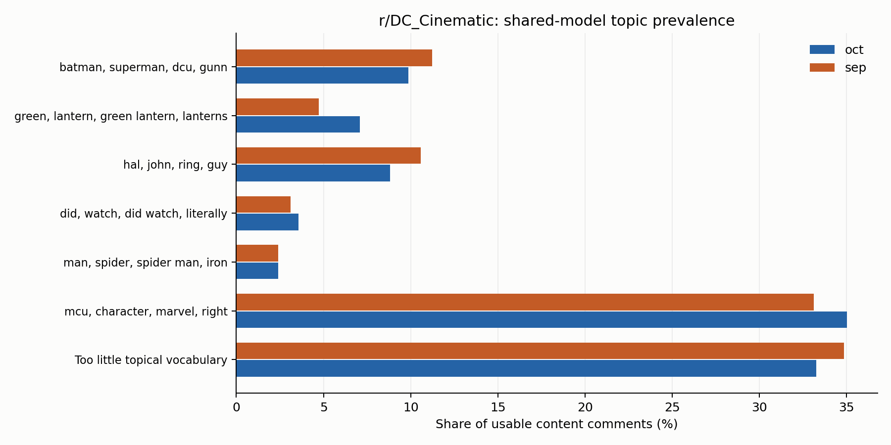
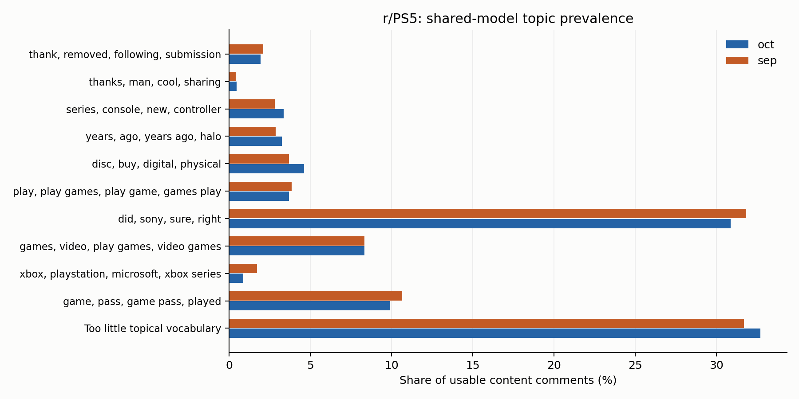

# Fandom Fault Lines

## Comparative longitudinal study

Repository maintainer: **gmayank9999**. Course: Computational Social Media Analysis. This report is generated from the aggregate tables in `outputs/study/tables/`. The original sampled pilot is superseded; its 5% overlap conclusion must not be reused.

## Research design

We compare Marvel/DC and PlayStation/Xbox communities over two adjacent 28-day UTC windows: 3 September–1 October and 1–29 October 2026 (ends exclusive), spanning 56 days. StarWars and lotr provide comparison audiences, not assumed hostile or rivalry-free controls. Pair selection reflects competing franchises/brands; individual users are not classified as fans or opponents. This extension was designed after inspecting the pilot and is exploratory, not preregistered.

1. **RQ1 — Content:** How do topics, franchise mentions and whole-comment sentiment differ across communities and periods?
2. **RQ2 — Structure:** Which users connect observed reply networks, and how sensitive is structure to including replies to posts?
3. **RQ3 — Boundaries:** How much observed participation overlaps, relative to other audience pairs?
4. **RQ4 — Stability:** How do those measurements change with period, duration and sampling effort?

## Data coverage and provenance

| window | subreddit | expected_days | valid_days | rows | complete_files |
| --- | --- | --- | --- | --- | --- |
| sep | marvelstudios | 28 | 28 | 167661 | True |
| sep | DC_Cinematic | 28 | 28 | 88049 | True |
| sep | PS5 | 28 | 28 | 99959 | True |
| sep | xbox | 28 | 28 | 92898 | True |
| sep | StarWars | 28 | 28 | 101882 | True |
| sep | lotr | 28 | 28 | 41004 | True |
| oct | marvelstudios | 28 | 28 | 138911 | True |
| oct | DC_Cinematic | 28 | 28 | 140166 | True |
| oct | PS5 | 28 | 28 | 72109 | True |
| oct | xbox | 28 | 28 | 88966 | True |
| oct | StarWars | 28 | 28 | 99426 | True |
| oct | lotr | 28 | 28 | 37607 | True |

A complete file set means every expected day is present and passes schema, ID and UTC-boundary checks. It does **not** certify that the archive contains every Reddit comment. New downloads record retrieval times and SHA-256 checksums; inherited caches have no historical request manifests. The collector fails on ambiguous timestamp pagination or a safety-cap limit, rather than saving a truncated day.

**Execution status:** Both designated pairs have aggregate analysis outputs.

## Corpus

| pair | window | subreddit | raw_comments | participation_comments | content_comments | commenters | rival_mention_pct |
| --- | --- | --- | --- | --- | --- | --- | --- |
| consoles | sep | PS5 | 99959 | 98060 | 96515 | 31217 | 3.34 |
| consoles | sep | xbox | 92898 | 90958 | 89870 | 27387 | 6.17 |
| consoles | oct | PS5 | 72109 | 70950 | 69575 | 25665 | 1.92 |
| consoles | oct | xbox | 88966 | 87468 | 86553 | 27055 | 6.23 |
| superheroes | sep | marvelstudios | 167661 | 164337 | 159073 | 47298 | 0.906 |
| superheroes | sep | DC_Cinematic | 88049 | 83745 | 83217 | 21631 | 2.63 |
| superheroes | oct | marvelstudios | 138911 | 137215 | 133558 | 37315 | 0.766 |
| superheroes | oct | DC_Cinematic | 140166 | 134952 | 134151 | 27725 | 3.41 |

Participation retains non-bot commenters even when their text is removed or too short for NLP. Content removes deleted/empty bodies, URLs/embeds, very short and non-letter text. This separates observable participation from usable linguistic evidence. Bot removal is a documented account list, not a comprehensive bot classifier. Counts are archive observations, not Reddit membership estimates.

## RQ3 and RQ4: audience boundaries

| pair | window | users_a | users_b | shared | pct_a | pct_b | jaccard_pct |
| --- | --- | --- | --- | --- | --- | --- | --- |
| consoles | sep | 31217 | 27387 | 2658 | 8.51 | 9.71 | 4.75 |
| consoles | oct | 25665 | 27055 | 2460 | 9.59 | 9.09 | 4.89 |
| consoles | pooled_56d | 46540 | 44309 | 4978 | 10.70 | 11.23 | 5.80 |
| superheroes | sep | 47298 | 21631 | 4378 | 9.26 | 20.24 | 6.78 |
| superheroes | oct | 37315 | 27725 | 4548 | 12.19 | 16.40 | 7.52 |
| superheroes | pooled_56d | 68608 | 39901 | 8807 | 12.84 | 22.07 | 8.83 |

A/B follow the order in `study.json`: Marvel/DC and PS5/xbox. Percentages use different denominators: shared/A, shared/B, and shared/(A∪B). The 56-day row deduplicates users across periods; it does not add monthly user counts. All activity thresholds (≥1, ≥2, ≥5 comments) appear in the accompanying table. Co-participation alone does not establish allegiance, exposure to opposing opinions, hostility or an echo chamber.

The subsampling experiment deliberately discards comments at fixed fractions, using five deterministic random draws. Its shaded ranges are sensitivity ranges, not confidence intervals. Cumulative 7/14/21/28-day curves show detection changes with duration; these nested windows are not independent observations.

**consoles, 56-day observation:** 4,978 users appear in both communities, representing 10.7% of PS5 commenters and 11.2% of xbox commenters (Jaccard 5.80%). This is a directional, period-specific participation result, not a binary verdict about whether the fandoms are closed.

For consoles, monthly Jaccard changes from 4.75% to 4.89% (+0.14 percentage points). This is a descriptive period comparison; the same people can appear in both windows.

**superheroes, 56-day observation:** 8,807 users appear in both communities, representing 12.8% of marvelstudios commenters and 22.1% of DC_Cinematic commenters (Jaccard 8.83%). This is a directional, period-specific participation result, not a binary verdict about whether the fandoms are closed.

For superheroes, monthly Jaccard changes from 6.78% to 7.52% (+0.74 percentage points). This is a descriptive period comparison; the same people can appear in both windows.

### Comparison audiences

| window | community_a | community_b | shared | pct_smaller | jaccard_pct |
| --- | --- | --- | --- | --- | --- |
| sep | marvelstudios | DC_Cinematic | 4378 | 20.24 | 6.78 |
| sep | marvelstudios | PS5 | 1962 | 6.29 | 2.56 |
| sep | marvelstudios | xbox | 1110 | 4.05 | 1.51 |
| sep | marvelstudios | StarWars | 3742 | 11.63 | 4.94 |
| sep | marvelstudios | lotr | 1057 | 6.05 | 1.66 |
| sep | DC_Cinematic | PS5 | 1028 | 4.75 | 1.98 |
| sep | DC_Cinematic | xbox | 566 | 2.62 | 1.17 |
| sep | DC_Cinematic | StarWars | 1615 | 7.47 | 3.09 |
| sep | DC_Cinematic | lotr | 360 | 2.06 | 0.930 |
| sep | PS5 | xbox | 2658 | 9.71 | 4.75 |
| sep | PS5 | StarWars | 1035 | 3.32 | 1.66 |
| sep | PS5 | lotr | 386 | 2.21 | 0.799 |
| sep | xbox | StarWars | 825 | 3.01 | 1.40 |
| sep | xbox | lotr | 237 | 1.36 | 0.531 |
| sep | StarWars | lotr | 1506 | 8.63 | 3.13 |
| oct | marvelstudios | DC_Cinematic | 4548 | 16.40 | 7.52 |
| oct | marvelstudios | PS5 | 1365 | 5.32 | 2.22 |
| oct | marvelstudios | xbox | 907 | 3.35 | 1.43 |
| oct | marvelstudios | StarWars | 3157 | 9.55 | 4.70 |
| oct | marvelstudios | lotr | 791 | 4.89 | 1.50 |
| oct | DC_Cinematic | PS5 | 1096 | 4.27 | 2.10 |
| oct | DC_Cinematic | xbox | 791 | 2.92 | 1.47 |
| oct | DC_Cinematic | StarWars | 1946 | 7.02 | 3.31 |
| oct | DC_Cinematic | lotr | 439 | 2.72 | 1.01 |
| oct | PS5 | xbox | 2460 | 9.59 | 4.89 |
| oct | PS5 | StarWars | 1181 | 4.60 | 2.05 |
| oct | PS5 | lotr | 315 | 1.95 | 0.759 |
| oct | xbox | StarWars | 1058 | 3.91 | 1.79 |
| oct | xbox | lotr | 256 | 1.58 | 0.596 |
| oct | StarWars | lotr | 1519 | 9.40 | 3.18 |

All pairs use the same participation filtering. We omit the old 'lift' interpretation: choosing the union of a few selected subreddits as the population does not supply a neutral model of all Reddit participation.

The six-node Gephi files in `outputs/study/aggregate_networks/` represent subreddits, with edge weight equal to Jaccard overlap. They contain only aggregates and are public. These audience-similarity graphs are distinct from user reply networks and do not measure hostility.

In oct, the highest observed Jaccard among the 15 selected audience pairs is marvelstudios/DC_Cinematic (7.52%). This ranking is conditional on the chosen six communities; it is not a Reddit-wide benchmark.

In sep, the highest observed Jaccard among the 15 selected audience pairs is marvelstudios/DC_Cinematic (6.78%). This ranking is conditional on the chosen six communities; it is not a Reddit-wide benchmark.

## RQ2: reply-network structure

| window | subreddit | nodes | edges | resolved_parent_pct | largest_component_pct | reciprocity | modularity_weighted | modularity_excess |
| --- | --- | --- | --- | --- | --- | --- | --- | --- |
| sep | PS5 | 32104 | 86348 | 99.75 | 96.57 | 0.243 | 0.521 | 0.029 |
| sep | xbox | 28390 | 80906 | 99.90 | 98.61 | 0.249 | 0.494 | 0.035 |
| oct | PS5 | 26332 | 62263 | 99.18 | 96.94 | 0.252 | 0.582 | 0.034 |
| oct | xbox | 27960 | 77402 | 99.40 | 98.75 | 0.269 | 0.518 | 0.040 |
| sep | marvelstudios | 49487 | 147982 | 99.88 | 95.83 | 0.217 | 0.458 | 0.023 |
| sep | DC_Cinematic | 22130 | 71108 | 99.95 | 98.59 | 0.275 | 0.474 | 0.042 |
| oct | marvelstudios | 39205 | 121963 | 99.64 | 96.04 | 0.240 | 0.463 | 0.036 |
| oct | DC_Cinematic | 28104 | 111636 | 99.66 | 99.23 | 0.294 | 0.407 | 0.026 |

A directed edge runs from the replier to the parent author; weight counts replies. Self-replies are excluded and counted, and isolated observed commenters remain nodes. Parent-only nodes are marked separately. Missing parents reduce coverage and are reported, not imputed. Reciprocal edge weights are summed for the undirected Louvain projection. Weighted PageRank, in/out degree, strengths, k-core and participation coefficient supplement directed, unweighted betweenness (reply frequency is not a distance).

The null comparison uses **unweighted observed modularity versus unweighted rewired modularity**. Each uses the same degree sequence with 10 requested rewires. The excess is descriptive, not a significance test; this small null ensemble cannot support a precise tail probability. Separate comment-to-comment graphs remove thread-starting hubs as a sensitivity analysis. Centrality denotes structural position, not influence. Approximate betweenness is checked with two seeds; top-20 set overlap is supplied in the network table.

### Gephi deliverables

Full and display-filtered GEXF files and node/edge CSVs are in `outputs/study/networks/` locally. See [GEPHI_GUIDE.md](GEPHI_GUIDE.md) for import settings, metric definitions, layout and export steps. Network files contain pseudonymous user-level information and are excluded from Git. All reported metrics use full graphs; filtered visualizations are never used to estimate population structure.

### Removing replies to posts

| window | subreddit | all_replies | comment_replies |
| --- | --- | --- | --- |
| oct | DC_Cinematic | 99.23 | 69.31 |
| oct | PS5 | 96.94 | 71.68 |
| oct | marvelstudios | 96.04 | 64.89 |
| oct | xbox | 98.75 | 60.87 |
| sep | DC_Cinematic | 98.59 | 64.66 |
| sep | PS5 | 96.57 | 69.53 |
| sep | marvelstudios | 95.83 | 59.31 |
| sep | xbox | 98.61 | 53.33 |

Differences in largest-component coverage quantify how much connectivity depends on replies to thread starters. Both graph variants retain observed commenters, so an isolated user is included in the denominator.

### Cross-participants among structural connectors

| window | subreddit | observed_shared_pct | selected_nodes | selected_parent_only_nodes | selected_shared_pct_of_observed | selected_observed_median_threads |
| --- | --- | --- | --- | --- | --- | --- |
| sep | PS5 | 8.51 | 20 | 0 | 10.00 | 40.00 |
| sep | xbox | 9.71 | 20 | 0 | 30.00 | 39.50 |
| oct | PS5 | 9.59 | 20 | 0 | 30.00 | 24.00 |
| oct | xbox | 9.09 | 20 | 0 | 35.00 | 55.50 |
| sep | marvelstudios | 9.26 | 20 | 0 | 25.00 | 70.50 |
| sep | DC_Cinematic | 20.24 | 20 | 0 | 30.00 | 58.50 |
| oct | marvelstudios | 12.19 | 20 | 0 | 15.00 | 94.50 |
| oct | DC_Cinematic | 16.40 | 20 | 0 | 15.00 | 68.50 |

The selection contains the top 20 positive betweenness scores, including every tie at the cutoff. Shared-participant percentages use observed commenters as their denominator; parent-only nodes are shown separately. The baseline is all observed commenters in that community-period. PageRank, incoming-strength and comment-only variants are in the connector-role tables. These are descriptive role comparisons, not a significance test or proof that an account transmits ideas between subreddits. Approximate betweenness rankings can change with the sampling seed.

### Native Gephi verification

| window | subreddit | nodes | edges | degree_mismatches | project_reopened |
| --- | --- | --- | --- | --- | --- |
| sep | PS5 | 32104 | 86348 | 0 | True |
| sep | xbox | 28390 | 80906 | 0 | True |
| oct | PS5 | 26332 | 62263 | 0 | True |
| oct | xbox | 27960 | 77402 | 0 | True |
| sep | marvelstudios | 49487 | 147982 | 0 | True |
| sep | DC_Cinematic | 22130 | 71108 | 0 | True |
| oct | marvelstudios | 39205 | 121963 | 0 | True |
| oct | DC_Cinematic | 28104 | 111636 | 0 | True |

The official Gephi Toolkit imported the full graphs, verified directed degrees and total reply weight, recomputed weighted PageRank, generated ForceAtlas2 display layouts and saved/reopened native two-workspace projects. These are engine-verified artifacts; desktop GUI inspection was unavailable because desktop automation failed to initialize.

*r/PS5, sep: focus with directed weights ≥2 and resulting isolates removed; ForceAtlas2 (400 iterations, seed 42); size reflects incoming reply strength; colors follow the imported Louvain communities with an eight-color repeating palette. Shown: 728 nodes and 1,551 edges; full graph: 32,104 nodes and 86,348 edges. No user labels are displayed.*

*r/xbox, sep: focus with directed weights ≥2 and resulting isolates removed; ForceAtlas2 (400 iterations, seed 42); size reflects incoming reply strength; colors follow the imported Louvain communities with an eight-color repeating palette. Shown: 767 nodes and 1,677 edges; full graph: 28,390 nodes and 80,906 edges. No user labels are displayed.*

*r/PS5, oct: focus with directed weights ≥2 and resulting isolates removed; ForceAtlas2 (400 iterations, seed 42); size reflects incoming reply strength; colors follow the imported Louvain communities with an eight-color repeating palette. Shown: 650 nodes and 1,109 edges; full graph: 26,332 nodes and 62,263 edges. No user labels are displayed.*

*r/xbox, oct: focus with directed weights ≥2 and resulting isolates removed; ForceAtlas2 (400 iterations, seed 42); size reflects incoming reply strength; colors follow the imported Louvain communities with an eight-color repeating palette. Shown: 756 nodes and 1,575 edges; full graph: 27,960 nodes and 77,402 edges. No user labels are displayed.*

*r/marvelstudios, sep: focus with directed weights ≥2 and resulting isolates removed; ForceAtlas2 (400 iterations, seed 42); size reflects incoming reply strength; colors follow the imported Louvain communities with an eight-color repeating palette. Shown: 844 nodes and 2,411 edges; full graph: 49,487 nodes and 147,982 edges. No user labels are displayed.*

*r/DC_Cinematic, sep: focus with directed weights ≥2 and resulting isolates removed; ForceAtlas2 (400 iterations, seed 42); size reflects incoming reply strength; colors follow the imported Louvain communities with an eight-color repeating palette. Shown: 898 nodes and 2,714 edges; full graph: 22,130 nodes and 71,108 edges. No user labels are displayed.*

*r/marvelstudios, oct: focus with directed weights ≥2 and resulting isolates removed; ForceAtlas2 (400 iterations, seed 42); size reflects incoming reply strength; colors follow the imported Louvain communities with an eight-color repeating palette. Shown: 834 nodes and 2,256 edges; full graph: 39,205 nodes and 121,963 edges. No user labels are displayed.*

*r/DC_Cinematic, oct: focus with directed weights ≥2 and resulting isolates removed; ForceAtlas2 (400 iterations, seed 42); size reflects incoming reply strength; colors follow the imported Louvain communities with an eight-color repeating palette. Shown: 986 nodes and 4,350 edges; full graph: 28,104 nodes and 111,636 edges. No user labels are displayed.*

## RQ1: content and sentiment

| window | subreddit | n_a | n_b | effect_size_r | author_diff | author_ci_low | author_ci_high | supported_both_clusterings |
| --- | --- | --- | --- | --- | --- | --- | --- | --- |
| sep | PS5 | 10267 | 3219 | -0.032 | -0.032 | -0.058 | -0.004 | False |
| sep | xbox | 16881 | 5546 | 0.003 | 0.012 | -0.014 | 0.046 | False |
| oct | PS5 | 5780 | 1335 | 0.024 | 0.029 | -0.010 | 0.066 | False |
| oct | xbox | 16532 | 5391 | -0.031 | -0.017 | -0.042 | 0.014 | False |
| sep | marvelstudios | 36584 | 1441 | -0.030 | -0.031 | -0.057 | -0.002 | False |
| sep | DC_Cinematic | 17442 | 2187 | -0.118 | -0.101 | -0.127 | -0.076 | True |
| oct | marvelstudios | 28267 | 1023 | -0.046 | -0.046 | -0.076 | -0.014 | True |
| oct | DC_Cinematic | 27083 | 4573 | -0.076 | -0.066 | -0.083 | -0.048 | True |

Positive differences mean own-franchise-only comments score more positively than rival-mentioning comments. These are **whole-comment sentiment** measurements, not target-specific attitudes. For example, a negative comment can criticise one's own franchise while praising the rival. Alias matches measure explicit mentions and can miss implicit references or include ambiguous ones.

Both original and domain-adapted VADER are reported, including rival-only and any-rival-mention definitions. Removing plot/franchise words can also remove real negative language; adaptation is a sensitivity analysis, not established ground truth. Comparisons report rank-biserial effects, independent user- and thread-cluster bootstraps, and Holm adjustment over all scorer/definition/community contrasts within a pair-period. This does not implement simultaneous two-way clustering and does not remove temporal confounding.

Topics use a shared TF-IDF/NMF model for each pair across both periods, with balanced training allocation by community-period. Candidate K values are compared by in-sample NPMI coherence; this is an exploratory heuristic, not held-out validation. Per-period topic proportions and weekly mention/sentiment trends are in the tables.

Across the 8 displayed community-period comparisons, 3 meet the Holm-adjusted threshold in both clustering sensitivities: 3 have a negative own-minus-rival difference and 0 a positive difference. A negative difference means rival-mentioning comments score more positively on average, which does not support interpreting mentions as automatically hostile. Statistical separation does not establish a practically large effect or a valid stance measurement.

Between 31.7% and 37.4% of content comments across the reported community-periods have insufficient topical vocabulary and remain unassigned (topic -1). Topic proportions retain those comments in their denominators; topic keywords are model summaries requiring interpretation, not validated human categories. Some factors capture generic conversation or moderation boilerplate; they must not be relabelled as rivalry themes without text review.

## Validation still needed before submission

The inherited 300-example sentiment development set was labelled by an AI assistant. It is **not a human gold standard**, and selecting a model on that same set does not establish held-out accuracy. It was also length-restricted and stratified, so its stance proportions cannot be extrapolated to all comments. No population hostility rate is claimed. Use [ANNOTATION_GUIDE.md](ANNOTATION_GUIDE.md) for a blinded independent human check. Record actual individual contributions separately; the previous autogenerated contribution table is not evidence of who did what.

## Limitations and interpretation

Two purposively selected rivalries and two adjacent windows cannot identify a general causal effect of rivalry. Archive omissions, moderation, bot detection, language filtering, asymmetric alias vocabularies and event-driven activity affect measurement. Baseline audiences differ in size and subject matter. Network topology reflects reply/thread mechanics as well as social organization. More data improves observable coverage; it does not guarantee stronger effects or validate an echo-chamber claim. Null and mixed findings are valid outcomes.

## Reproduction and sources

Run `python run_study.py --stage all` to collect, analyze and regenerate this report. Use `--stage inventory` to audit coverage, `--stage analyze` to reuse local raw caches, and `--stage report` to rebuild figures/report from aggregates. Fixed dates and seeds are in `study.json`.

- [Arctic Shift API and pagination documentation](https://github.com/ArthurHeitmann/arctic_shift/blob/master/api/README.md)
- [NetworkX reciprocal-edge conversion semantics](https://networkx.org/documentation/stable/reference/classes/generated/networkx.DiGraph.to_undirected.html)
- [Gephi documentation](https://docs.gephi.org/)
- [VADER original paper](https://ojs.aaai.org/index.php/ICWSM/article/view/14550)
- [The echo chamber effect on social media](https://doi.org/10.1073/pnas.2023301118)
