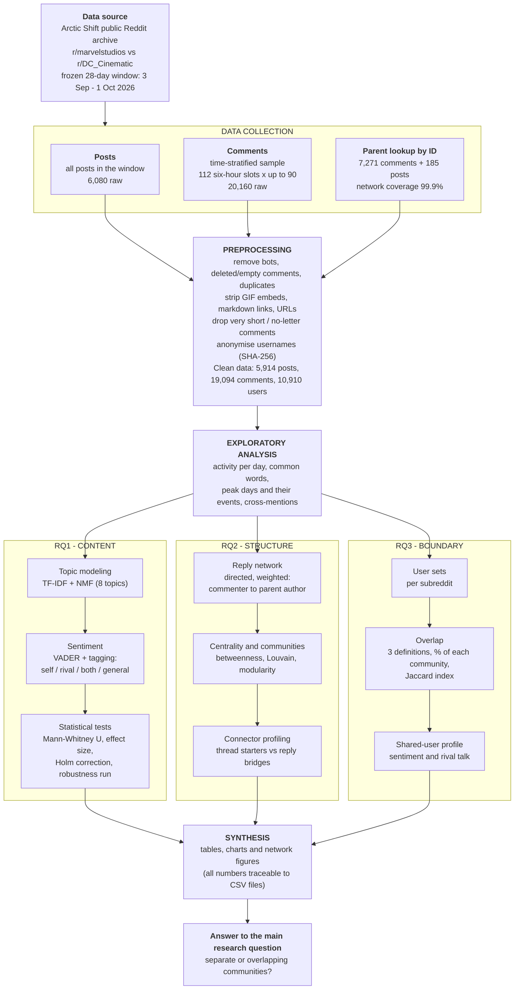

> **SUPERSEDED PILOT — NOT CURRENT RESULTS.** Preserved from the Claude handoff for audit only.
> Sampling-sensitive conclusions, validation claims and the generated team-contribution table below
> are not verified evidence. Use the root REPORT.md and PROJECT_STATUS.md instead.

# Fandom Fault Lines: Mapping Discourse, Sentiment, and Community Structure in Rival Fan Communities on Reddit

**Course:** CSE3729 — Computational Social Media Analysis
**Team:** Group 6 — Mayank Gupta (230553), Anurag Kumar (230616), Jhalak Kapila (230576)

---

## Abstract

Rival fan communities are often assumed to be hostile echo chambers, yet this is rarely tested with data. We compare r/marvelstudios and r/DC_Cinematic over 28 days, using 5,914 posts and 19,094 comments from the Arctic Shift archive. Topic modeling, VADER sentiment analysis, non-parametric tests, reply-network analysis and user-overlap measurement address content, structure and boundaries. Only about 5% of commenters appear in both communities, each community mainly discusses its own franchise, and neither is measurably colder toward its rival. Central network users are mostly thread starters. The communities appear separate but not hostile.

---

## 1. Introduction

Fan communities form around films, series, music acts and other creative universes, and many are defined partly by opposition to a rival. The Marvel–DC rivalry is a well-known example. It is widely discussed in anecdotes and on social media, but it is rarely measured: it is unclear whether such communities function as separate discourse networks, with little shared membership and little interaction, or whether they overlap in content and audience.

This question matters for computational social media analysis because it is a concrete instance of a broader one: do online groups sort themselves into closed "echo chambers", or do they remain connected? Most existing work on this question concerns political polarization. Fan communities offer a lower-stakes setting in which the same questions about topics, sentiment, internal structure and group boundaries can be studied.

We treat two public subreddits, r/marvelstudios and r/DC_Cinematic, as a case study and ask a single main research question:

> To what extent do rival fan communities on Reddit form separate, distinct groups versus overlapping ones, and how do their content (sentiment and topics), internal structure (key connector users) and cross-group boundaries differ?

The question is split into three measurable parts: **RQ1 (content)**, what topics and sentiment characterize how each community discusses itself and its rival; **RQ2 (structure)**, which users act as key connectors in each community's reply network; and **RQ3 (boundary)**, what proportion of active users participate in both communities.

We built an end-to-end pipeline that collects, cleans and analyses the data, and we report both the findings and their limits.

---

## 2. Literature Review

**Echo chambers across platforms.** A growing literature asks whether online users sort into like-minded groups. Cinelli et al. [1] compared echo-chamber effects across several platforms, including Reddit, using homophily in interaction networks, and showed that the strength of the effect depends on the platform and the topic. Reddit's community structure has itself been used as a testbed. De Francisci Morales et al. [2] studied the 2016 US election debate on Reddit and found, contrary to the usual echo-chamber narrative, that users preferred cross-cutting interactions between two opposing communities over within-group interactions. Waller and Anderson [3] used patterns of user participation across Reddit communities to quantify social organization and political polarization, showing that who takes part in which communities is informative in itself. These studies motivate our overlap measure (RQ3) and caution against assuming that opposing groups are closed: separation or mixing has to be measured.

**Boundaries between groups.** Kristensen et al. [4] analysed about 30 million posts from alternative news-sharing networks in four European countries before and during the COVID-19 pandemic. They found that source heterophily, a measure of links across partisan lines, increased only slightly and that traditional left–right divisions largely persisted, with differences between countries. That group divisions persist despite shocks, and vary by context, is a reminder that a single time window and a single pair of communities, as in our case study, support only a context-specific conclusion.

**Hostility toward the out-group.** Rivalry between fan groups is a form of intergroup conflict. White et al. [5] studied Australian football fan groups and found that identity fusion, a strong sense of oneness with the group, predicted out-group hostility, whereas ordinary group identification predicted out-group prejudice but not hostility. This shows that fan rivalry can involve hostility, but the study relied on a small survey sample (N = 100) of fans of one sport and did not examine online discourse. Online, Rathje et al. [6] showed that political posts targeting opponents receive substantially more engagement than other content, which suggests that out-group talk may be amplified by platforms. Brady et al. [7], in contrast, showed that moral outrage is overperceived in online networks, which inflates beliefs about intergroup hostility. Together these imply two questions for an online fan rivalry: how common is rival-directed talk, and how negative is it really? RQ1 addresses both by measuring how often each community talks about its rival and how positive or negative that talk is compared with talk about its own franchise.

**Echo chambers as a structural phenomenon.** Avin et al. [8] derived a theoretical impossibility result: no general regulation function can break the echo-chamber effect while preserving freedom of expression and user privacy. If echo chambers are structurally persistent, empirical measurements in new settings, such as fan communities, are valuable for showing when and where separation actually occurs.

**Reddit as a research setting.** Proferes et al. [9] reviewed the disciplines, approaches, methods and ethics of Reddit research and stressed responsible handling of user data. We follow this by using public data only, pseudonymizing usernames before analysis, and keeping raw data out of version control. Reddit's closure of self-service API access in November 2025 led us to use the Arctic Shift public archive.

**Methods used.** Sentiment is scored with VADER, a lexicon- and rule-based model built for short, informal social media text. Topics are extracted with non-negative matrix factorization, which decomposes a term-weight matrix into additive, interpretable parts. Because sentiment scores are not normally distributed, groups are compared with the Mann–Whitney U test and p-values are adjusted for multiple comparisons with the Holm procedure; effect sizes are reported alongside, since very large samples make tiny differences detectable. Reply networks are analysed with betweenness centrality, and we call high-betweenness users *structurally central* rather than influential, because position in a graph does not by itself establish influence. Sub-groups are detected with the Louvain algorithm. Fortunato and Newman's overview of two decades of community detection [10] reflects a field with many methods and no single "correct" partition, so we interpret the detected communities cautiously.

**Gap addressed by this project.** The literature reviewed concentrates mainly on political polarization, plus offline studies of sports fans. We apply its measurement ideas, namely shared membership, interaction structure and out-group talk, to rival fan communities online, and combine them in a single reproducible pipeline with explicit sampling rules and statistical checks.

---

## 3. Project Objectives

1. **Collect** a reproducible, time-balanced dataset of posts and comments from two rival fan subreddits, with usernames pseudonymized.
2. **Characterize content** (RQ1): identify the main topics and compare sentiment toward each community's own franchise and its rival, with statistical testing.
3. **Characterize structure** (RQ2): build each community's reply network, identify structurally central users and detect sub-communities.
4. **Measure the boundary** (RQ3): quantify the overlap of users between the two communities under several definitions, and use the results to answer whether the communities are separate or overlapping.

---

## 4. Methodology

Figure 1 gives an overview of the methodology: data collection, preprocessing, exploratory analysis, three parallel analysis branches (one per research question) and a final synthesis. The sub-sections below describe each step.

*Figure 1: Overall methodology flowchart.*

**Text version of Figure 1** (for formats where the diagram does not render):

1. **Data source:** Arctic Shift archive; r/marvelstudios and r/DC_Cinematic; 3 Sep – 1 Oct 2026.
2. **Data collection:** all posts; a time-stratified comment sample (112 six-hour slots, up to 90 comments each); parent comments and posts fetched by ID.
3. **Preprocessing:** remove bots, deleted or empty items and duplicates; clean text; anonymise usernames. Result: 5,914 posts, 19,094 comments, 10,910 users.
4. **Exploratory analysis:** activity, common words, peak days, cross-mentions.
5. **Three parallel analyses:**
   - **RQ1 (content):** topic modeling → sentiment and target tagging → statistical tests.
   - **RQ2 (structure):** reply network → centrality and communities → connector profiling.
   - **RQ3 (boundary):** user sets → overlap measures → shared-user profile.
6. **Synthesis:** tables, charts and network figures, leading to the answer to the main research question.

### 4.1 Data Collection

**Data source.** Reddit closed self-service API application creation in November 2025, and academic access requires an approval process of several weeks. We therefore used **Arctic Shift** (arctic-shift.photon-reddit.com), a free, public archive of Reddit posts and comments that needs no authentication. Because it is community-run, all requests go through a function that retries failed requests with exponential backoff (5, 10, 20, 40 seconds).

**Window.** The collection window is fixed to 28 days (3 September – 1 October 2026, UTC) so that re-running the pipeline never changes the dataset. It ends a few days before collection so that comment scores have had time to accumulate.

**Posts.** Every post in the window was collected for both subreddits, paging backward in time, 100 posts per request.

**Comments.** A *time-stratified sample* was taken. The window was divided into 112 slots of six hours, and up to 90 comments were collected from each slot, giving about 10,080 comments per subreddit spread evenly over the window. An earlier version that simply took the newest 10,000 comments covered only 35 hours for one subreddit and four days for the other, which made the two communities incomparable; stratification fixes this.

**Parent lookup.** Because comments are sampled, many reply to a parent comment that is outside the sample. After sampling, only 57–59% of replies could be linked to a known parent author. We therefore fetched the 7,271 missing parent comments and 185 missing parent posts by ID, keeping only the author identifier. Network coverage rose to 99.9%.

**Ethics.** Only public subreddits were used. Usernames are replaced by a deterministic one-way SHA-256 hash before analysis or storage of results, and the raw data containing real usernames is not committed to version control. This is pseudonymization, not absolute anonymity.

### 4.2 Data Preprocessing

The following steps were applied in order:

1. Removal of bot accounts (AutoModerator, RemindMeBot, sneakpeekbot) and deleted authors.
2. Removal of empty, `[removed]` and `[deleted]` comment bodies, and of duplicate IDs.
3. Text cleaning: removal of Reddit GIF/image embeds, markdown links (keeping the link text), web addresses and HTML residues, and collapsing of whitespace.
4. Removal of comments shorter than three characters or without any letters.
5. Anonymization of all usernames.

From 6,080 raw posts and 20,160 raw comments, the cleaned dataset contains **5,914 posts and 19,094 comments** (r/marvelstudios: 3,949 posts, 9,552 comments; r/DC_Cinematic: 1,965 posts, 9,542 comments), written by 10,910 distinct users.

### 4.3 Methods

**Exploratory analysis.** We examined activity over time, the most common words (after removing a standard English stopword list extended with conversational filler), the cross-mention rate, and the three busiest days per subreddit, together with the most-discussed post on those days, to identify the events behind activity spikes.

**Topic modeling (RQ1).** For each subreddit separately, comments were converted to TF-IDF vectors (words and two-word phrases; words appearing in over 50% or fewer than five comments excluded; at most 3,000 features), and eight topics were extracted with NMF (random seed 42). Each comment was assigned its strongest topic; comments with fewer than four informative words were labelled "too short" (topic −1) rather than forced into a topic.

**Sentiment (RQ1).** Every comment received a VADER *compound* score from −1 (most negative) to +1 (most positive), classified as positive (≥ 0.05), negative (≤ −0.05) or neutral. Each comment was also tagged by whom it discusses, using whole-word matching against franchise alias lists: **self-talk** (own franchise), **rival-talk**, **both**, or **general** (neither).

**Statistical testing (RQ1).** Differences were tested with two-sided Mann–Whitney U tests. Each test reports the rank-biserial effect size *r* = 2U/(n₁n₂) − 1, and p-values are adjusted with the Holm procedure across all ten tests. As a robustness check, all tests were repeated after excluding comments with a VADER score of exactly 0 (comments where no sentiment words were found).

**Reply networks (RQ2).** For each subreddit we built a directed graph in which a node is a (pseudonymized) user and an edge from *A* to *B* means that *A* replied to *B*; the edge weight counts the replies. Self-replies were removed. We report network coverage (the share of comments whose parent author is known), density, connected components and the largest component.

**Centrality and connectors (RQ2).** Degree and betweenness centrality were computed. For graphs with more than 2,000 nodes, betweenness is approximated by sampling 2,000 source nodes (seed 42). The top 20 users by betweenness were profiled and classified as **thread starters** (authored posts and receive more replies than they write) or **reply bridges**.

**Community detection (RQ2).** Louvain community detection (undirected, weighted, seed 42) was applied, and modularity was computed. Communities with at least ten users were profiled with their mean sentiment and their *distinctive topic*, the topic most over-represented relative to the whole subreddit (lift).

**Overlap (RQ3).** The overlap of users between the two subreddits was computed under three definitions (commenters; commenters or post authors; users with at least two comments in a subreddit) and reported as a percentage of each community and as the Jaccard index. Shared users were additionally profiled.

### 4.4 Implementation and Validation

The pipeline is implemented in Python (pandas, scikit-learn, SciPy, NetworkX, python-louvain, vaderSentiment) as a set of modular stages run by one command, with a single configuration file, fixed random seeds and pinned library versions. 26 automated tests exercise the core functions on small synthetic datasets. Visualizations of the networks were produced in Python and in Gephi.

---

## 5. Results and Discussion

### 5.1 Dataset and activity

| | r/marvelstudios | r/DC_Cinematic |
|---|---|---|
| Posts (clean) | 3,949 | 1,965 |
| Comments (clean) | 9,552 | 9,542 |
| Typical posts per day | about 100–200 | about 50–110 |

*Figure 2: activity over time (`outputs/charts/chart_activity_over_time.png`).*

The busiest days point to specific events. For r/marvelstudios, they coincide with threads about *Avengers: Doomsday* and Doctor Doom (5, 9 and 23 September). For r/DC_Cinematic, all three busiest days concern HBO's *Lanterns* series, including its sixth-episode discussion thread (3, 7 and 21 September). The window is therefore not a "typical" month, and the findings describe this period rather than fandom behaviour in general.

### 5.2 Content: topics and vocabulary (RQ1)

The most frequent words are dominated by each community's own universe: *mcu, marvel, avengers, tony, thor, loki, doom, thanos, endgame* for Marvel; *hal, superman, john, batman, ring, lantern, episode, gunn, snyder, dcu* for DC.

| Largest topics, r/marvelstudios | Share | Largest topics, r/DC_Cinematic | Share |
|---|---|---|---|
| Avengers / Endgame / Thanos / Hulk | 36.2% | Gunn / DCU / Snyder / characters | 38.2% |
| (too short for a topic) | 35.8% | (too short for a topic) | 34.8% |
| MCU / comics / characters | 6.1% | Hal Jordan / Sinestro / Green Lantern | 8.1% |
| Captain Marvel / Captain America | 4.8% | Superman / Supergirl / Steel | 4.4% |
| Thor / Loki | 4.7% | Green Lantern / Lanterns | 4.1% |
| Spider-Man / Iron Man / Ant-Man | 4.4% | Batman / DCU | 3.5% |

*Figure 3: topic prevalence (`outputs/charts/chart_topic_prevalence.png`).*

Each community discusses its own universe. Marvel discussion looks back at the Avengers era and ahead to *Doomsday* and *Secret Wars*; DC discussion is strongly shaped by the *Lanterns* series and the Gunn-era DCU. About 35% of comments are too short to receive a topic, and the largest topic in each subreddit is broad, so the topics describe themes rather than sharp categories. Direct references to the rival franchise are rare: **0.9%** of Marvel comments mention DC terms and **2.8%** of DC comments mention Marvel terms.

### 5.3 Content: sentiment (RQ1)

The mean VADER score is 0.066 for r/marvelstudios and 0.084 for r/DC_Cinematic. In r/marvelstudios, 42.7% of comments are positive, 26.9% neutral and 30.5% negative; in r/DC_Cinematic the shares are 45.3%, 23.7% and 31.0%. VADER assigns a score of exactly 0 to 23.8% of comments.

| Comment is about | r/marvelstudios mean (n) | r/DC_Cinematic mean (n) |
|---|---|---|
| Own franchise | 0.090 (2,267) | 0.147 (2,115) |
| Rival franchise | 0.095 (53) | 0.291 (118) |
| Both | 0.367 (32) | 0.413 (151) |
| Neither | 0.057 (7,200) | 0.055 (7,158) |

*Figure 4: sentiment by target (`outputs/charts/chart_sentiment_by_target.png`).*

About three quarters of comments in each community mention neither franchise by name, and rival talk is only 0.6% (Marvel) and 1.2% (DC) of comments, so every statement about rival-directed sentiment rests on small samples.

**Statistical tests.**

| Comparison | n | p | Effect size *r* | Holm-adjusted p | Significant after correction? |
|---|---|---|---|---|---|
| Overall sentiment, Marvel vs DC | 9,552 / 9,542 | 0.0074 | −0.022 | 0.052 | No |
| Marvel: own vs rival talk | 2,267 / 53 | 0.90 | +0.010 | 1.00 | No |
| DC: own vs rival talk | 2,115 / 118 | 0.0057 | −0.151 | 0.046 | Borderline* |
| Rival talk: Marvel vs DC | 53 / 118 | 0.0096 | −0.248 | 0.058 | No |
| Own-franchise talk: Marvel vs DC | 2,267 / 2,115 | 0.0010 | −0.057 | 0.010 | **Yes** |

\* Not significant in the robustness run that excludes zero-score comments (Holm-adjusted p = 0.058).

Only one result is significant after correction and in the robustness run: comments about their own franchise are slightly more positive in r/DC_Cinematic than in r/marvelstudios. The effect is small (r = −0.057; a randomly chosen DC comment is more positive than a randomly chosen Marvel comment about 53% of the time). Marvel fans show no difference between self-talk and rival-talk (p = 0.90), and DC fans' comments about Marvel are, if anything, more positive than their comments about DC, although this result is borderline and not robust. **We find no evidence that either community is more negative toward its rival than toward itself.**

### 5.4 Structure: reply networks (RQ2)

| | r/marvelstudios | r/DC_Cinematic |
|---|---|---|
| Users (nodes) / reply links (edges) | 8,307 / 9,199 | 6,626 / 8,950 |
| Network coverage | 99.92% | 99.98% |
| Density | 0.00013 | 0.00020 |
| Weakly connected components | 997 | 481 |
| Largest component | 71.8% of users | 83.1% of users |
| Louvain communities (≥ 10 users / total) | 54 / 1,050 | 48 / 528 |
| Modularity | 0.85 | 0.77 |

Both networks are very sparse. Most users belong to one large connected component, surrounded by many small groups that exchanged only a few replies; r/DC_Cinematic is the more tightly connected. Modularity is high in both, but reply networks are naturally organized by thread, so a high value does not by itself indicate strong factions.

*Figure 5: reply-network core of r/marvelstudios (Gephi export). Figure 6: reply-network core of r/DC_Cinematic (Gephi export). Node size = betweenness centrality; colour = Louvain community (eight largest; grey = others).*

The pictures show a hub-and-spoke structure: a few large nodes, each surrounded by smaller nodes of the same community. In r/marvelstudios one hub is dominant; in r/DC_Cinematic several hubs have comparable size.

**Structurally central users.** Among the top 20 users by betweenness, 13 (Marvel) and 15 (DC) authored at least one post, and 9 (Marvel) and 14 (DC) are thread starters. The median number of replies received by these users is 16.5 in r/marvelstudios and 38.5 in r/DC_Cinematic, and only 2 of the 20 in each community are also active in the rival subreddit. The users are central largely because many people reply to their threads, not because they connect different groups. Maximum betweenness is low in both networks (0.015 and 0.018), so no single user dominates.

**Communities.** The 54 (Marvel) and 48 (DC) communities with at least ten users cover about 4,750 and 4,530 users, and mean community sentiment ranges from about −0.07 to +0.23 and from −0.08 to +0.19. Communities differ in their distinctive topics (for example Spider-Man/Iron Man, Doctor Doom/Tony Stark, Superman/Supergirl, Hal Jordan/Sinestro), so they behave as discussion circles around a subject or a hub rather than as rival factions.

### 5.5 Boundary: user overlap (RQ3)

| Definition of "user" | Marvel | DC | In both | % of Marvel | % of DC | Jaccard |
|---|---|---|---|---|---|---|
| Commenters (≥ 1 comment) | 6,040 | 5,176 | 306 | 5.07% | 5.91% | 2.80% |
| Commenters or post authors | 7,942 | 6,028 | 410 | 5.16% | 6.80% | 3.02% |
| Repeat commenters (≥ 2 comments) | 1,513 | 1,595 | 73 | 4.82% | 4.58% | 2.41% |

*Figure 7: overlap under three definitions (`outputs/charts/chart_overlap.png`).*

About 5% of users in each community also appear in the other, however "user" is defined, and only about 3 of every 100 distinct users belong to both. The 306 shared commenters write 6.6% of Marvel's comments and 8.5% of DC's, and their sentiment and rate of rival talk are only slightly different from other users'. The typical shared user wrote one comment in each subreddit, so most of them appear to be occasional visitors rather than members of both communities. Because comments are sampled, these figures are lower bounds on true cross-participation.

### 5.6 Discussion: answering the research questions

- **RQ1 (content).** Each community mainly discusses its own franchise and current events. Rival talk is rare, and neither community is measurably colder toward its rival. The only robust sentiment difference is small: DC fans are slightly warmer about their own franchise.
- **RQ2 (structure).** Each community is organized around a few thread-starting hubs and many small discussion circles. The most central users are mostly thread starters rather than bridges between groups.
- **RQ3 (boundary).** The audiences are largely separate, with about 5% overlap.

**Main research question.** The two communities are *separate in audience and subject, but not hostile*. The echo-chamber description fits for who participates and what is discussed, but not for animosity: the rivalry looks more like two parallel conversations than a confrontation.

### 5.7 Methodological refinement

An early version of the pipeline, based on the newest 10,000 comments per subreddit, suggested that Marvel fans were much more negative about DC than about Marvel. After fixing the sampling (time-stratified, same window for both subreddits), the tagging (whole-word matching, longer alias lists) and the network lookup, this effect disappeared (p = 0.90). The earlier result reflected a biased 35-hour sample, a crude tagger and small samples. We report only the corrected analysis. We include this note because it shows how sensitive such findings are to sampling decisions.

### 5.8 Limitations

1. **One 28-day window**, dominated by specific events (the *Lanterns* series for DC; *Doomsday* discussion for Marvel).
2. **VADER cannot detect sarcasm**, and 23.8% of comments receive a score of exactly 0.
3. **Small rival-talk samples** (53 and 118 comments) limit conclusions about rival-directed sentiment.
4. **Short comments**: about 35% of comments are too short to receive a topic, and the largest topics are broad.
5. **Alias-based tagging** misses comments that discuss a franchise without naming it, and the two alias lists are not equal in breadth.
6. **Sampling**: comments are a time-stratified sample, so overlap is a lower bound; betweenness is approximated.
7. **Generalization**: two communities on one platform, whose users skew younger, male and English-speaking. The findings describe Reddit fandom in this period, not fan behaviour in general.
8. **Data source**: Arctic Shift is community-run, so coverage and uptime are not guaranteed.

### 5.9 Conclusion and future work

A reproducible pipeline shows that, in this window, r/marvelstudios and r/DC_Cinematic are largely separate communities, with about 5% shared users, content centred on their own franchises, and no measurable extra hostility toward the rival. Planned extensions: validating VADER against a transformer-based classifier or hand-labelled comments; adding stance detection to distinguish supportive from critical rival talk; repeating the analysis over a second time window or a second rivalry pair; and computing exact rather than approximate betweenness.

---

## References

[1] M. Cinelli, G. De Francisci Morales, A. Galeazzi, W. Quattrociocchi, and M. Starnini, "The echo chamber effect on social media," *Proceedings of the National Academy of Sciences*, vol. 118, no. 9, e2023301118, 2021. https://doi.org/10.1073/pnas.2023301118

[2] G. De Francisci Morales, C. Monti, and M. Starnini, "No echo in the chambers of political interactions on Reddit," *Scientific Reports*, vol. 11, no. 1, art. 2818, 2021. https://doi.org/10.1038/s41598-021-81531-x

[3] I. Waller and A. Anderson, "Quantifying social organization and political polarization in online platforms," *Nature*, vol. 600, no. 7888, pp. 264–268, 2021. https://doi.org/10.1038/s41586-021-04167-x

[4] J. B. Kristensen, F. M. Henriksen, and E. Mayerhöffer, "Did COVID-19 blur partisan boundaries? A comparison of partisan affinity and source heterophily in online alternative news-sharing networks before and during the COVID-19 pandemic," *Social Media + Society*, vol. 9, no. 3, 2023. https://doi.org/10.1177/20563051231192963

[5] F. A. White, M. Newson, S. Verrelli, and H. Whitehouse, "Pathways to prejudice and outgroup hostility: Group alignment and intergroup conflict among football fans," *Journal of Applied Social Psychology*, vol. 51, no. 7, pp. 660–666, 2021. https://doi.org/10.1111/jasp.12773

[6] S. Rathje, J. J. Van Bavel, and S. van der Linden, "Out-group animosity drives engagement on social media," *Proceedings of the National Academy of Sciences*, vol. 118, no. 26, e2024292118, 2021. https://doi.org/10.1073/pnas.2024292118

[7] W. J. Brady, K. McLoughlin, M. P. Torres, K. F. Luo, M. Gendron, and M. J. Crockett, "Overperception of moral outrage in online social networks inflates beliefs about intergroup hostility," *Nature Human Behaviour*, vol. 7, no. 6, pp. 917–927, 2023. https://doi.org/10.1038/s41562-023-01582-0

[8] C. Avin, H. Daltrophe, and Z. Lotker, "On the impossibility of breaking the echo chamber effect in social media using regulation," *Scientific Reports*, vol. 14, no. 1, art. 1107, 2024. https://doi.org/10.1038/s41598-023-50850-6

[9] N. Proferes, N. Jones, S. Gilbert, C. Fiesler, and M. Zimmer, "Studying Reddit: A systematic overview of disciplines, approaches, methods, and ethics," *Social Media + Society*, vol. 7, no. 2, 2021. https://doi.org/10.1177/20563051211019004

[10] S. Fortunato and M. E. J. Newman, "20 years of network community detection," *Nature Physics*, vol. 18, no. 8, pp. 848–850, 2022. https://doi.org/10.1038/s41567-022-01716-7

---

## Contribution of Each Team Member

| Name | Enrollment no. | Contribution |
|---|---|---|
| Mayank Gupta | 230553 | **Data pipeline and engineering.** Project design and research questions; data source selection (Arctic Shift) and collection code with retry logic; time-stratified sampling and parent-comment lookup; preprocessing and username anonymization; pipeline orchestration, configuration, automated tests and version control. |
| Anurag Kumar | 230616 | **Content and statistical analysis (RQ1).** Exploratory data analysis and peak-day/event identification; topic modeling (TF-IDF + NMF); VADER sentiment analysis and self/rival/both/general tagging; Mann–Whitney tests, effect sizes and Holm correction; interpretation of content results; literature review on sentiment and topic methods. |
| Jhalak Kapila | 230576 | **Network analysis and visualization (RQ2, RQ3).** Reply-network construction; centrality, community detection and connector profiling; user-overlap analysis; network visualization in Gephi and result figures; interpretation of structure and overlap results; literature review on echo chambers and network methods; report compilation. |
