# Fandom Fault Lines: the complete project explanation

**A beginner's guide to the research, data, code, results and Gephi demonstration**

Course: Computational Social Media Analysis

Group: **6**

Members: **Mayank Gupta (230553), Anurag Kumar (230616), Jhalak Kapila (230576)**

Documentation snapshot: **26 November 2026**

This document explains the current project from the beginning. It does not assume that you know Reddit, programming, statistics or network analysis. Definitions appear alongside the methods, with a glossary near the end. Numerical tables come from the current saved study outputs. Links provide traceability; you do not need to read the linked documents to understand the explanation here.

The current study is an **exploratory observational study**. Exploratory means that we developed some questions and checks after seeing earlier results. Observational means that we examined existing activity without assigning people to experimental groups. We can describe patterns and associations, but cannot establish that rivalry caused them.

The study is complete for its implemented computational analyses. Independent human validation of attitudes remains unfinished. This distinction is part of the result, rather than something to hide in a presentation.

## Contents

1. [The project in ordinary language](#1-the-project-in-ordinary-language)
2. [Reddit and the things we observe](#2-reddit-and-the-things-we-observe)
3. [Problem, objectives and research questions](#3-problem-objectives-and-research-questions)
4. [The research journey](#4-the-research-journey)
5. [Study design and dates](#5-study-design-and-dates)
6. [How data collection works](#6-how-data-collection-works)
7. [Cleaning, participation and privacy](#7-cleaning-participation-and-privacy)
8. [Exploratory data analysis](#8-exploratory-data-analysis)
9. [Audience overlap, Jaccard and sampling](#9-audience-overlap-jaccard-and-sampling)
10. [Content, mentions and sentiment](#10-content-mentions-and-sentiment)
11. [Topics and language patterns](#11-topics-and-language-patterns)
12. [Building the reply networks](#12-building-the-reply-networks)
13. [Understanding every network measure](#13-understanding-every-network-measure)
14. [Graph checks and thread sensitivity](#14-graph-checks-and-thread-sensitivity)
15. [Connectors and fairer comparisons](#15-connectors-and-fairer-comparisons)
16. [Participation across time](#16-participation-across-time)
17. [Combined graphs and group mixing](#17-combined-graphs-and-group-mixing)
18. [Gephi from zero to a mentor demonstration](#18-gephi-from-zero-to-a-mentor-demonstration)
19. [The final findings and answers](#19-the-final-findings-and-answers)
20. [What the study cannot establish](#20-what-the-study-cannot-establish)
21. [Validation, annotation and future work](#21-validation-annotation-and-future-work)
22. [Code and folder guide](#22-code-and-folder-guide)
23. [How to read the CSV files](#23-how-to-read-the-csv-files)
24. [Reproducing the project](#24-reproducing-the-project)
25. [Presenting the story and answering questions](#25-presenting-the-story-and-answering-questions)
26. [Glossary](#26-glossary)
27. [Detailed numerical reference](#27-detailed-numerical-reference)
28. [Complete aggregate CSV inventory](#28-complete-aggregate-csv-inventory)
29. [Exact configuration and implementation excerpts](#29-exact-configuration-and-implementation-excerpts)
30. [Literature and methodological references](#30-literature-and-methodological-references)

## 1. The project in ordinary language

Marvel and DC are competing entertainment franchises. PlayStation and Xbox are competing gaming brands. It is tempting to assume that people discussing these rivals belong to separate camps, dislike the other side, and mainly interact with their own camp. Our project checks which parts of that story are actually visible in Reddit data.

We ask four practical questions:

- What do people discuss, and what emotional tone do their comments have?
- Who replies to whom, and what structure does that create?
- How many accounts participate in both discussion spaces?
- Do those patterns remain similar when we change the observation period or analytical choices?

We collected **1,168,638 archive comment records** from six subreddits over **56 days**. Detailed language and user reply-network analyses concern four rivalry communities. The other two communities provide additional audience-overlap comparisons.

The strongest story is about measurement and participation: rival audiences overlap, but many shared participants are not continuously shared across both periods. The apparent connectedness of a reply network changes greatly when replies to original posts are removed. Some users look like connectors in a simple ranking, but the evidence for unusual shared-user representation disappears under the specified activity-matched tests. Automated sentiment does not establish general rival-directed hostility.

This is a meaningful computational social media result because a single percentage or a visually separated graph could otherwise encourage an incorrect conclusion.

## 2. Reddit and the things we observe

**Reddit** is a platform containing topic-based discussion spaces called **subreddits**. The prefix `r/` identifies a subreddit: `r/PS5` is a discussion space about PlayStation 5. A subreddit is not a list of verified brand supporters.

A **post**, also called a submission, starts a discussion. A **comment** responds either to the post or to another comment. A **thread** is the post together with the discussion beneath it. The **parent** of a comment is the exact post or comment to which it directly replies.

Consider this invented example:

```text
Post by Priya: Which game are you playing?
  Comment by Aman: I am playing Game X.
    Reply by Neha: Is it worth buying?
      Reply by Aman: Yes, if you like exploration.
```

There are three reply events: Aman replies to Priya, Neha replies to Aman, and Aman replies to Neha. Being in the same thread does not mean that everybody replied to everybody else.

An **account**, a **comment** and an **interaction** are different units:

| Unit | What one observation means | Used for |
|---|---|---|
| Comment record | One archived comment | Text analysis and counts |
| Account | One observed username, subsequently pseudonymized | Audience overlap and participation histories |
| Reply event | One eligible comment addressed to its parent author | Weighted network activity |
| Ordered account pair | A particular replier and recipient, such as Aman to Neha | One directed network edge |
| Subreddit | One discussion space | Six-community audience comparison |
| Community-period | One subreddit in one observation window | Comparative result tables |

One person may control multiple accounts, and an account need not correspond to one distinct person. We use “users” as convenient shorthand for observed accounts. Readers who never comment are absent from our audience measures. Upvotes, subscription membership, impressions, private messages and off-platform interaction are not the basis of our networks.

## 3. Problem, objectives and research questions

The overall question is: **To what extent do rival discussion communities form separate versus overlapping audiences, and how do their content, internal reply structure and participation boundaries differ?**

The three original research questions remain the foundation:

| Question | Plain-language meaning | Evidence in this project |
|---|---|---|
| **RQ1: Content** — How do topics, franchise mentions and whole-comment sentiment differ across communities and periods? | What do people talk about, and how does the language sound? | Mention dictionaries, original/adapted VADER, pooled topic models, weekly summaries, clustered comparisons and paired-author comparisons |
| **RQ2: Structure** — Which users connect observed reply networks, and how sensitive is structure to including replies to posts? | Who is structurally central, and are hubs mainly caused by starting threads? | Directed weighted graphs, degree/strength, PageRank, betweenness, Louvain, graph checks, alternative edge definitions and matched connector tests |
| **RQ3: Boundaries** — How much observed participation overlaps, relative to other audience pairs? | Are the same accounts present in both places, and do previously distinct groups actually reply to one another? | Directional overlap, Jaccard, six-community comparisons, activity thresholds, participation transitions and prior-group mixing |

Some generated material additionally calls period/duration/sampling sensitivity **RQ4: Stability**. This is an added robustness question supporting the original three, not a replacement for them. If a mentor asks for three research questions, present RQ1–RQ3 and introduce stability checks as methodological support.

The four practical objectives are to:

1. Build a traceable dataset with explicit dates, filters and coverage checks.
2. Compare language and observed audience overlap across two rivalry cases.
3. Construct, verify and visualize user reply networks, distinguishing structural position from causal influence.
4. Test whether interpretations survive different observation and analysis choices.

An **operational definition** states exactly how an abstract idea becomes a measurable quantity. Here, “shared participant” means an account with sufficient observed comments in each community, not a person who likes both brands. “Connector” refers to a specified structural ranking, not a verified messenger transferring information between fandoms.

## 4. The research journey

### 4.1 The initial pilot

The inherited pilot focused on Marvel/DC and used a relatively small sampled corpus, approximately 19,000 comments. It collected recent comments from time slots rather than the complete accessible archive for each day. A headline of roughly 5% overlap appeared in the older reporting.

That procedure could miss a person's activity on one side. It could also miss parent comments and break visible reply chains. An account that actually wrote in both places might appear in only one sample. The old headline is therefore superseded. The historical report remains in `docs/archive/` to explain how the project developed.

### 4.2 Audit before interpretation

We checked collection completeness relative to expected files, missing authors, bot filters, parent matching, graph weights, isolated accounts, statistical assumptions and stale report outputs. Important corrections included summing reciprocal edge weights correctly, keeping observed isolated accounts, failing explicitly on incomplete downloads, and separating whole-comment sentiment from target-directed attitudes.

### 4.3 Expansion

The study expanded to Marvel/DC and PS5/Xbox, added StarWars and lotr for audience comparisons, and used two adjacent 28-day windows. The current study uses `run_study.py`, `study.json` and the `src/study_*.py` modules. The old `run_pipeline.py` remains for historical reproducibility and optional model experiments.

### 4.4 Robustness and deeper analysis

We compared different comment samples, cumulative durations, activity thresholds, sentiment scorers and graph definitions. We then added longitudinal participation, activity-standardized return rates, within-author sentiment, and matched connector tests. These address explanations that collecting more comments alone would not resolve.

### 4.5 Network review and presentation artifacts

We independently rebuilt all original edge counts from raw records. We added combined second-window graphs with first-window participation labels, measured reply mixing, and created native Gephi projects with separate full and display workspaces. A course report, methodology diagram and detailed presentation explain the work.

The project did not become stronger by forcing a dramatic “fandom war” result. It became stronger by making its measurements and limitations inspectable.

## 5. Study design and dates

| Role | Community A | Community B | Scope |
|---|---|---|---|
| Original rivalry, `superheroes` | `marvelstudios` | `DC_Cinematic` | Content, overlap, networks, advanced analyses |
| Second rivalry, `consoles` | `PS5` | `xbox` | Content, overlap, networks, advanced analyses |
| Comparison audiences | `StarWars` | `lotr` | Participation/overlap comparisons with all six communities |

The two comparison audiences are not assumed to be perfectly neutral or rivalry-free experimental controls. They differ in topic, size and culture. “Baseline” in the configuration means an additional comparison audience.

| Window ID | Included dates in UTC | Exact interval |
|---|---|---|
| `sep` | 3–30 September 2026 | 2026-09-03 00:00 inclusive to 2026-10-01 00:00 exclusive |
| `oct` | 1–28 October 2026 | 2026-10-01 00:00 inclusive to 2026-10-29 00:00 exclusive |
| `pooled_56d` | 3 September–28 October 2026 | The union of the two windows |

**UTC** is the shared time standard used to avoid mixing local time zones. **End exclusive** means that a record exactly at the end boundary belongs to the next interval, not the preceding one. September and October here are convenient labels for 28-day windows; these are not two complete calendar months.

Six communities multiplied by 56 days gives **336 expected community-day files**. Four rivalry communities multiplied by two windows gives eight community-periods. Each of those gets two reply definitions, producing **16 original measured graphs**. Two pairs multiplied by two definitions gives **four additional combined October graphs**. There are **12 native Gephi projects**: eight original all-reply projects and four combined projects. The original comment-only graphs exist as GEXF files even though they do not each have a separately built native project.

## 6. How data collection works

### 6.1 Source and access

The project collects archived Reddit records through the **Arctic Shift API**, configured at `https://arctic-shift.photon-reddit.com/api`. An API is a structured interface through which a program requests data. A request returns structured records rather than requiring manual copying from web pages. This project did not obtain its main corpus by manually scraping Reddit pages in a browser.

`src/study_data.py` is the current collection and validation implementation. It also reuses valid historical daily caches. A **cache** is a saved copy that avoids repeating the same download.

For rivalry communities, each record retains:

| Field | Meaning |
|---|---|
| `id` | Identifier of this comment |
| `subreddit` | Discussion space containing it |
| `link_id` | Identifier of the original post/thread |
| `parent_id` | Identifier of the immediate parent comment or post |
| `author` | Account that wrote the comment |
| `body` | Comment text |
| `score` | Archived Reddit score; this is not our network edge weight |
| `created_utc` | Creation timestamp, measured as seconds since the Unix epoch |

The comparison communities need only `id`, `subreddit`, `author` and `created_utc` for overlap. We do not claim the same full content analysis for StarWars and lotr.

### 6.2 Downloading a day in pages

**Pagination** means retrieving a large result in smaller batches. The current collector requests up to 100 comments per page in descending creation-time order, works backward from the day's end, and stops when it has passed the day's beginning or exhausted results. It retains records satisfying `start <= created_utc < end`.

Comments can share a timestamp. The cursor deliberately overlaps a boundary second, and a set of already-seen IDs removes repeated records. If a saturated timestamp makes coverage ambiguous, the collector raises an error rather than pretending that it has collected everything. The current collector also raises an error at its 1,000-page safety cap. The older collector in `collect_full.py` uses a different 400-page cap; do not confuse the two implementations.

Temporary files become completed daily CSVs only after validation succeeds. A **CSV** is a plain-text table with columns separated by commas. New downloads get a companion JSON manifest containing retrieval time, row count, source, time bounds and a SHA-256 checksum. **JSON** stores structured settings and metadata. A **checksum** is a fingerprint used to detect changes to file contents; it does not prove that the original archive was complete.

The current code retries transient failures, respects rate-limit responses, uses bounded concurrency and leaves failed days incomplete. **Concurrency** means handling a small number of downloads at the same time. Default collection uses two workers. Existing valid day files are reused.

### 6.3 Parent-author lookup

To identify a reply recipient, we need the parent's author. A parent might be in the downloaded comments, an inherited post table, or an additional parent-author cache. Missing references are queried through comment/post ID endpoints in batches of up to 500 IDs.

Reddit's `t1_` prefix identifies a comment; `t3_` identifies a post. The lookup requests identity information needed for graph construction, not a new independent content corpus. If an author cannot be recovered, the reply remains unresolved. We do not invent a recipient.

### 6.4 What collection validation establishes

For every expected day, validation checks required columns, unique/nonmissing IDs, the intended subreddit and timestamps within the intended UTC day. The inventory distinguishes new files with manifests from inherited caches without historical request manifests.

All 336 expected files are present and valid in the current study. This is **file coverage**, not proof of complete Reddit coverage. Archive omissions, deleted material, moderation and historical retrieval limitations may remain. “Full collected window” means all valid records collected for that window under this pipeline.

## 7. Cleaning, participation and privacy

### 7.1 Two different cleaned populations

We deliberately do not use one filtered text table for every research question.

**Participation data** keep comments with usable non-bot authors, even when their text is removed, short or unsuitable for text analysis. These records support overlap and networks. A removed body can still show that an identifiable account participated and replied to a particular parent.

**Content data** additionally require usable text. These records support sentiment, mentions and topics. This prevents text-cleaning choices from artificially making audiences look separate.

The participation filter removes missing authors, configured bot accounts and invalid author placeholders. The content cleaner removes missing/removed/deleted bodies, deduplicates comment IDs, cleans markup, requires at least **three cleaned characters**, and requires at least one Latin letter. This letter check is **not an English-language detector**: non-English or mixed-language comments with Latin letters can remain.

### 7.2 What text cleaning changes

`clean_text()` removes embedded image/GIF markup, removes URLs, retains the visible text of Markdown links, replaces selected HTML artifacts and compresses repeated whitespace. It does not translate text or reliably detect sarcasm. Sentiment scoring retains textual features such as punctuation and capitalization rather than reducing everything to a bag of words.

The configured account exclusion list contains AutoModerator, RemindMeBot, sneakpeekbot, _pixelcounterbot_, Hi_Im_Dadbot, SokkaHaikuBot, auddbot, rammus-bot, reaporbot and the deleted-account placeholder. This is a documented list, not a comprehensive machine-learned bot detector.

### 7.3 Actual counts

The four rivalry communities contribute **888,719 raw records**, **867,685 participation records**, and **852,512 content records**. The two comparison audiences account for the remaining raw records in the six-community total. Counts of comments are not counts of distinct accounts. Detailed community-period counts appear in Section 27.

### 7.4 Pseudonymization and publication

**Pseudonymization** replaces account names with stable artificial identifiers. The same account must receive the same identifier across communities and periods so that overlap and longitudinal analysis work.

`src/utils.py` uses a local secret salt with SHA-256 and retains a shortened digest. Account, comment and post identifiers use distinct prefixes/categories. Parent type prefixes remain available so that the graph can still distinguish comments from posts. The salt lives in an ignored local file, or can be supplied through an environment setting. Never publish its value.

This is not a guarantee of perfect anonymity. Comment text is searchable, and detailed graph structure can be identifying. Raw data, text-bearing derivatives, annotation sheets, account-level centralities and detailed Gephi files therefore stay local. Public outputs contain aggregate tables and unlabeled figures. Earlier Git history still contains some previously published text; ordinary commits and untracking do not erase history. No history rewrite is claimed.

## 8. Exploratory data analysis

**EDA**, or exploratory data analysis, means inspecting the dataset before interpreting sophisticated models. We ask whether counts, dates, filtering and distributions make sense, and whether a simple feature could explain an apparent result.

The current study's EDA is distributed across inventory, corpus, weekly, overlap, sampling and network tables. The older `src/eda.py` belongs to the pilot; do not treat all historical EDA charts as current results.

The current EDA checks include:

1. **Coverage:** expected versus available day files, timestamp validity and provenance.
2. **Volume:** raw, participation and usable-content counts per community-period.
3. **Audience size:** unique eligible commenters, separately from comment volume.
4. **Content composition:** own-only, rival-only, both and general mention categories.
5. **Time summaries:** four weekly bins within each 28-day window, with comment counts, rival-mention share and mean adapted sentiment.
6. **Activity and overlap sensitivity:** minimum comment thresholds, shorter cumulative windows and random subsamples.
7. **Graph diagnostics:** eligible replies, missing parents, self-replies, distinct edges, total reply weight and isolates.
8. **Topic coverage:** how many comments receive a topic and how many remain unassigned.

For example, DC has 88,049 raw records in the first window and 140,166 in the second, while PS5 falls from 99,959 to 72,109. These are observed volume changes. The study does not identify a particular release or news event as their cause. Weekly variation can suggest a question for later event research, but does not itself establish the explanation.

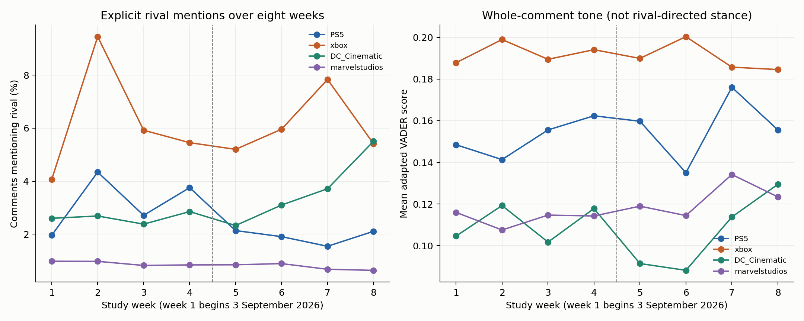

Read each plotted unit carefully: the weekly CSV stores a rival-mention **share** on a 0–1 scale, while several summary tables report **percentages** on a 0–100 scale. Multiplying a share by 100 converts it to a percentage.

## 9. Audience overlap, Jaccard and sampling

### 9.1 Sets and the denominator problem

A **set** contains distinct items without repetition. Let A be the set of observed eligible accounts in the first community, and B the set in the second. An account with 100 comments still appears once in its audience set.

- The **intersection**, written `A ∩ B`, contains accounts present in both.
- The **union**, written `A ∪ B`, contains accounts present in either, counting shared accounts once.
- The notation `|A|` means the number of accounts in A.

There are several legitimate overlap percentages:

```text
Shared percentage of A = 100 × |A ∩ B| / |A|
Shared percentage of B = 100 × |A ∩ B| / |B|
Jaccard percentage     = 100 × |A ∩ B| / |A ∪ B|
Union size            = |A| + |B| − |A ∩ B|
```

**Jaccard similarity** expresses the shared set as a fraction of the combined distinct audience. It ranges from 0 for no overlap to 1 for identical sets, or 0% to 100% when shown as a percentage. It is symmetric: Jaccard(A,B) equals Jaccard(B,A). Directional overlap percentages need not be equal.

Suppose A has 100 accounts, B has 200, and 20 occur in both. Then shared/A is 20%, shared/B is 10%, and Jaccard is `20/(100+200−20) = 7.14%`. These are three answers to three different denominator questions; none should be substituted for another.

### 9.2 What we found

Across the pooled 56 days, Marvel/DC has 68,608 Marvel accounts, 39,901 DC accounts and **8,807 shared accounts**. Shared accounts represent **12.84% of Marvel**, **22.07% of DC**, and **8.83% of the union**.

PS5/Xbox has 46,540 PS5 accounts, 44,309 Xbox accounts and **4,978 shared accounts**. The corresponding percentages are **10.70%**, **11.23%** and **5.80%**.

Monthly Jaccard changes from **6.78% to 7.52%** for Marvel/DC and **4.75% to 4.89%** for consoles. These are descriptive changes between dependent, adjacent observation windows, not an independent experiment.

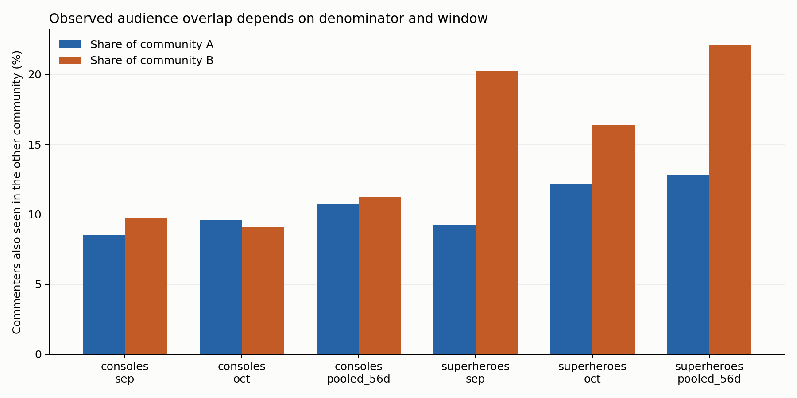

### 9.3 Six-community comparison

Six communities produce `6 × 5 / 2 = 15` unordered community pairs. We compute all 15 pair overlaps in each period with consistent participation filtering. Marvel/DC has the largest Jaccard among these selected pairs in both windows. For perspective, Marvel/StarWars is 4.94% in the first window and 4.70% in the second; PS5/Xbox is 4.75% and 4.89%.

This is a ranking within six selected communities, not across Reddit. It does not prove that rivalry increases overlap. Shared interests, size, posting behavior and topic selection could explain differences.

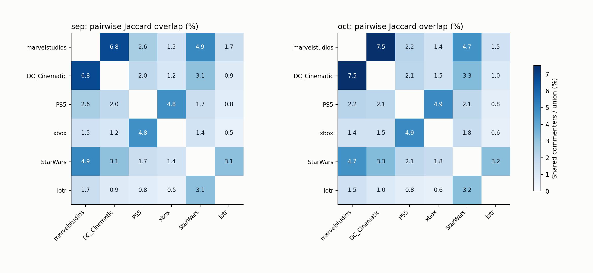

### 9.4 Activity thresholds

We repeat overlap with at least one, two or five comments per community. At threshold five, a user needs five comments in A and five in B to count as shared. This checks whether overlap mainly consists of one-off activity. The eligible audience changes with the threshold; the threshold is not a measure of emotional commitment.

### 9.5 Sampling and duration

The sampling experiment randomly retains 10%, 25%, 50% and 100% of eligible participation comments within each subreddit. Below 100%, it uses five fixed random seeds. A **seed** is an initialization value that makes a randomized procedure repeatable.

For first-window Marvel/DC, mean Jaccard at 10% sampling is **3.15%**, compared with **6.78%** using all collected participation comments. The older course report prints 3.16%; that is a transcription/rounding error. The CSV-derived mean is approximately 3.1547377%, which rounds to 3.15%. This experiment demonstrates sampling sensitivity; it is not an exact recreation of the pilot's time-slot sampling.

We also measure cumulative first 7, 14, 21 and 28 days. These nested intervals overlap and are not independent datasets. A longer observation can reveal activity previously missed, but Jaccard is not mathematically guaranteed to increase because the union can grow too.

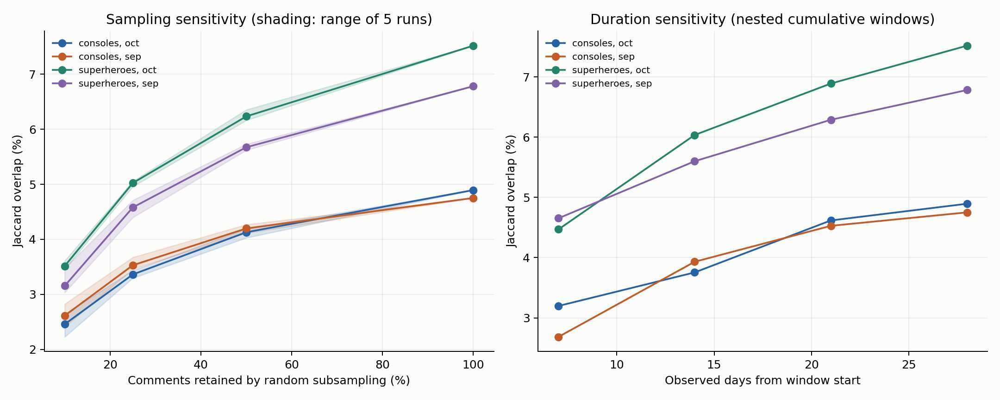

The spread across five samples is a sensitivity range, not a formal 95% confidence interval. A pooled 56-day population deduplicates accounts across both periods; it is not the sum of monthly unique-account totals.

## 10. Content, mentions and sentiment

### 10.1 Identifying what a comment explicitly mentions

An **alias dictionary** is a list of names and phrases representing a brand or franchise. The active lists live in `study.json`; they differ from the older pilot lists in `config.py`. For example, MCU and Avengers are Marvel aliases, Batman and DCU are DC aliases, PS5 and PlayStation are PlayStation aliases, and Xbox and Game Pass are Xbox aliases. Section 29 reproduces the exact active lists.

The code uses a **regular expression**, a pattern for finding text, with case-insensitive boundaries around aliases. This avoids matching `dc` inside an unrelated longer alphanumeric word. It does not solve ambiguous references or identify unmentioned targets.

Each comment belongs to one of four mutually exclusive categories relative to its own subreddit:

| Stored category | Meaning | Invented example in a Marvel community |
|---|---|---|
| `self_talk` | Own-franchise alias, no rival alias | “The MCU announcement looks interesting.” |
| `rival_talk` | Rival alias, no own alias | “Batman looks interesting.” |
| `both` | At least one own and one rival alias | “Marvel and DC both have announcements.” |
| `general` | No dictionary match for either side | “I liked the announcement.” |

These labels identify explicit lexical mentions. `general` can still discuss a franchise implicitly. `self_talk` does not mean talking about oneself. `rival_talk` does not mean hostile speech. A phrase such as “Microsoft” can refer to matters outside consoles, and different dictionary breadths affect measured mention rates.

The main “any rival mention” percentage includes `rival_talk` plus `both`, divided by **all usable content comments**. The rival-only sensitivity includes only `rival_talk`.

### 10.2 Rival attention results

| Community | First-window rival mentions | Second-window rival mentions |
|---|---:|---:|
| Marvel mentioning DC | 0.91% | 0.77% |
| DC mentioning Marvel | 2.63% | 3.41% |
| PS5 mentioning Xbox | 3.34% | 1.92% |
| Xbox mentioning PlayStation | 6.17% | 6.23% |

Under our specified dictionaries, rival attention is asymmetric: DC mentions Marvel more often than the reverse, and Xbox mentions PlayStation more often than the reverse. This measures the frequency of explicit mentions, not the amount of hostility.

### 10.3 What sentiment analysis actually measures

**Sentiment analysis** estimates the emotional polarity of language: broadly positive, negative or neutral/mixed. The current comparative study scores every usable content comment using **VADER**, a lexicon-and-rule-based sentiment tool. A **lexicon** maps words to emotional scores; rules account for features such as intensifiers, negation and punctuation. The compound score lies between −1 and +1.

We retain two scorers:

- **Original VADER**, using its normal lexicon.
- **Adapted VADER**, removing configured franchise/plot-related words from that lexicon before scoring.

For example, a comment mentioning “Secret Wars” may contain a negatively scored word without expressing a negative attitude. Conversely, removing “kill” or “evil” can discard genuine emotional meaning. The adapted scorer is a sensitivity analysis, not a human-validated correction. Both scorers use the same configured adaptation for the two pairs, which is another reason not to assume equal measurement accuracy in every domain.

**Stance** is an attitude toward a specific target. Sentiment and stance are different. In the invented sentence “I hated the Marvel film, but DC did a wonderful job,” the whole comment mixes negative and positive language. A single scalar score cannot establish hostility toward DC. Sarcasm, quotations, jokes, plot descriptions and conversational context create further difficulties.

The repository also contains a RoBERTa transformer experiment from the older pipeline. A **transformer** is a learned language model architecture. The current comparative study's reported content comparisons use the two VADER variants. A setting named `PRIMARY_SCORER` in the old configuration does not mean that the current `study_analysis.py` uses that model.

### 10.4 Comparing sentiment fairly

The primary contrast compares own-only comments with rival-mentioning comments within a community-period. The sign is always:

```text
Difference = mean own-only sentiment − mean rival-category sentiment
```

A positive difference means own-only comments score more positively. A negative difference means rival-category comments score more positively. This sign is easy to reverse accidentally.

The code reports a **Mann–Whitney U test**, which compares the ordering of scores between two groups, and a **rank-biserial effect size**, `2U/(nA × nB) − 1`. Positive values favor larger scores in A. It is a rank-based comparison, not automatically a test of medians under arbitrary distributions. With ties, its probability interpretation includes half the tied comparisons. A large number of comments can produce small p-values for small differences, so effect magnitude matters.

A **p-value** summarizes how unusual a statistic would be under a specified null model and assumptions. It is not the probability that the research hypothesis is true. A **null hypothesis/model** supplies a reference scenario, such as no specified difference or no unusual enrichment conditional on the matching design.

Comments are not independent observations: one author can write many, and many comments can respond to the same thread. Therefore the code also uses a **cluster bootstrap**. A bootstrap repeatedly resamples observed units with replacement to assess variation. Resampling entire author clusters keeps an author's comments together; resampling thread clusters keeps a thread's comments together. The study performs these as **two separate sensitivities**, not simultaneous two-way clustering.

The main comparisons use 1,000 bootstrap draws, bounded memory batches, and remove undefined draws rather than treating an empty category as zero. The displayed `p_boot` is a two-sided bootstrap sign-tail measure with a plus-one correction. Its finite simulation count limits precision; it should not be reported as an exact probability of zero.

**Holm correction** adjusts for testing multiple related comparisons. Within each pair-period, the family includes two communities, two scorers and two rival-category definitions: eight comparisons for each p-value column. The adjusted author-cluster and thread-cluster values must both be below .05 for `supported_both_clusterings=True`.

For the eight main adapted-VADER/any-rival comparisons across the study, **three** meet that criterion. All three differences are negative: DC in both windows and Marvel in the second window. This does not support a general claim that rival mentions are more negative. It also does not prove favorable attitudes toward the rival, because the score concerns the whole comment.

### 10.5 Within-author comparison

The advanced analysis compares two categories written by the **same authors**. First compute each eligible author's own-only mean and rival-category mean; subtract them; then average these differences with equal weight per author. A prolific author therefore does not automatically dominate the estimate.

We retain both scorers, both rival definitions, and minimum one or three comments in each category, across eight community-periods: **64 comparisons**. Each interval uses 5,000 paired-author bootstrap draws; intervals are suppressed below 20 eligible authors. “Paired” means that an author's two category means remain linked during resampling.

These are descriptive, unadjusted 95% intervals, not a fresh family of corrected significance claims. Authors who write both categories are a different population from all commenters. Pairing reduces stable author-composition differences but does not solve topic, time, thread dependence, sarcasm or target stance.

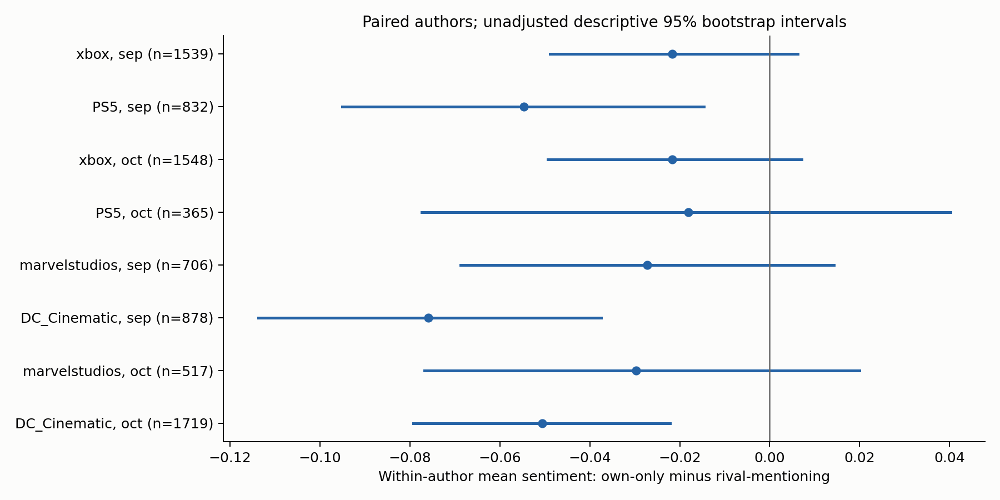

A **95% interval** describes uncertainty under the chosen procedure and assumptions. It does not mean that 95% of individual comments lie inside it, and it does not quantify every source of bias.

## 11. Topics and language patterns

**Topic modeling** finds recurring combinations of words without requiring a person to label every comment first. It helps summarize what discussions contain; it does not directly identify ideological factions or hostility.

The pipeline uses **TF-IDF** followed by **NMF**:

1. **Tokenization** turns text into usable word features. The configured token pattern retains alphabetic tokens of at least three characters.
2. **Stopwords** are common words removed because they are not useful for this model. The list includes common English function words and conversational filler such as “lol,” “yeah,” and several generic movie-discussion terms. This choice affects which themes remain visible.
3. **Unigrams** are single-word features; **bigrams** are two-word features such as “game pass.” Both are included.
4. **TF-IDF**, term frequency–inverse document frequency, gives relatively more emphasis to words characteristic of particular comments than to words appearing almost everywhere. A document here means a comment.
5. **NMF**, non-negative matrix factorization, approximates a comment-by-word matrix with a comment-by-topic matrix and a topic-by-word matrix. All entries are nonnegative. A topic is a weighted combination of vocabulary features; a comment may have several topic weights.

The study trains **one pooled model per pair across both windows**, rather than a separate model per subreddit and period. That keeps topic indices comparable inside a pair. Topic 2 in the superhero model has no required relation to topic 2 in the console model.

Training allocates up to 20,000 comments per pair, balanced across the four community-period groups, normally up to 5,000 from each. The vocabulary has at most 3,000 features, excludes features in fewer than five training comments, and excludes features occurring in more than 80% of training comments. These choices limit noise and computation. All usable content comments are transformed after training.

Candidate topic counts are 6, 8, 10 and 12. The code selects the count with the highest in-sample **NPMI coherence**, normalized pointwise mutual information. In plain language, coherence asks whether a topic's leading words tend to occur together more than their separate frequencies would suggest. This is a heuristic for useful word groupings, not held-out proof of semantic accuracy. The selected counts are **6 superhero factors** and **10 console factors**.

Each comment receives its strongest topic only if it has at least four nonzero vocabulary features. Despite the configuration name `TOPIC_MIN_TOKENS`, the implementation counts **distinct nonzero TF-IDF features**, which can include bigrams, rather than simply counting four words in the original sentence. Others receive topic **−1**, meaning insufficient topical vocabulary. They are not silently assigned topic zero.

Between **31.7% and 37.4%** of usable comments remain unassigned across community-periods. They remain in topic-share denominators. A topic share therefore means “percentage of all usable content comments,” including the unassigned group in the total.

Examples of model keywords include `batman, superman, dcu, gunn`, `green lantern, lanterns, ring`, `game, pass, game pass`, and `disc, digital, physical, drive`. They suggest franchise/character discussion, Green Lantern discussion, Game Pass, and ownership or purchase formats. Some factors capture generic conversation or moderation language. The labels are interpretations of model summaries, not validated human categories.

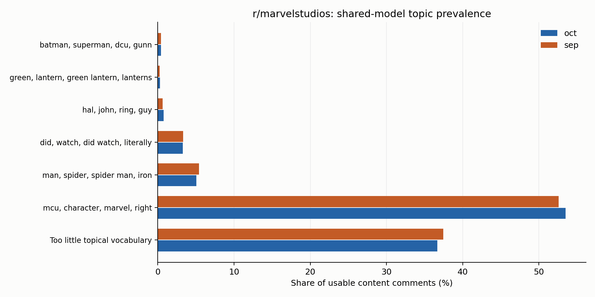

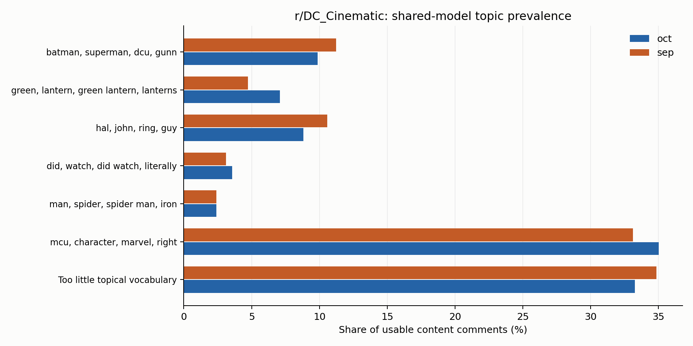

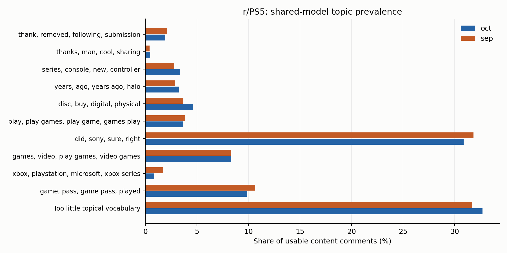

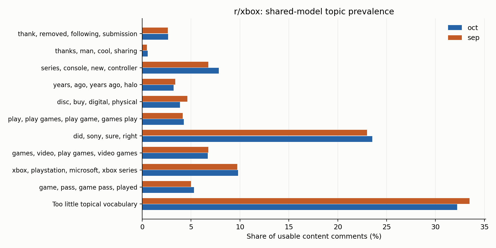

## 12. Building the reply networks

### 12.1 What a graph is

A **network**, also called a **graph**, consists of nodes and edges. A **node** represents an entity. An **edge** represents a specified relation. In our user reply graphs, nodes are accounts and edges are observed replies.

The graph is **directed**: A replying to B gives `A → B`. Direction matters because replying and receiving a reply are different roles. The graph is **weighted**: repeated replies from A to B accumulate on one directed edge.

```text
A replies to B twice:  A → B, weight 2
B replies to A once:   B → A, weight 1
```

This example has **two nodes, two directed edges and three reply events**. The graph does not contain three separate parallel edges. The implementation uses a NetworkX `DiGraph`, which stores one edge per ordered pair and increases its weight.

An edge does not mean agreement, friendship, a follow relationship, common subscription or information diffusion. Criticism and friendly conversation both create replies. Merely appearing in both subreddits creates no user reply edge.

### 12.2 Step-by-step construction

`graph_from_comments()` in `src/study_network.py`:

1. Adds all eligible observed comment authors as nodes before building edges.
2. Reads each comment's author and immediate parent identifier.
3. For a comment-only graph, excludes parents that are not `t1_` comments.
4. Looks up the parent author's account.
5. Counts unresolved parents separately and adds no invented edge.
6. Excludes and counts replies to oneself.
7. Adds or increments the directed edge from replier to parent author.

Adding authors first preserves **isolates**, nodes with no retained edges. Otherwise accounts with unresolved parents, only self-replies, or excluded top-level replies could disappear from the graph and make it look more connected than the observed population warrants.

A **parent-only node** is an account appearing as a reply recipient without an eligible observed comment in that community-period. It might have authored the original post or a parent outside the observed window. This explains why graph node counts can exceed the number of observed commenters. Parent-only nodes are marked; they are not automatically treated as overlap participants.

### 12.3 Two graph definitions

| Variant | Included replies | Purpose |
|---|---|---|
| `all_replies` | Replies to posts and replies to comments | Full observed reply relation, including thread starters |
| `comment_replies` | Replies to comments only | Tests dependence on replies to original post authors |

“Comment-only” does not remove first-level comment authors from the node set. It removes their post-directed edge if that is the relevant event. Nor does it prove a back-and-forth conversation: a single comment reply remains one event.

### 12.4 Conservation checks

For a fixed graph variant, every participation comment should belong to one accounting category:

```text
participation comments = excluded top-level replies
                      + unresolved eligible parents
                      + removed self-replies
                      + retained reply events
```

For `all_replies`, excluded top-level replies is zero. Total edge weight equals retained reply events. Distinct edge count is usually smaller because the same ordered pair can interact repeatedly.

**Resolved-parent percentage** uses eligible comments after top-level exclusion as its denominator. Resolved self-replies still count as resolved parents even though their self-loop edges are removed.

### 12.5 Projection for undirected methods

Some measures use an **undirected projection**, which treats the relation between A and B as a single connection without an arrow. In this project the projection explicitly sums reciprocal weights. The example `A → B = 2` and `B → A = 1` becomes `A — B = 3`.

Simply converting a directed graph without specifying this rule can lose one directional weight. The helper `undirected_sum()` implements the intended rule. The original directed graph remains available for directed measures.

## 13. Understanding every network measure

### 13.1 Counts, density and components

**Nodes** count accounts in the graph. **Edges** count distinct directed pairs. **Reply events** count edge weights summed over all edges. State which one you mean when describing network size.

**Density** is the fraction of possible directed non-self edges that exist: `m / [n(n−1)]`, where n is nodes and m is edges. Large networks are often sparse because each account interacts with a small fraction of everyone else. Low density alone does not establish segregation.

A **path** is a sequence of adjacent edges. A **weakly connected component** is a group of nodes connected when arrow directions are ignored. A **strongly connected component** requires directed reachability between every pair. The main reported component percentages use weak connectivity, not strong connectivity.

The **largest component percentage** is `100 × nodes in largest weak component / all nodes`. It measures how much of the observed network sits in its largest weakly connected piece. A 99% value does not mean that every account spoke with every other account.

### 13.2 Degree and strength

**In-degree** counts distinct accounts that replied to a node. **Out-degree** counts distinct accounts to which it replied. **In-strength** sums incoming reply weights, and **out-strength** sums outgoing reply weights.

If A replies to B ten times and C once, A's out-degree is two and out-strength is eleven. B receives ten replies from one distinct account, giving in-degree one and in-strength ten for those events. Reddit score/upvotes do not enter these weights.

### 13.3 Reciprocity

**Reciprocity** describes how many directed edges have an edge in the reverse direction. For this NetworkX measure, the numerator counts directed edges belonging to reciprocal pairs, divided by all directed edges. A reciprocal pair therefore contributes two directed edges to that numerator.

If the only edges are `A → B`, `B → A`, and `C → A`, reciprocity is `2/3`. This measure ignores weight differences: ten replies one way and one the other still form a reciprocal pair. It does not measure politeness, agreement or balanced reply volume.

### 13.4 PageRank

**PageRank** assigns structural importance by considering who points toward whom, not just how many incoming edges exist. It can be pictured as a random walker following outgoing edges, with occasional jumps. Here edge weights influence where the walker goes.

Because arrows point from repliers to recipients, high PageRank is interpreted as structural attention received in this reply system. The NetworkX call uses weighted edges, the default damping factor of .85, tolerance `1e-10` and up to 500 iterations. An **iteration** is one repeated computational update. High PageRank is not evidence that the account changed anybody's mind.

### 13.5 Betweenness centrality

**Betweenness** measures how often a node lies on shortest paths between other nodes. Conceptually, for each source and destination, count the fraction of shortest paths that pass through the node and sum those contributions.

In a chain `A → B → C`, B lies between A and C. That structural location can make B a candidate connector. But shortest paths are mathematical possibilities, not observed routes of information transmission.

Our betweenness is **directed and unweighted**. We do not pass reply count as a distance, because then a frequently used edge could incorrectly become a longer path. We approximate large graphs using **128 sampled source nodes**, with seed 42. For all-reply graphs, a second run with seed 43 reports overlap between the two top-20 sets. Approximation makes the calculation feasible, but small rank differences need caution.

The seed-stability overlap is itself a Jaccard of two top sets, not audience overlap. A stability value and an audience Jaccard have different objects and purposes even though they use the same mathematical formula.

### 13.6 Louvain communities and modularity

A **network community** is an algorithmically detected group of comparatively strongly connected nodes. It is different from a subreddit. **Louvain** is the community-detection algorithm used here, applied to the reciprocal-sum weighted undirected projection with a fixed seed and its default resolution.

**Modularity**, often written Q, compares the amount of within-group connectivity with a degree/strength-based reference expectation. For the weighted undirected graph, a common expression is:

```text
Q = (1 / 2W) × sum over i,j of
    [w_ij − (s_i × s_j)/(2W)] × I(group_i = group_j)
```

Here `w_ij` is edge weight, `s_i` is node strength, W is total undirected edge weight and I is one when two nodes have the same group and zero otherwise. You do not need to memorize the equation to explain the result: the measure asks whether the proposed groups contain more internal connectivity than its reference model predicts.

Weighted modularity ranges approximately **0.407–0.582** across the eight original all-reply graphs. A positive value does not prove ideological polarization. Reply threads themselves create structure. Group numbers are arbitrary: community 3 in one graph is not necessarily the same kind of group as community 3 in another.

### 13.7 The rewired reference comparison

A **null network** is a randomized reference graph. Here the code makes an unweighted undirected topology, rewires it using degree-preserving edge swaps, and runs Louvain on both the observed topology and the rewired versions. Degree-preserving means each node keeps its number of neighbors while particular connections change.

The routine requests ten rewired graphs, attempts three times the number of edges in swaps per replicate, and skips failed swap runs. The output records the requested count; do not reinterpret this as proof of a large successful random ensemble. Null means and standard deviations summarize the completed values.

The comparison is **unweighted observed modularity minus mean unweighted null modularity**. Weighted observed Q is reported separately. It would be misleading to subtract an unweighted null from a weighted observed statistic. Excess values are about **0.023–0.042** here. With this small ensemble, the project makes a descriptive topology comparison, not a precise null-model significance claim.

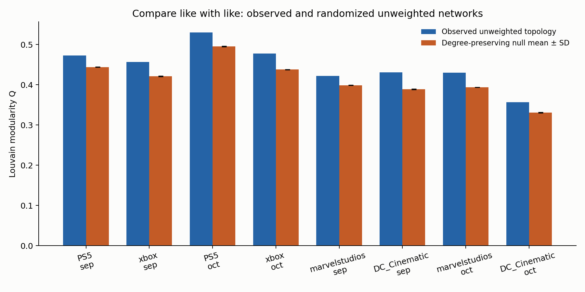

### 13.8 Clustering, core number and participation coefficient

**Transitivity** compares closed triangles with connected triples in the undirected projection. **Local clustering** measures how often a node's neighbors connect to each other; the reported mean averages local clustering over nodes. These measure patterns of closure, not emotional cohesion. In this implementation these measures use the undirected topology without weighting.

A **k-core** is a subgraph in which every remaining node has at least k neighbors within that subgraph. A node's **core number** is the largest k-core to which it belongs. The repeated removal of low-degree nodes distinguishes a core from simply selecting nodes whose original degree exceeds k.

The **participation coefficient** describes how a node's weighted connections spread across detected Louvain groups:

```text
P_i = 1 − sum over groups c of (weight from i to group c / total weight of i)^2
```

It is zero when all weight goes to one group and increases when ties spread across groups. It depends on the chosen partition and uses the undirected summed weights. It is different from cross-subreddit participation and cannot establish diffusion.

**Thread breadth**, stored as `threads_participated`, counts distinct observed thread IDs for an account. It helps distinguish activity across many conversations from repeatedly posting in one thread.

## 14. Graph checks and thread sensitivity

### 14.1 Independent reconstruction

`src/study_network_review.py` reconstructs edge counts using a separate table-join and grouped-count procedure. A **join** matches records using a common identifier; here it matches parent references with authors. It compares every directed edge, integer weight and node set with each saved original graph.

All **16 original graphs** match exactly: zero incorrect/missing edges, zero extra edges and zero node-set differences. Where both parent and child records exist, thread identifiers also agree. Top-level comments point to their thread's original post. The audit verifies fidelity to the local records, not the completeness or ultimate truth of the external archive.

The Gephi import round trip provides another kind of check: the exported graph survives import, computation, save and reopening with matching counts and directed degrees. A successful **round trip** means the data survive conversion through another format or tool.

### 14.2 Why thread starters matter

Suppose hundreds of accounts independently reply to a post by one author. The all-reply graph forms a large star around that author, even if the commenters never reply to one another. The center looks prominent and the graph looks connected because of the thread structure.

Removing replies to posts tests how much connectedness depends on those star centers. Largest-component shares in the all-reply graphs are approximately 96–99%. In comment-only variants, they are approximately 53–72%. For **Xbox in the first window**, the share falls from **98.61% to 53.33%**.

This does not mean that the all-reply graph was wrong. The two graphs answer different questions. The result means that inclusion of original post authors materially affects the network's apparent connectedness. It qualifies interpretations of centrality and community organization.

## 15. Connectors and fairer comparisons

### 15.1 Descriptive rankings

The project initially summarizes shared-user representation among top positive betweenness, PageRank and incoming-strength scores. All accounts tied at the twentieth cutoff are retained, so “top 20” can contain more than 20 nodes. Parent-only accounts are counted separately. Shared percentages use observed commenters as the relevant denominator.

The `*_connector_roles.csv` summaries select from positive scores across graph nodes and then distinguish observed versus parent-only nodes. The advanced matched-betweenness procedure selects within observed commenters from the start. These are related but distinct selection rules, so they must not be treated as identical tables.

### 15.2 Why an unadjusted percentage can mislead

An account that writes frequently has more chances to appear in both communities and more chances to gain network connections. Activity may therefore explain an association between sharing and centrality. This is a possible **confounder**, a factor related to both quantities being compared.

Imagine that 25% of the highest-betweenness accounts are shared but only 10% of all accounts are shared. That is not enough to establish a special connector role. The correct comparison may be with accounts having similar activity and degree, among whom 25% might be normal.

### 15.3 Matched comparison

The advanced procedure selects the top 20 positive betweenness accounts among observed commenters, retaining cutoff ties. It compares the observed number of shared accounts with random selections that preserve the selected count within each activity stratum, or within each activity-and-degree stratum.

A **stratum** is a category used to group comparable observations. Activity bins are 1, 2–4, 5–9, 10–19, 20–49, 50–99 and 100+ comments. Degree bins have lower bounds 0, 2, 5, 10, 20, 50, 100 and 200. Total directed degree is in-degree plus out-degree; a reciprocal partner contributes to both.

Within a stratum, a **hypergeometric distribution** models how many shared accounts would be selected by drawing a fixed number without replacement from a population with a known number of shared accounts. We sum these draws across strata for 5,000 repetitions. This preserves the selection's activity/degree composition.

The model assumes accounts are exchangeable within those coarse strata under the null: after conditioning on the bins, shared status has no additional relation to selection. That assumption is not the same as experimentally randomizing users.

We report observed and expected shared percentages, their percentage-point difference, randomized count ranges and a one-sided enrichment probability. **Enrichment** means overrepresentation relative to this reference. The plus-one probability is `(1 + draws at least as large as observed)/(1 + total draws)`. Holm adjustment covers all **32** combinations of pair, period, community, graph definition and matching definition.

### 15.4 Result

**None of the 32 comparisons passes the Holm-adjusted .05 enrichment threshold.** The main all-reply/activity-and-degree comparisons range from observed shared percentages below the matched expectation to modestly above it.

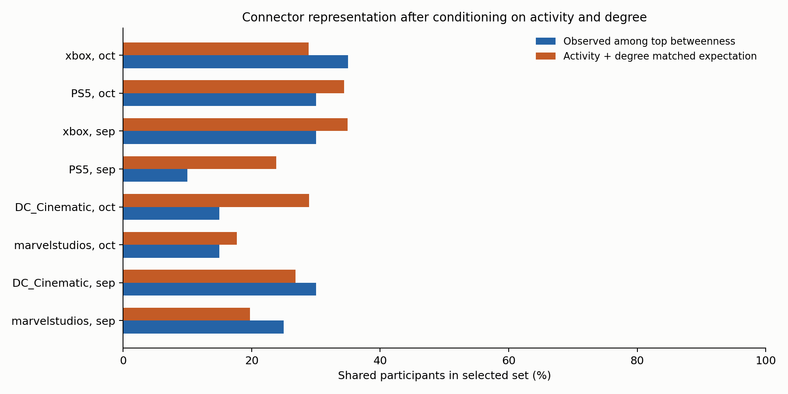

This prevents the claim that shared users are generally exceptional connectors on this evidence. It does not establish that they have no role: the selected sets are small, the bins are coarse, centrality is approximate, and the test has limited **power**, meaning limited ability to detect some real effects. Failure to reject a null is not proof of equivalence.

## 16. Participation across time

### 16.1 From a single overlap number to a participation history

A **longitudinal** analysis follows the same units over time. A **cohort** is a defined group followed across observations. We form a pair-specific cohort from the union of accounts observed in either window and count comments in A and B separately for each window.

At each minimum-comment threshold, an account has one of four states:

- **A-only:** reaches the threshold in A but not B.
- **B-only:** reaches it in B but not A.
- **Both:** reaches it in each.
- **Neither:** reaches it in neither.

At threshold one, “neither” means no observed participation in this pair during that window. At thresholds two or five it can mean that the account commented but remained below the threshold. It never means that the account stopped using Reddit altogether.

A **transition matrix** counts movements from first-window states to second-window states. Its row percentages use the first-window state's accounts as their denominator. At threshold one, neither-to-neither is a structural zero because the cohort was defined by being observed somewhere in at least one window. “Structural zero” means zero by construction, not a surprising empirical discovery.

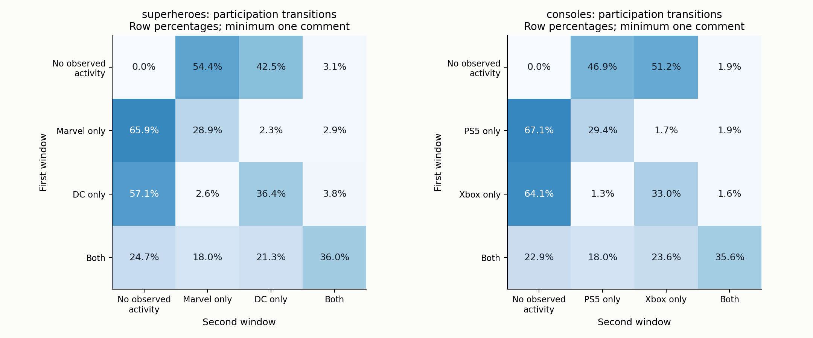

### 16.2 Pooled versus persistent overlap

Someone can write only in Marvel in September and only in DC in October. They are shared in the pooled 56-day audience but never shared within a single window. The pooled total therefore cannot be interpreted as a permanent shared group.

| Pattern at threshold one | Marvel/DC accounts | Share of pooled shared | PS5/Xbox accounts | Share of pooled shared |
|---|---:|---:|---:|---:|
| Shared in both windows | 1,577 | 17.91% | 945 | 18.98% |
| Shared in the first window only | 2,801 | 31.80% | 1,713 | 34.41% |
| Shared in the second window only | 2,971 | 33.73% | 1,515 | 30.43% |
| Shared only after pooling, not within either window | 1,458 | 16.56% | 805 | 16.17% |
| Total pooled shared accounts | 8,807 | 100% | 4,978 | 100% |

Thus only about **18–19%** of pooled shared accounts are shared in each window. A different denominator gives a different valid statement: `1,577/4,378 = 36.02%` of first-window superhero shared accounts are shared again; `945/2,658 = 35.55%` for consoles. Do not confuse these approximately 36% conditional rates with the 18–19% pooled-persistence rates.

At higher thresholds, pooled-only sharing can also arise because comments accumulate across windows until a threshold is reached. The sequential interpretation is cleanest at threshold one.

### 16.3 Return rates and activity adjustment

The next question is whether initially shared participants are more likely to appear again. Group assignment uses the **first window only**, while the outcome is observed in the second. This avoids defining a group using its future outcome.

The analysis measures two outcomes: appearing anywhere in the pair and appearing in both communities. The main reported return finding uses **anywhere in the pair**. It is not a measure of Reddit-wide retention or subscription renewal.

Raw return percentages are higher for initially shared accounts. But these accounts are often more active. **Standardization** gives the groups the same comparison-specific distribution of activity bins, so their rates are compared at a common observed activity mix.

For each shared-versus-exclusive comparison:

1. Divide accounts into first-window total-comment bins.
2. Retain bins containing accounts from both groups. This is **common support**.
3. Compute return proportions for each group within each retained bin.
4. Weight those proportions by the pooled bin distribution of the retained accounts.
5. Subtract the resulting adjusted return rates.

In symbols, the adjusted rate for group g is `sum over bins b of weight_b × return_rate_gb`. The two groups use the same weights within a comparison. Different comparisons can have different weights and populations.

An account needs at least two comments to appear in both communities. One-comment exclusive users have no shared counterparts and are excluded from the adjusted population. Consequently, the difference between raw and adjusted estimates reflects both changed activity weights and a restricted population.

| Shared accounts compared with | Adjusted return difference | Descriptive 95% interval |
|---|---:|---:|
| Marvel-only | +13.08 percentage points | 11.39 to 14.74 |
| DC-only | +7.23 percentage points | 5.50 to 8.92 |
| PS5-only | +15.28 percentage points | 13.02 to 17.49 |
| Xbox-only | +10.95 percentage points | 8.84 to 13.17 |

A **percentage point** is the difference between percentages: 60% minus 50% is ten percentage points, or a 20% relative increase. These are not interchangeable descriptions.

The procedure uses 5,000 binary-outcome bootstrap draws within fixed group/bin sizes, with weights held fixed. Because return is yes/no, equivalent **binomial** draws count how many simulated users return in each bin. Intervals are descriptive and unadjusted for multiple comparisons.

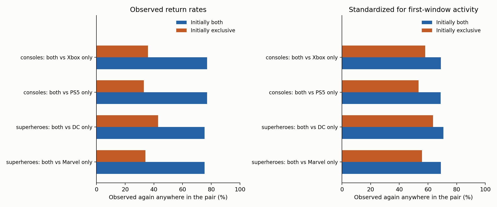

The association remains after the specified adjustment. We cannot say that cross-participation causes return. Interests, activity elsewhere, events and remaining within-bin differences can still explain it.

## 17. Combined graphs and group mixing

### 17.1 Why combine graphs?

Audience overlap tells us that some accounts appear in both subreddits. It does not tell us whether accounts from different observed participation groups actually reply to one another. Combined graphs address the interaction question while preserving where the replies occurred.

For each pair and graph definition, we combine the two **second-window** graphs. The same account becomes one node. The same ordered account pair becomes one edge if it occurs in both layers. A **layer** here means the replies observed in one subreddit.

Each edge retains:

- `weight_a`: reply events observed in subreddit A.
- `weight_b`: reply events observed in subreddit B.
- `weight`: their sum.

The sum of weights in the combined graph equals the sum across its layers. Counts of nodes and distinct edges need not add because identical accounts and dyads merge. A **dyad** is a pair of accounts; an **ordered dyad** distinguishes A-to-B from B-to-A.

### 17.2 Labels come from the prior window

We label accounts using first-window participation only: A-only, B-only, both, or unobserved. In combined Gephi figures:

| Color | `prior_group` | Meaning |
|---|---|---|
| Blue | `a_only` | Observed in A but not B in the first window |
| Orange | `b_only` | Observed in B but not A in the first window |
| Green | `both` | Observed in both in the first window |
| Grey | `unobserved` | Not observed in either in the first window |

For superheroes A is Marvel and B is DC. For consoles A is PS5 and B is Xbox. Grey does not mean neutral, and green does not mean a diplomat. These are participation labels, not opinions. `current_group` separately records second-window commenting; parent-only nodes remain distinguishable.

### 17.3 Mixing matrices

A **mixing matrix** is a table whose rows identify the replier's group and columns identify the recipient's group. Each cell counts replies from one group to another. We report weighted reply-event matrices and unweighted ordered-dyad matrices for each subreddit and the combined graph.

Weighted mixing counts repeated replies. If A replies to B five times, that contributes five events but one ordered dyad. Both are useful, but they answer different questions. `pct_all` uses all events or dyads; `pct_origin` uses only events or dyads from that row's origin group.

The all-reply combined superhero graph contains **7,428 reply events** between prior Marvel-only and prior DC-only accounts in either direction. The console equivalent is **3,438**. These are events, not distinct people. The replies occur inside individual subreddit threads. They are not replies physically jumping from a Marvel post into a DC post.

### 17.4 Assortativity, explained

**Categorical assortativity** measures whether endpoints with the same category connect more often than expected from the source and destination category totals. The category here is prior participation.

On the known-prior subset, normalize the mixing table so all cells sum to one. Let S be the observed diagonal sum, the same-group fraction. Let E be the sum of each group's row share multiplied by its column share. E is the same-group fraction expected from those endpoint marginals. Then:

```text
Assortativity r = (S − E) / (1 − E)
```

If S=.60 and E=.40, r=.333. Positive values indicate more same-group mixing than this marginal reference, zero indicates matching the reference, and negative values indicate less. The negative feasible bound depends on the margins. If E is one, the coefficient is undefined.

**Marginals** are the row and column totals. Adjusting for them matters because a large group can generate many same-group replies simply by being large. The coefficient is descriptive here; no significance test for these mixing coefficients is claimed.

### 17.5 The aggregation result

For all replies, the combined coefficients are **0.348 for superheroes** and **0.349 for consoles**. Within the individual subreddit layers, they are much smaller: approximately **0.001–0.040**. The comment-only contrast remains: superhero layers 0.013 and 0.003 versus combined 0.347; console layers 0.013 and 0.032 versus combined 0.387.

This is an **aggregation effect**: combining spaces used by different groups can create a stronger apparent separation than the mixing observed inside either space. Imagine one venue mostly visited by group A and another mostly by group B. Combining their conversations can show many same-group interactions even if each venue mixes approximately as expected given its own visitors.

This is not proof of ideological **homophily**, which means a tendency for similar people to associate. We did not measure opinion similarity. Only **47.95%** of superhero and **45.63%** of console all-reply events have both endpoints observed in the first window. Comment-only coverage is **52.50%** and **50.09%**. Unknown prior groups stay in the full matrices but are excluded from the known-group coefficient. The coefficient therefore concerns a conditional subset, not all activity.

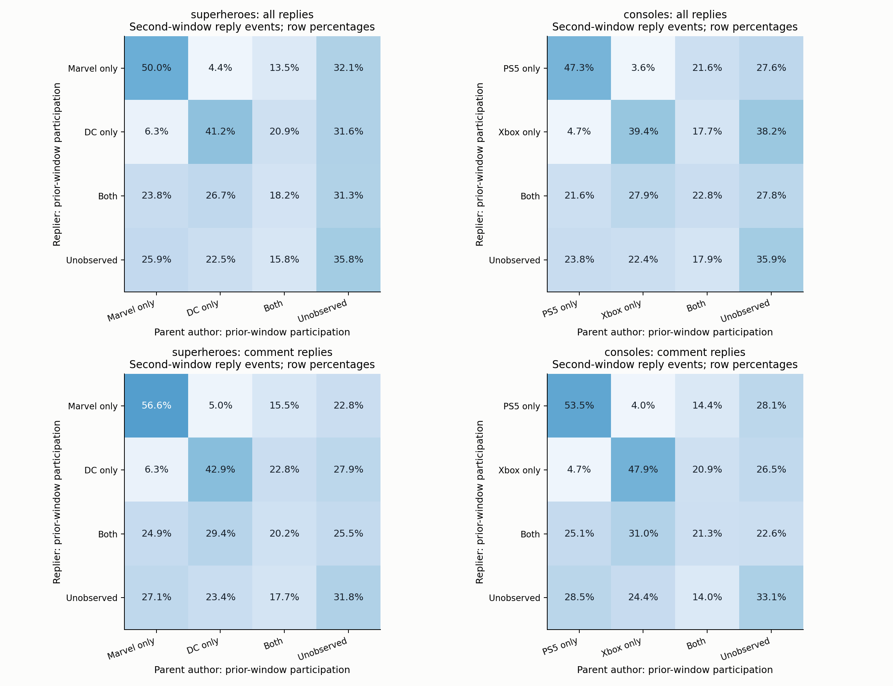

## 18. Gephi from zero to a mentor demonstration

### 18.1 What Gephi contributes

**Gephi** is software for inspecting, analyzing and drawing networks. It allows you to inspect node/edge tables, compute metrics, apply filters and layouts, and export figures. A **layout** assigns screen coordinates to nodes; it does not define who replied to whom.

Our Python pipeline builds and measures the graph reproducibly. The official Gephi Toolkit imports it, checks counts and degrees, recomputes weighted PageRank for comparison, lays out a display graph, saves the native project and reopens it. The desktop application lets you inspect the resulting project interactively. Toolkit verification is actual Gephi engine execution, but it is distinct from claiming that every project was manually reviewed in the desktop UI. The user has also inspected and saved views in the desktop application.

Your Gephi evidence is therefore more than one picture: it includes graph definitions, full graph data, a filtered view, metric tables, import checks and comparisons between graph variants.

### 18.2 Formats and workspaces

- **GEXF** is a graph exchange file containing nodes, edges and attributes, sometimes with visual settings.
- **`.gephi`** is a native saved project, retaining workspaces and their state.
- **Node CSV** is a table with one node per row.
- **Edge CSV** has one directed pair per row, with source, target and weight.
- A **workspace** is a separate graph view within a project.

The native projects have a **FULL — verified metrics** workspace and a **FOCUS — display only, ForceAtlas2** workspace. The full graph provides numerical evidence. The focus graph improves readability. Metrics imported on display nodes still refer to the full graph; recalculating on the focus graph produces a different quantity.

### 18.3 Exact graph sizes for the main combined views

| Pair and October variant | Full nodes | Full edges | Full reply events | Native display nodes | Native display edges |
|---|---:|---:|---:|---:|---:|
| Marvel/DC all replies | 62,620 | 233,557 | 270,428 | 786 | 3,344 |
| Marvel/DC comment replies | 61,356 | 138,992 | 167,617 | 782 | 2,801 |
| PS5/Xbox all replies | 51,782 | 139,519 | 156,727 | 608 | 1,345 |
| PS5/Xbox comment replies | 50,692 | 85,515 | 98,796 | 577 | 1,058 |

The familiar superhero screenshot with **782 nodes and 2,801 edges** is the filtered native October comment-reply display. It is not the whole dataset and not the full graph.

### 18.4 Why some other files show different display counts

There are two display stages. Original single-community focus exports select the largest weak component, take its undirected 2-core (with a fallback if empty), and cap it at 1,200 PageRank-ranked nodes. Combined focus exports instead select the top 1,000 combined-PageRank nodes and retain the largest weak component of that selected graph.

The native Gephi builder then removes directed edges with weight below two and removes resulting isolates. This creates the final repeated-reply display. It does not recompute a largest component after that final pruning, so small pieces can remain.

For the combined superhero comment graph, the intermediate GEXF focus has **982 nodes and 10,533 edges**, while the native display has **782 and 2,801**. For console comment replies, the intermediate focus has **950 and 5,343**, while the native display has **577 and 1,058**. The intermediate counts in `combined_exports.csv` and final counts in `network_review/gephi_validation.csv` describe different stages, not an unexplained contradiction.

### 18.5 Reading the picture correctly

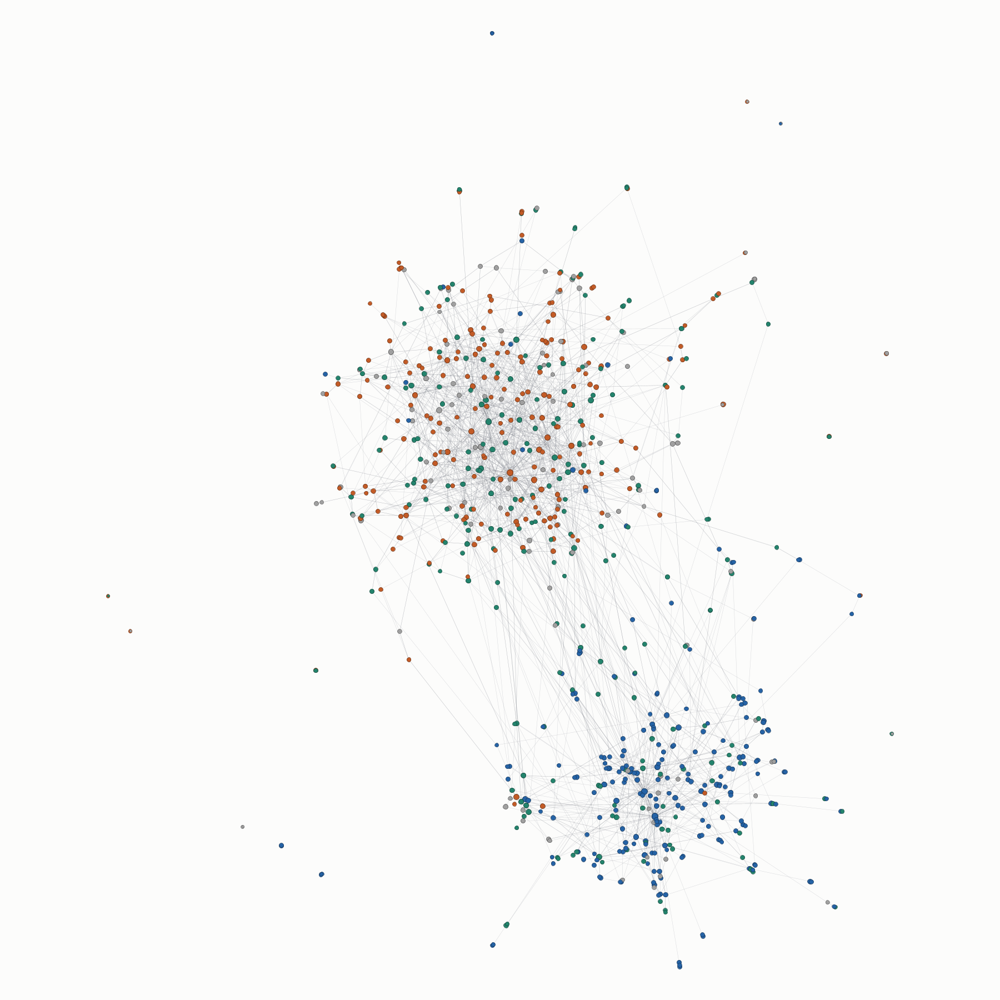

This figure shows a selected repeated-reply portion of the October Marvel/DC graph. Colors describe September participation. Node size increases with incoming reply strength using a logarithmic transformation, which compresses very large differences. Positions come from ForceAtlas2.

**ForceAtlas2** is a force-directed layout: nodes repel one another while connected nodes attract, producing an arrangement that can expose structure. **Gravity** pulls nodes toward the center; **scaling** affects spacing; **edge-weight influence** controls how strongly heavier edges affect attraction; **LinLog** changes the attraction behavior to emphasize group structure; **Barnes–Hut optimization** approximates distant repulsion to reduce computation.

Spatial proximity is not a calibrated measure of agreement or similarity. A visual gap does not by itself prove an echo chamber. Green nodes appearing between blue and orange regions do not establish causal brokerage. The numerical mixing analysis and matched connector comparisons are the evidence needed to qualify those impressions.

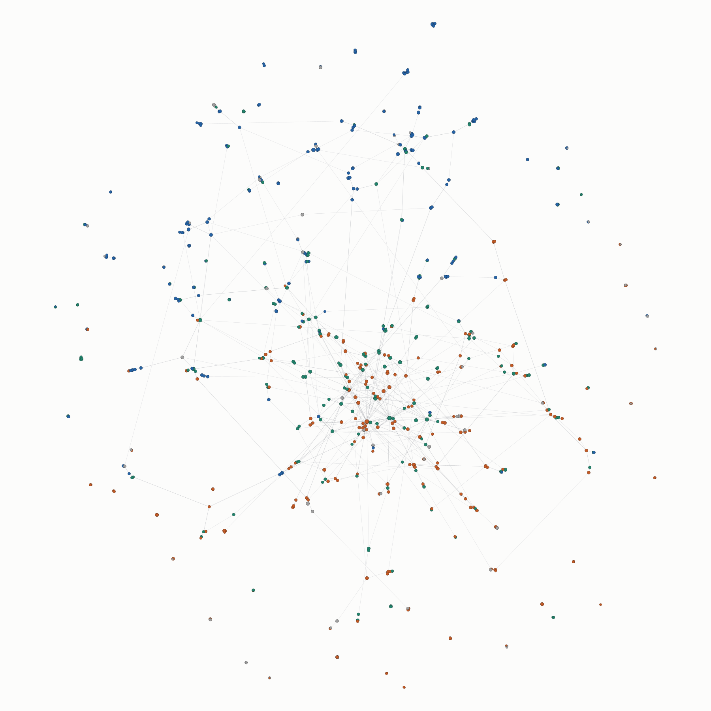

The display is deliberately selective. For example, in the superhero comment-only full graph prior-both accounts are **5.4% of nodes**, while they are **30.1% of the final display**. Prior-unobserved nodes fall from **58.1% to 13.9%**. You cannot estimate the population's group proportions by looking at the picture.

### 18.6 What to show mentors

Use the following sequence; it does not require showing all 12 projects one after another:

1. Open `outputs/study/networks/combined_superheroes_oct_comment_replies_native.gephi`.
2. Select FULL. State direction, weight, period, node definition and the full counts.
3. Open **Data Laboratory**. Show `prior_group`, `current_group`, `observed_a`, `observed_b`, `in_strength`, `pagerank`, and the edge columns `weight_a`, `weight_b`, `weight` where available. Explain one invented A-to-B example rather than exposing usernames.
4. Switch to FOCUS. State the selection rule and the displayed 782/2,801 counts. Explain the color legend and size mapping.
5. Open **Preview** for the clean figure. Explain that ForceAtlas2 coordinates are illustrative.
6. Open `combined_consoles_oct_comment_replies_native.gephi` and make the same interpretation with PS5/Xbox labels.
7. Show the all-reply counterparts if asked about thread starters. Use the full metric table to demonstrate the all-reply versus comment-only component difference.
8. Show the separate-layer and combined assortativity table. Explain why a combined picture alone can exaggerate the interpretation of separation within a space.
9. Keep one original single-community project ready, such as `superheroes_sep_marvelstudios_all_replies_native.gephi`, to discuss Louvain communities and centrality attributes.
10. Optionally show the six-node audience-overlap graph to explain how a network of subreddits differs from a network of accounts.

The six-node graphs are `outputs/study/aggregate_networks/audience_overlap_sep.gexf` and `audience_overlap_oct.gexf`. Their nodes are subreddits and their weights are Jaccard percentages. They are **similarity networks**, not reply networks. Their weights do not count messages.

### 18.7 If importing from scratch

Open the appropriate `*_full.gexf` and preserve **Directed** graph type and numerical weights. For CSV import, import nodes first (`Id` as a string), then edges (`Source`, `Target`, `Type=Directed`, numeric `Weight`). A string is text; treating hashed IDs as numbers can corrupt identifiers.

Check node and edge counts against the matching table. Save the full workspace, then make a separate workspace for filtering. For original graphs, color by `community` to show Louvain groups or `shared_in_pair` to show same-period cross-participation. These are different color meanings from `prior_group` in combined graphs. Do not reuse one legend for all views.

### 18.8 Layout and export settings

The reproducible native build uses Gephi Toolkit **0.11.3**, ForceAtlas2 for **400 iterations**, seed **42**, one thread, Barnes–Hut enabled, scaling **8**, gravity **1**, edge-weight influence **0.5**, LinLog enabled and size adjustment disabled. Spring coordinates initialize the layout, followed by uniform coordinate rescaling for export. These settings affect the picture, not the underlying edge list.

The saved native project already has its layout. You do not need to rerun it merely to present it. If you change layout settings, keep the change in the display workspace and record the settings used. Changing a layout to make an expected pattern appear would not be evidence for that pattern.

In Preview, use a readable background, thin translucent edges, small arrows where legible, and no bulk account labels. Refresh before export. SVG and PDF preserve vector detail; PNG is convenient for slides. Save the `.gephi` session as well as an exported picture. Every caption should include community/pair, dates, edge rule, full/display counts, filters, color and size meanings, and layout.

A suitable caption is: “October Marvel/DC comment-reply network. Directed edges represent replies from commenter to parent-comment author; weight counts repeated replies. Full graph: 61,356 nodes and 138,992 edges. Display: 782 nodes and 2,801 edges after PageRank/component/repeated-reply filtering. Colors indicate September participation; size indicates incoming reply strength. ForceAtlas2 layout is illustrative.”

## 19. The final findings and answers

| Finding | Main evidence | Meaning |
|---|---|---|
| Observation effort changes detected boundaries | First-window Marvel/DC Jaccard 3.15% at a 10% sample versus 6.78% with all collected comments | A small sample can miss cross-participation |
| Rival audiences overlap | 8,807 superhero and 4,978 console pooled shared accounts | The observed audiences are not completely separate |
| Overlap is asymmetric | 12.84% of Marvel versus 22.07% of DC accounts shared | Always state the denominator |
| Shared participation is often temporary or sequential | Only 17.91%/18.98% of pooled shared accounts shared in both windows | A pooled label is not stable membership |
| Thread mechanics affect graph connectivity | First-window Xbox largest component 98.61% all replies versus 53.33% comment-only | Thread starters contribute substantially to apparent connectedness |
| Simple connector claims need adjustment | Zero of 32 matched enrichment tests passes Holm | Unadjusted prominence does not establish exceptional shared-user representation |
| Prior groups interact, with a substantial unknown group | 7,428/3,438 opposite-exclusive all-reply events; known-prior coverage about 48%/46% | Some direct interaction exists, but prior labels cover only part of activity |
| Aggregation changes the segregation picture | Combined assortativity about .35 versus much smaller within-layer values | Between-space composition differs from within-space selective mixing |
| Rival attention is asymmetric | Higher rival-mention rates in DC and Xbox | Explicit mention frequency differs by direction |
| Automated sentiment is mixed and target validity incomplete | Three corrected main contrasts, all negative own-minus-rival | No generalized rival-hostility claim is justified |
| Shared participants return more often after specified adjustment | Adjusted differences of 7.23–15.28 percentage points | A temporal association remains, without a causal interpretation |

**RQ1:** We can describe explicit mentions, recurring word themes and whole-comment tone. We cannot yet establish validated target-directed hostility.

**RQ2:** We can describe and verify reply structure, centrality, structural groups and thread sensitivity. The matched tests qualify the shared-connector story. We cannot establish causal influence or actual diffusion paths.

**RQ3:** We can quantify overlap with explicit denominators, compare it across selected audiences, follow persistence and measure replies among prior participation groups. We cannot infer allegiance, readership or ideological exposure from commenting alone.

The coherent conclusion is: **participation boundaries are permeable and change over time; observation and thread structure materially affect what we detect; stronger claims about attitudes and influence require stronger evidence.**

## 20. What the study cannot establish

An **echo chamber** normally implies more than separate colors in a graph: claims about selective exposure, similar attitudes, reinforcement or restricted information exchange require appropriate evidence. Here we measure participation, reply structure and text proxies. Low Jaccard, high modularity or a visually separated layout cannot individually settle that broader claim.

The principal limitations are:

- **Archive coverage:** valid daily files do not certify every Reddit comment; inherited caches lack request manifests.
- **Selection:** two purposively chosen rivalries are not a random sample of communities. Baselines differ in size and topic.
- **Time:** two adjacent 28-day windows cannot establish seasonal or long-term stability. Repeated accounts make the windows dependent.
- **Participation:** readers, subscribers who do not comment, deleted authors and activity elsewhere are not observed as comparable audiences.
- **Text measurement:** dictionaries can miss implicit references or include ambiguous words. The letter filter is not language detection. VADER can misread sarcasm, quotations and targets.
- **Topics:** coherence is in-sample, themes need interpretation and about a third of content is unassigned.
- **Network meaning:** replies do not imply agreement or diffusion. Parent-only nodes and missing parents affect coverage; removing self-replies defines the measured relation.
- **Approximation:** betweenness samples source nodes; ranks have uncertainty. Small rewiring ensembles are descriptive.
- **Adjustment:** activity and degree bins are coarse; unobserved confounding remains. Common-support restriction changes the target population.
- **Multiple analyses:** the study is exploratory, with explicitly bounded testing families; not every interval is multiplicity-adjusted.
- **Visualization:** display filters deliberately overrepresent some nodes and groups. Layout distances are not statistical evidence.
- **Human validation:** independent stance labels and held-out evaluation remain unfinished.

These limits do not invalidate the calculations. They determine which conclusions those calculations support.

## 21. Validation, annotation and future work

### 21.1 What has been checked

The recorded latest offline regression suite has **64 passing tests and one optional pretrained-model integration test skipped**. The tests cover collection boundaries and saturation, duplicate detection, cleaning, aliases, deterministic pseudonymization, reply conservation, reciprocal weights, isolates, explicit overlap denominators, graph round trips, statistical behavior on synthetic examples, longitudinal conservation, matching, corrupted output detection and combined mixing calculations.

A **regression test** checks that a previously working behavior remains correct. A **synthetic test** uses invented data with a known expected answer. Test success supports implementation correctness under tested cases; it does not validate sociological interpretations or archive completeness.

All 16 original graph audits matched. All 12 native Gephi projects saved and reopened with matching node/edge/weight totals and zero directed-degree mismatches. The four combined PageRank L1 differences from Python are below 0.000021. An **L1 difference** sums absolute differences across nodes; small differences can arise from numerical stopping criteria or implementation details.

Manifests record settings, source/input fingerprints and output hashes. **Provenance** means the origin and processing history of evidence. A matching fingerprint permits reuse of a completed analysis; changed code, settings or inputs can invalidate the cache. The report and verification scripts check aggregate artifacts instead of silently mixing different result generations.

### 21.2 The annotation task that remains

The inherited 300-example sentiment set was labeled by an AI assistant. It is a development resource, not independent human ground truth. Choosing a model based on agreement with those labels does not establish human-validated accuracy. The set was length-restricted and drawn during partial collection; it cannot supply a population hostility percentage.

Two independently shuffled, blinded sheets containing **256 examples each** have been prepared with blank human labels. These are two arrangements of the sampled annotation task for independent raters, not a claim of 512 independently labeled comments. The preparation helper refuses to overwrite existing sheets.

The completion protocol is:

1. Have two humans label independently, without seeing model predictions or each other's labels.
2. Label overall tone separately from stance toward the specified rival.
3. Allow uncertain, mixed or not-mentioned outcomes rather than forcing unsupported judgments.
4. Use a small pilot to clarify a **codebook**, the written rules for assigning labels.
5. Freeze the rules before evaluating untouched held-out examples.
6. Preserve original independent labels before discussing disagreements.
7. Report label distributions, uncertain/missing rates, raw agreement, Cohen's kappa and confusion matrices.
8. Evaluate model precision, recall, per-class F1 and macro-F1 against the human labels.

**Cohen's kappa** adjusts observed agreement for agreement expected from the raters' category frequencies. A **confusion matrix** shows true-label versus predicted-label counts. **Precision** asks what fraction of predicted cases of a category are correct; **recall** asks what fraction of actual cases are detected. **F1** is their harmonic mean; **macro-F1** averages F1 equally across categories. Class definitions and uncertain cases must be specified before interpreting these numbers.

If strata were sampled at different rates, population stance estimates would need inclusion-probability weights and appropriate uncertainty. A convenient balanced annotation sample is not automatically representative of the full comment population.

### 21.3 What would strengthen which claim?

Independent human stance validation strengthens the attitude claim. Separated or event-aligned windows strengthen temporal generality. A justified additional rivalry strengthens cross-domain breadth. More precise centrality or larger null ensembles can strengthen particular network diagnostics. None is a substitute for the others.

Future work should choose its design before examining the desired outcomes and retain inconvenient or null results. Extending collection merely until a dramatic effect appears would weaken the study. The current data support a bounded exploratory account; neither a universal “enough data” threshold nor a guaranteed course grade follows from the number of comments.

## 22. Code and folder guide

### 22.1 The big picture

The **repository** is the project folder plus its tracked version history. A **module** is a Python file containing related functions. A **function** is a named reusable operation. A **pipeline** executes stages in a defined order. A **dependency** is an external software package the project uses.

```text
study.json + advanced_study.json + network_review.json
                         |
                   run_study.py
                         |
          daily archive records + parent lookup
                         |
             validation and author filtering
                  /                  \
         participation data       usable content
          /             \          /          \
     overlap/time    reply graphs  mentions    sentiment/topics
          \             |           |          /
          aggregates + sensitivity checks + audits
                         |
       reports / figures / Gephi projects / presentation
```

This text diagram shows data dependencies, not a claim that every stage runs simultaneously. The native Gephi build is an additional step after graph export.

### 22.2 Current research implementation

| File | Responsibility |
|---|---|
| `run_study.py` | Command-line orchestrator; chooses collection, analysis, advanced, review or report stages |
| `study.json` | Active communities, dates, aliases, main random seed, topic and network settings |
| `advanced_study.json` | Longitudinal, paired-author and matched-connector settings |
| `network_review.json` | Independent audit, combined graphs, prior groups and mixing settings |
| `src/study_data.py` | Validates design/day files, retrieves archive pages, resolves parent authors and writes inventory |
| `src/study_analysis.py` | Builds participation/content populations; scores content; computes overlap, sensitivity, topics and original networks |
| `src/study_network.py` | Constructs directed weighted graphs, computes metrics and exports full/focus graph files |
| `src/study_connectors.py` | Summarizes top-score groups into aggregate connector-role tables |
| `src/study_advanced.py` | Participation panel, transitions, persistence, adjusted return, paired sentiment and matched connectors |
| `src/study_network_review.py` | Independent raw-edge audit, combines layers, labels prior groups and computes mixing |
| `src/study_report.py` | Generates the main Markdown report, figures and aggregate audience graphs |
| `src/study_advanced_report.py` | Incorporates advanced aggregate results and related plots into reporting |
| `src/study_network_review_report.py` | Incorporates audit, combined-network and mixing results into reporting |

### 22.3 Shared helpers and inherited analysis modules

“Inherited” does not mean useless. Some helper functions are reused by the current pipeline while the file's standalone `main()` belongs to the old pipeline. A **CLI**, command-line interface, is the set of options accepted when you run a script from a terminal. Reading a helper and executing the whole historical script are different actions.

| File | Role and how to interpret it |
|---|---|
| `config.py` | Shared paths/filter settings and historical pilot settings. The active study design overrides pilot pair/window/topic/centrality choices where explicitly used. |
| `src/utils.py` | Logging, retry helpers, salted pseudonyms, ID handling, alias matching and stopwords |
| `src/preprocess.py` | Shared text cleaning; standalone runner prepares historical processed files |
| `src/sentiment.py` | Adapted VADER helper plus historical target tagging, transformer scoring and cache machinery |
| `src/statistical_tests.py` | Shared Mann–Whitney, cluster bootstrap and Holm helpers; historical standalone comparison families also remain |
| `src/topic_modeling.py` | Shared NPMI selection and topic assignment; standalone per-subreddit pilot topic workflow |
| `src/network_analysis.py` | Shared reciprocal-sum projection and unweighted null helper; additional historical centrality/community profiling |
| `src/gephi_export.py` | Historical export workflow and shared palette helpers |
| `src/collect_full.py` | Earlier full-day collector and shared field/day definitions; current main collector lives in `study_data.py` |
| `src/collect_posts.py` | Historical post collection |
| `src/collect_comments.py` | Historical sampled comment collection |
| `src/collect_parents.py` | Historical missing-parent lookup |
| `src/eda.py` | Historical exploratory plots and summaries |
| `src/network_build.py` | Historical reply-graph construction |
| `src/overlap_analysis.py` | Historical overlap and comparison-audience analysis |
| `src/connector_analysis.py` | Historical connector profiling |
| `src/gold_set.py` | Development annotation preparation/evaluation; AI labels are not human validation |
| `src/replication.py` | Historical replication workflow; now checks expected day files |
| `src/visualize.py` | Historical combined visual summaries |
| `src/__init__.py` | Marks/imports the Python source package; not a result-producing analysis |
| `run_pipeline.py` | Historical pipeline entry point, including optional transformer work |

For the current study, **128** is the configured betweenness-source count, **20,000** the topic training cap per pair, and **6/8/10/12** the candidate K list. Different numbers in old standalone modules do not change those current settings. Likewise, an old “hand-labelled” comment in source code does not supersede the documented AI provenance of the inherited labels.

### 22.4 Build and verification tools

| File | Purpose |
|---|---|
| `tools/build_gephi.py` | Builds eight native original all-reply projects with the pinned toolkit |
| `tools/build_combined_gephi.py` | Builds four native combined second-window projects |
| `tools/GephiStudy.java` | Actual Gephi import/check/PageRank/layout/export/save/reopen implementation |
| `tools/prepare_annotation.py` | Creates blinded shuffled annotation sheets without overwriting existing work |
| `tools/verify_advanced.py` | Verifies advanced output fingerprints and reconciles counts/estimates |
| `tools/verify_network_review.py` | Verifies review output fingerprints and structural/mixing invariants |
| `tools/check_publication.py` | Rejects staged/tracked private paths and prohibited identifying columns in aggregate outputs |
| `tools/prepare_course_report.py` | Prepares course-report evidence metadata and component figure |
| `tools/build_course_report.ps1` | Uses Microsoft Word to export the HTML report into DOCX/PDF |
| `tools/verify_course_report.py` | Checks course report artifacts and renders pages for visual review |
| `tools/draw_methodology_flowchart.py` | Produces the methodology diagram assets |
| `tools/prepare_presentation.py` | Prepares slide content, evidence references, chart data and notes |
| `tools/build_presentation.ps1` | Builds and renders the PowerPoint using native PowerPoint automation |
| `tools/verify_presentation.py` | Checks slide/table text, notes, sources, counts and the corrected sampling mean |
| `tools/build_explanation_reference.py` | Refreshes this guide's numerical appendix, public CSV inventory, configuration/code excerpts and report bibliography from local evidence |

`.ps1` denotes a PowerShell script. `.java` is Java source. A **JAR** bundles Java code and dependencies; the Gephi Toolkit JAR is kept locally under `.bin/`. **COM automation** is the Windows interface used to control installed Word or PowerPoint programmatically. These Office build tools are separate from the core research dependencies.

### 22.5 Tests and automation

| File | What it checks |
|---|---|
| `tests/test_sanity.py` | Basic text, identity, collection, graph, topic, overlap and statistical helpers |
| `tests/test_pipeline_e2e.py` | Historical pipeline integration, determinism, identity handling and optional real transformer test |
| `tests/test_study.py` | Current study filters, coverage, conservation, GEXF round trips, pipeline, annotation and connector summaries |
| `tests/test_study_advanced.py` | Transitions, activity adjustment, paired weighting, matched nulls and changed-result rejection |
| `tests/test_network_review.py` | Edge corruption detection, layer union, directed weighted mixing and prior-label/export behavior |
| `.github/workflows/` | GitHub Actions configuration for offline tests, publication checks and aggregate verification |

**Continuous integration**, often abbreviated CI, automatically runs checks after repository updates. The current workflow installs core dependencies with Python 3.11, runs the test suite, checks tracked publication paths, and verifies advanced/network-review aggregates. CI has no access to ignored local raw records unless separately supplied, so its checks differ from recomputing the entire real-data study.

### 22.6 Where the artifacts live

| Location | Contents and authority |
|---|---|
| `data/raw/full/` | First-window historical daily caches |
| `data/raw/full_2026-10-29/` | Second-window historical daily caches |
| `data/raw/study/` | Additional current-study daily caches and parent lookup |
| `data/raw/.salt` | Local private pseudonymization secret; do not display or publish |
| `data/processed/` | Historical processed/text/model outputs; local |
| `data/gold/` | Development labels and independent annotation work; local |
| `outputs/study/tables/` | Current aggregate corpus, overlap, NLP and original-network results |
| `outputs/study/advanced/` | Current advanced results plus manifest |
| `outputs/study/network_review/` | Current audit/mixing/combined-export results plus manifest and Gephi validation |
| `outputs/study/networks/` | Detailed GEXF/CSV/native Gephi projects and native validation JSON; local |
| `outputs/study/private/` | Text caches, per-account centrality, connectors and completion markers; local |
| `outputs/study/figures/` | Current shareable analytical figures |
| `outputs/study/aggregate_networks/` | Public six-community audience similarity graphs |
| `outputs/charts/`, `outputs/networks/` | Superseded pilot artifacts retained locally |
| `logs/` | Run logs and report/presentation visual-check files; useful diagnostics, not the primary result source |
| `reports/` | Course HTML/DOCX/PDF, evidence metadata, diagram assets and presentation |
| `docs/archive/` | Superseded pilot narrative |
| `venv/` | Local Python virtual environment and installed packages |

A **virtual environment** isolates a project's Python packages from other projects. A **log** records events during execution; logs can include old runs, so their last visible message is not automatically the current study state.

### 22.7 Which document should you trust?

This file is the beginner's complete explanation. `REPORT.md` is the generated analytical report. `MENTOR_STORY.md` provides the speaking narrative. `GEPHI_GUIDE.md` provides focused network instructions. `ADVANCED_METHODS.md` and `ANNOTATION_GUIDE.md` describe specialized protocols. `PROJECT_STATUS.md` records historical stages, so earlier entries mentioning 55 or 60 tests precede its latest 64-test status.

The final course artifacts are `reports/Group6_FandomFaultLines_Report.docx` and `.pdf`. The presentation is `reports/presentation/Group6_FandomFaultLines_Presentation.pptx`, with 27 main slides and eight backup slides. Its text/tables and bar shapes are editable; embedded scientific/Gephi images remain images. Each slide has notes and sources. `presentation_content.json` stores its content and chart data.

For exact current measurements, follow the appropriate aggregate CSV and settings. Historical reports and pilot output folders are not competing final results. The course report's 3.16% sampling mean is the known exception already corrected to 3.15% in this guide, mentor story and presentation. A generated report's recorded Git revision refers to when it was generated, not necessarily the latest documentation commit.

Team membership is known. A previously suggested equal contribution allocation is a proposed allocation, not proof of actual work performed. Confirm individual contributions before course submission; Git authorship also does not establish who performed every research task or annotation.

## 23. How to read the CSV files

### 23.1 Start with what one row represents

A table is understandable only when you know its **row unit**. In a corpus table one row is a community-period. In an edge table one row is an ordered account pair. In a transition table one row is a particular origin/destination state at a threshold. Adding rows with different units produces meaningless totals.

The file pattern `{pair}_{suffix}.csv` uses `superheroes` or `consoles` for the pair. The suffix identifies the analysis. `sep`, `oct` and `pooled_56d` are window labels. The `pair` column is a grouping label, not a measured score.

### 23.2 Result table families

| Table or suffix | One row represents | Main contents |
|---|---|---|
| `collection_inventory.csv` | Community-period | Expected/valid days, raw rows, manifest count and errors |
| `*_corpus.csv` | Rival community-period | Raw/participation/content counts, accounts, rival mentions, shared-user comment contribution |
| `*_overlap.csv` | Pair-period-threshold | A/B audience sizes, shared users and explicit overlap percentages |
| `all_pair_overlap.csv` | One of 15 pairs, period, threshold | Comparable overlap across all six communities |
| `*_duration.csv` | Pair-window-cumulative duration | Overlap after first 7/14/21/28 days |
| `*_sampling.csv` | Pair-window-fraction-replicate | Overlap after retaining a specified comment fraction |
| `*_sentiment.csv` | Community-period-mention category | Counts, original/adapted means, original zero-score percentage |
| `*_tests.csv` | Community-period-scorer-contrast | Group counts/medians, U, rank effect, cluster differences/intervals/tail measures and Holm adjustments |
| `*_topics.csv` | Community-period-topic | Assigned comment count, share and top vocabulary features |
| `*_topic_selection.csv` | Candidate topic count | NPMI, selected flag and training count |
| `*_weekly.csv` | Community-period-week | Usable comments, rival-mention share, adapted mean sentiment |
| `*_networks.csv` | Community-period-graph definition | Coverage, graph size, components, centralities' settings, modularity/null and seed diagnostics |
| `*_gephi.csv` | Original all-reply export | Full/focus counts, focus rule and initial spring-layout metadata |
| `*_connector_roles.csv` | Community-period-variant-ranking | Descriptive top-score selection, ties, observed/parent-only/shared counts and breadth summaries |
| `advanced/transitions.csv` | Pair-threshold-state transition | Number of accounts, origin total and row percentage |
| `advanced/persistence.csv` | Pair-threshold-pattern | Four-way decomposition of pooled sharing |
| `advanced/retention.csv` | Pair-reference-outcome | Raw/adjusted return, common-support counts and interval |
| `advanced/retention_strata.csv` | Pair-reference-outcome-activity bin | Group sizes, returned counts and common-support flag |
| `advanced/paired_sentiment.csv` | Community-period-scorer-contrast-minimum | Eligible authors, equal-author and comment-weighted differences, interval |
| `advanced/matched_connectors.csv` | Community-period-variant-matching | Selected size, observed/expected sharing, null range, enrichment and Holm value |
| `network_review/edge_audit.csv` | Original graph | Reconstruction, event accounting, node/edge and thread-consistency checks |
| `network_review/mixing_cells.csv` | Pair-variant-layer-weighting-origin-destination | Full 4×4 mixing cells, all-total and origin-total percentages |
| `network_review/mixing_summary.csv` | Pair-variant-layer-weighting | Known coverage, opposite-exclusive counts, same-group expectation and assortativity |
| `network_review/combined_exports.csv` | Pair-variant combined graph | Full graph and intermediate focus counts |
| Both `gephi_validation.csv` files | Native project | Import totals, degree differences, PageRank agreement, save/reopen, layout and final display counts |
| `legacy_tracking_review.csv` | Previously reviewed legacy artifact | Administrative tracking decision; not a scientific observation |

Section 28 lists the actual files, row counts and every stored column name. This is useful when a spreadsheet shows a column not visible in the shorter report tables.

### 23.3 Common column conventions

`n`, `comments`, `users`, `nodes`, `edges` and `count` are counts, but of different objects. `_pct` ordinarily denotes percentages on a 0–100 scale. `_share` ordinarily denotes a 0–1 fraction; check the specific schema. `_pp` denotes percentage points. `ci_low` and `ci_high` are interval endpoints whose scale follows the estimate. `p_value` and `_holm` are probabilities/adjustments, not percentages. `True/False` are logical flags. Blank numeric values can mean undefined, too few observations or not computed; they are not automatically zero.

`author_` versus `link_id_` prefixes in a sentiment test identify author-cluster versus thread-cluster resampling. `min_comments` in overlap applies per community. `min_per_category` in paired sentiment applies to both compared text categories for each author. `reply_events` and `ordered_dyads` distinguish weighting. `selected_parent_only_nodes` must not be included in an observed-commenter sharing denominator.

An example lookup: to explain September Xbox thread sensitivity, filter `consoles_networks.csv` to `window=sep` and `subreddit=xbox`, then compare `largest_component_pct` across `all_replies` and `comment_replies`. To explain the superhero screenshot, use the `comment_replies` row in `network_review/gephi_validation.csv` for final display counts and `combined_exports.csv` for full/intermediate counts.

### 23.4 Detailed local node and edge tables

Original node attributes include `Id`, `Label`, `community`, `betweenness`, `pagerank`, `in_degree`, `out_degree`, `in_strength`, `out_strength`, `core_number`, `participation_coefficient`, `shared_in_pair`, `subreddit`, `window`, `threads_participated`, `observed_commenter`, and `comment_count`. They are pseudonymous account-level data, not public aggregates.

Original edge CSVs contain `Source`, `Target`, `Type`, `Weight`. Combined graph edges additionally retain `weight_a` and `weight_b` in GEXF/Gephi. Combined nodes use prior/current participation groups and combined metrics; do not assume every original Louvain or betweenness attribute is recomputed for the combined graph. The combined exporter computes PageRank, degrees and incoming strength for its intended display and mixing purpose.

## 24. Reproducing the project

### 24.1 Environment

The tested core environment is Python **3.11** with pinned packages in `requirements-core.txt`: requests 2.32.3, pandas 2.2.2, NumPy 1.26.4, Matplotlib 3.8.4, seaborn 0.13.2, vaderSentiment 3.3.2, NetworkX 3.3, python-louvain 0.16, scikit-learn 1.5.0, SciPy 1.13.0 and pytest 8.2.0.

Pandas handles tables; NumPy numerical arrays; requests HTTP access; NetworkX graphs; python-louvain communities; scikit-learn text features/NMF; SciPy statistical routines; Matplotlib/seaborn figures; pytest tests. `requirements.txt` additionally supports historical optional experiments. The core study does not require running the pretrained transformer.

In a new checkout, from the project root:

```powershell
python -m venv venv
.\venv\Scripts\python.exe -m pip install -r requirements-core.txt
.\venv\Scripts\python.exe run_study.py --stage inventory
```

The inventory stage checks available local raw files. A public GitHub checkout does not include ignored raw data or native account-level Gephi projects. Missing private inputs are expected until collected or supplied appropriately.

### 24.2 Stage order

```powershell
# Download or reuse the configured daily archive records and parent identities.
.\venv\Scripts\python.exe run_study.py --stage collect

# Build main content, overlap and original-network results.
.\venv\Scripts\python.exe run_study.py --stage analyze

# Build longitudinal, paired-author and matched-connector results.
.\venv\Scripts\python.exe run_study.py --stage advanced

# Audit original graphs and build combined graphs/mixing results.
.\venv\Scripts\python.exe run_study.py --stage network-review

# Generate analytical report and figures from results.
.\venv\Scripts\python.exe run_study.py --stage report
```

`--stage all` runs these research stages in order. It does not automatically build the native Gephi sessions or Office course report/presentation. Every stage invocation refreshes the collection inventory first. The default stage is `inventory`, not a full reanalysis.

`--subreddit PS5` restricts collection, not every subsequent analysis to PS5. `--workers 1`, `2` or `4` controls collection concurrency. Analysis can report a pair as pending when expected inputs are missing. Do not interpret a pending analysis as a completed null result. Do not run multiple collectors against the same cache simultaneously.

Collection and network computation can take substantial time. Reports already exist; you do not need to redownload the corpus before a presentation. Reusing verified caches is intentional. Changing the salt, dates, filters or source code changes reproducibility conditions and can trigger reanalysis.

### 24.3 Native Gephi build

Install JDK 17 or later, with `java` and `javac` available. Download the official pinned [Gephi Toolkit 0.11.3 JAR](https://github.com/gephi/gephi-toolkit/releases/download/v0.11.3/gephi-toolkit-0.11.3-all.jar) into `.bin/gephi-toolkit-0.11.3-all.jar`. The builder checks this SHA-256:

```text
3201e7c7a8353963d9dc6c180916f2fee882b72ce3f053d51464ac76863a545b
```

Then run after the corresponding graph exports exist:

```powershell
.\venv\Scripts\python.exe tools/build_gephi.py
.\venv\Scripts\python.exe tools/build_combined_gephi.py
.\venv\Scripts\python.exe run_study.py --stage report
```

The builders compile `GephiStudy.java`, invoke the toolkit with a 3 GB maximum Java heap, and save local projects. They can reuse matching source fingerprints. The final report refresh incorporates the native validation tables and figures.

### 24.4 Checks and deliverable builds

```powershell
.\venv\Scripts\python.exe -m pytest tests -q
.\venv\Scripts\python.exe tools/verify_advanced.py
.\venv\Scripts\python.exe tools/verify_network_review.py
.\venv\Scripts\python.exe tools/check_publication.py --tracked
```

The optional model test uses `FFL_MODEL_TEST=1` and can require a model download and extra dependencies. Its skip is not a failure of the core study. `FFL_TRANSFORMER=0` disables inference in the older pipeline; it is not needed to make the current VADER study avoid transformers.

To prepare human annotation sheets, use `tools/prepare_annotation.py` only when ready to manage that task; existing sheets are protected from overwrite. To regenerate the course report, the prepared HTML and `prepare_course_report.py` feed the Word build script and artifact verifier. Word must be installed and the source/output files must be accessible. To regenerate the presentation:

```powershell
.\venv\Scripts\python.exe tools/prepare_presentation.py
powershell -ExecutionPolicy Bypass -File tools/build_presentation.ps1
.\venv\Scripts\python.exe tools/verify_presentation.py
```

This uses installed PowerPoint. The execution-policy option applies to that launched process; it is not a reason to change machine-wide policy. The scripts produce editable slides, notes and local render checks. This Markdown guide is a documented snapshot, not automatically regenerated by `run_study.py`; update it if the study changes. `python tools/build_explanation_reference.py` refreshes only the reference appendix from saved results and preserves the explanatory chapters. Changes to study results also require reviewing the prose and headline numbers manually.

### 24.5 Diagnosing common problems

| Symptom | Meaning or next check |
|---|---|
| Missing day / incomplete pair | Use inventory, then collect the missing configured data; do not bypass coverage checks |
| Checksum/fingerprint mismatch | Inputs, code or artifacts changed; investigate provenance and rerun the appropriate producer |
| Graph counts differ between two files | Check full versus intermediate focus versus native display, variant, pair and period |
| Gephi results differ from Python | Check direction, weights, graph scope, approximation, resolution and numerical settings |
| Different pseudonymous IDs after moving machines | Check whether the same local salt was preserved securely |
| Missing native Gephi files in GitHub clone | They are intentionally local; regenerate from appropriate inputs |
| A model test is skipped | Optional real transformer integration is disabled by default |
| An Office file cannot be rebuilt | It may be open/locked; save work and close the relevant file normally before rebuilding |
| Old chart contradicts current CSV | Check whether it belongs to the archived pilot or predates the current analysis |

## 25. Presenting the story and answering questions

### 25.1 A simple opening

“Our project studies whether rival online communities are separate camps or overlapping discussion spaces. We compare Marvel/DC and PlayStation/Xbox through language, actual reply networks and audience participation. We started with a small pilot, found that sampling affected the measurements, expanded the data, and then tested the explanations behind the initial patterns.”

### 25.2 The presentation journey

1. Explain the real-world question and the three RQs.
2. Explain why the pilot was insufficient as a final measurement.
3. Introduce six communities, two rivalry cases, two windows and the actual corpus counts.
4. Show how collection and filters produce separate participation and content populations.
5. Demonstrate Jaccard with the 100/200/20 toy example, then show actual overlap and sampling sensitivity.
6. Explain the two-node reply example before displaying any large graph.
7. Present full graph metrics, thread sensitivity and the matched connector result.
8. Demonstrate Gephi full/data/focus/preview views for both rivalry pairs.
9. Explain transient overlap, prior-group mixing and the aggregation contrast.
10. Present mention asymmetry, qualified sentiment/topic results and adjusted return.
11. Answer each RQ explicitly and name the unfinished human validation.

The PowerPoint follows this journey. Slides 1–27 are the main talk, about 25 minutes at a measured pace; slides 28–35 are backups. Slide 30 gives the Gephi demonstration sequence. Use speaker notes to rehearse explanations rather than reading dense tables aloud.

### 25.3 Likely mentor questions

**Why Reddit?** It provides explicit community boundaries, timestamped participation and parent-linked discussions suitable for content, audience and reply-network analysis. Our inference remains about observed archived Reddit activity.

**Why these rivalries?** Marvel/DC is the original entertainment case; PS5/Xbox adds a different brand domain. Selection is purposive and exploratory, not random or exhaustive.

**Why 56 days? Is that enough?** It provides two equal adjacent windows and a pooled comparison. It supports these bounded measurements but cannot establish long-term or seasonal stability. There is no universal duration that resolves every research question.

**Are there three or four RQs?** Three original substantive RQs concern content, structure and boundaries. The generated report labels sampling/duration/period stability as an additional robustness RQ4.

**Is this network correct?** The directed weighted construction is explicit. Independent raw-record reconstruction matched all 16 original graph node sets, edges and weights, and Gephi round trips matched graph totals. That is a statement about fidelity to observed records, not complete knowledge of Reddit.

**Why are there more nodes than commenters?** Parent authors can become nodes even when they have no observed comment in that community-period. They remain distinguishable as parent-only nodes.

**Why is the picture much smaller?** It is a PageRank/component/repeated-reply display selection for readability. We report all numerical population metrics from the full graph and disclose display counts.

**Do blue and orange mean pro-Marvel and pro-DC?** No. They mean prior observed participation in only one of the pair's communities. Opinions were not used to assign those colors.

**Why do you say shared users are not exceptional connectors?** More precisely, none of our 32 specified matched enrichment tests supports corrected enrichment. That is narrower than claiming they never connect communities or have no influence.

**Did you find hostility?** Automated whole-comment scores do not establish generalized rival-directed hostility. Independent target-specific human validation is unfinished.

**What is the most important methodological finding?** A single overlap percentage or graph picture can combine different explanations. Sampling affects observed sharing, thread starters affect connectedness, and combining subreddit layers increases apparent assortativity relative to the within-layer coefficients.

**What would you do next?** Finish independent stance annotation for attitude validity, then select separated/event-aligned periods or an additional justified rivalry if broader generality is the goal.

### 25.4 A defensible closing

“We found overlapping but changing audiences. Most pooled shared users were not shared in both windows. The reply networks were strongly shaped by thread mechanics, and apparent connector prominence needed activity-adjusted comparison. The combined graphs showed more prior-group separation than the individual subreddit layers. Our contribution is a reproducible analysis that distinguishes these effects while keeping attitude and causal claims within the evidence.”

## 26. Glossary

This index provides quick reminders; the relevant methods above give worked explanations.

| Term | Meaning in this project |
|---|---|
| Aggregate | Summary across records, such as a count or mean, rather than one user's record |
| Alias | Name or phrase used to detect an explicit brand/franchise mention |
| API | Structured interface used by a program to request data |
| Archive | Stored historical records; not necessarily a complete copy of the platform |
| Assortativity | Same-category mixing beyond an endpoint-frequency reference |
| Attribute | Property attached to a node, edge or table row |
| Baseline | Additional comparison audience, not necessarily an experimental control |
| Betweenness | Position on shortest paths between other nodes |
| Bootstrap | Repeated resampling with replacement to describe estimator variation |
| Cache | Saved intermediate data reused to avoid repeated work |
| Causal claim | Claim that changing one factor produces a change in another |
| Centrality | A measure of a node's structural position or prominence |
| Cluster bootstrap | Resampling whole groups such as authors or threads |
| Cohort | Defined accounts followed across time |
| Common support | Activity categories containing both compared groups |
| Confounding | Alternative explanation involving a factor related to both compared variables |
| Content corpus | Collection of usable text comments for language analysis |
| Degree | Number of distinct graph neighbors in the specified direction |
| Density | Existing edges divided by possible edges |
| Directed edge | Relation with a source and destination |
| Dyad | Pair of nodes; ordered dyads retain direction |
| EDA | Exploratory data analysis before and alongside modeling |
| Effect size | Magnitude and direction of a comparison, not just its p-value |
| Enrichment | Overrepresentation relative to a specified reference model |
| Epoch timestamp | Time measured in seconds from 1970-01-01 UTC |
| Exchangeability | Assumption that units can be interchanged under a reference model after conditioning |
| Fingerprint/hash | Digest used to recognize unchanged data or code |
| ForceAtlas2 | Gephi layout algorithm, not a method for validating opinions |
| GEXF | File format for exchanging graphs and attributes |
| Ground truth | Independent reference labels; AI-generated development labels are not human ground truth |
| Held-out set | Evaluation data not used to tune the method or codebook |
| Holm correction | Multiple-testing adjustment controlling a family-wise error criterion under its assumptions |
| Homophily | Association among similar entities; participation labels are not measured ideology |
| Hypergeometric | Sampling-without-replacement count model used for matched connector draws |
| Intersection | Distinct accounts appearing in both sets |
| Interval | Range describing uncertainty under a specified procedure |
| Isolate | Node with no retained incoming or outgoing edges |
| Jaccard | Intersection divided by union; multiply by 100 for percentage |
| k-core | Subgraph where every node has at least k neighbors within the subgraph |
| Layer | Replies belonging to one subreddit in a combined graph |
| Lexicon | Word-to-score dictionary used by a lexical sentiment method |
| Longitudinal | Following the same units over time |
| Louvain | Algorithm for detecting structurally connected groups by modularity optimization |
| Manifest | Metadata recording settings, inputs, outputs and/or checksums |
| Marginal | Row or column total of a table |
| Matched comparison | Comparison preserving specified observed characteristics |
| Modularity | Within-group connectivity relative to a graph-based expectation |
| NMF | Non-negative matrix factorization used to discover word factors/topics |
| NLP | Natural language processing: computational analysis of human language |
| NPMI | Normalized co-occurrence score used for topic coherence |
| Null model | Explicit reference scenario for assessing a pattern |
| Observational | Based on observed behavior without experimental assignment |
| PageRank | Recursive weighted directed structural-attention measure |
| Pagination | Retrieval of a large response in successive batches |
| Parent | Exact comment or post to which a comment replies |
| Parent-only node | Recipient without an eligible observed comment in that community-period |
| Participation coefficient | Spread of a node's weighted ties across detected graph communities |
| Percentage point | Arithmetic difference between two percentages |
| Persistence | Being shared in each observation window under the stated threshold |
| Pooled | Combining periods and deduplicating accounts |
| Power | Ability of a testing procedure to detect some specified real departure |
| Projection | Transformation into another graph representation, such as undirected reciprocal sums |
| Provenance | Origin and processing history of data or claims |
| Pseudonymization | Replacement of identifiers with consistent artificial identifiers |
| p-value | Tail probability under a specified reference model, not hypothesis truth probability |
| Reciprocity | Directed edges whose reverse direction also exists |
| Replicate | One repeated randomized analysis or resampling draw, depending on context |
| Robustness/sensitivity | Checking how conclusions depend on analytical or observational choices |
| Salt | Private value used in generating pseudonymous hashes |
| Seed | Initialization that makes a randomized procedure repeatable |
| Sentiment | Overall emotional tone of text |
| Stance | Attitude toward a particular target |
| Standardization | Comparing group rates using common weights across strata |
| Stratum/bin | Category used to group observations, such as 5–9 comments |
| Strength | Sum of edge weights in a specified direction |
| TF-IDF | Text weighting that emphasizes features distinctive to particular documents |
| Thread | Original post plus its comment discussion |
| Topology | Pattern of connections, ignoring geometric layout |
| Union | Distinct accounts appearing in either set |
| UTC | Shared time standard used for data boundaries |
| VADER | Lexicon-and-rule-based social-media sentiment scorer |
| Weak component | Connected group after ignoring edge directions |
| Weight | Reply count on user edges; Jaccard on the distinct audience-similarity graphs |

## 27. Detailed numerical reference

The following tables are copied programmatically from the saved aggregate CSVs at the documentation snapshot. They complement the explanations above. Rounding is for readability; the original CSVs retain additional precision. They do not represent a new collection or reanalysis.

<!-- GENERATED_REFERENCE_START -->

### 27.1 Collection by community and window
Manifest days count files with a checked request manifest. Zero does not mean zero comments; it identifies inherited provenance limits.

Source: [collection_inventory.csv](outputs/study/collection_inventory.csv).

| window | subreddit | expected_days | valid_days | rows | manifest_days | complete_files |
| --- | --- | --- | --- | --- | --- | --- |
| sep | marvelstudios | 28 | 28 | 167,661 | 0 | True |
| sep | DC_Cinematic | 28 | 28 | 88,049 | 0 | True |
| sep | PS5 | 28 | 28 | 99,959 | 28 | True |
| sep | xbox | 28 | 28 | 92,898 | 28 | True |
| sep | StarWars | 28 | 28 | 101,882 | 0 | True |
| sep | lotr | 28 | 28 | 41,004 | 0 | True |
| oct | marvelstudios | 28 | 28 | 138,911 | 0 | True |
| oct | DC_Cinematic | 28 | 28 | 140,166 | 0 | True |
| oct | PS5 | 28 | 28 | 72,109 | 28 | True |
| oct | xbox | 28 | 28 | 88,966 | 28 | True |
| oct | StarWars | 28 | 28 | 99,426 | 28 | True |
| oct | lotr | 28 | 28 | 37,607 | 28 | True |

### 27.2 Raw, participation and content populations
The last column is the percentage of participation comments written by shared accounts, not the percentage of accounts that are shared.

Source: [superheroes_corpus.csv](outputs/study/tables/superheroes_corpus.csv), [consoles_corpus.csv](outputs/study/tables/consoles_corpus.csv).

| window | subreddit | raw_comments | participation_comments | content_comments | commenters | content_commenters | rival_mention_pct | shared_users_comment_share_pct |
| --- | --- | --- | --- | --- | --- | --- | --- | --- |
| sep | marvelstudios | 167,661 | 164,337 | 159,073 | 47,298 | 46,101 | 0.9059 | 16.3834 |
| sep | DC_Cinematic | 88,049 | 83,745 | 83,217 | 21,631 | 21,543 | 2.6281 | 29.2794 |
| oct | marvelstudios | 138,911 | 137,215 | 133,558 | 37,315 | 36,633 | 0.766 | 19.3441 |
| oct | DC_Cinematic | 140,166 | 134,952 | 134,151 | 27,725 | 27,633 | 3.4088 | 25.6602 |
| sep | PS5 | 99,959 | 98,060 | 96,515 | 31,217 | 30,860 | 3.3352 | 16.1156 |
| sep | xbox | 92,898 | 90,958 | 89,870 | 27,387 | 27,114 | 6.1711 | 20.2214 |
| oct | PS5 | 72,109 | 70,950 | 69,575 | 25,665 | 25,277 | 1.9188 | 16.4468 |
| oct | xbox | 88,966 | 87,468 | 86,553 | 27,055 | 26,812 | 6.2286 | 18.0592 |

### 27.3 All pair-window overlap thresholds
Source: [superheroes_overlap.csv](outputs/study/tables/superheroes_overlap.csv), [consoles_overlap.csv](outputs/study/tables/consoles_overlap.csv).

| pair | window | min_comments | users_a | users_b | shared | pct_a | pct_b | jaccard_pct |
| --- | --- | --- | --- | --- | --- | --- | --- | --- |
| superheroes | sep | 1 | 47,298 | 21,631 | 4,378 | 9.2562 | 20.2395 | 6.7822 |
| superheroes | sep | 2 | 20,537 | 10,045 | 1,709 | 8.3216 | 17.0134 | 5.919 |
| superheroes | sep | 5 | 7,076 | 3,744 | 486 | 6.8683 | 12.9808 | 4.7029 |
| superheroes | oct | 1 | 37,315 | 27,725 | 4,548 | 12.1881 | 16.404 | 7.5183 |
| superheroes | oct | 2 | 16,642 | 14,077 | 1,920 | 11.5371 | 13.6393 | 6.6669 |
| superheroes | oct | 5 | 5,953 | 5,885 | 540 | 9.0711 | 9.1759 | 4.7796 |
| superheroes | pooled_56d | 1 | 68,608 | 39,901 | 8,807 | 12.8367 | 22.0721 | 8.8333 |
| superheroes | pooled_56d | 2 | 31,847 | 20,547 | 3,919 | 12.3057 | 19.0733 | 8.0846 |
| superheroes | pooled_56d | 5 | 12,247 | 8,901 | 1,315 | 10.7373 | 14.7736 | 6.6304 |
| consoles | sep | 1 | 31,217 | 27,387 | 2,658 | 8.5146 | 9.7053 | 4.751 |
| consoles | sep | 2 | 13,673 | 11,994 | 1,158 | 8.4692 | 9.6548 | 4.7248 |
| consoles | sep | 5 | 4,538 | 4,025 | 351 | 7.7347 | 8.7205 | 4.2742 |
| consoles | oct | 1 | 25,665 | 27,055 | 2,460 | 9.585 | 9.0926 | 4.8945 |
| consoles | oct | 2 | 10,783 | 11,647 | 1,003 | 9.3017 | 8.6117 | 4.681 |
| consoles | oct | 5 | 3,192 | 3,911 | 286 | 8.9599 | 7.3127 | 4.1954 |
| consoles | pooled_56d | 1 | 46,540 | 44,309 | 4,978 | 10.6962 | 11.2347 | 5.7971 |
| consoles | pooled_56d | 2 | 21,275 | 20,380 | 2,245 | 10.5523 | 11.0157 | 5.6965 |
| consoles | pooled_56d | 5 | 7,724 | 7,678 | 762 | 9.8654 | 9.9245 | 5.2049 |

### 27.4 All 15 audience pairs in both windows
Threshold one. `pct_smaller` divides by the smaller audience. Thresholds two and five remain in the source table and its inventory below.

Source: [all_pair_overlap.csv](outputs/study/tables/all_pair_overlap.csv).

| window | community_a | community_b | shared | pct_smaller | jaccard_pct |
| --- | --- | --- | --- | --- | --- |
| sep | marvelstudios | DC_Cinematic | 4,378 | 20.2395 | 6.7822 |
| sep | marvelstudios | PS5 | 1,962 | 6.285 | 2.5629 |
| sep | marvelstudios | xbox | 1,110 | 4.053 | 1.5087 |
| sep | marvelstudios | StarWars | 3,742 | 11.6291 | 4.941 |
| sep | marvelstudios | lotr | 1,057 | 6.0549 | 1.6594 |
| sep | DC_Cinematic | PS5 | 1,028 | 4.7524 | 1.9838 |
| sep | DC_Cinematic | xbox | 566 | 2.6166 | 1.1682 |
| sep | DC_Cinematic | StarWars | 1,615 | 7.4661 | 3.0942 |
| sep | DC_Cinematic | lotr | 360 | 2.0622 | 0.9296 |
| sep | PS5 | xbox | 2,658 | 9.7053 | 4.751 |
| sep | PS5 | StarWars | 1,035 | 3.3155 | 1.6597 |
| sep | PS5 | lotr | 386 | 2.2111 | 0.7994 |
| sep | xbox | StarWars | 825 | 3.0124 | 1.4045 |
| sep | xbox | lotr | 237 | 1.3576 | 0.5313 |
| sep | StarWars | lotr | 1,506 | 8.6269 | 3.1291 |
| oct | marvelstudios | DC_Cinematic | 4,548 | 16.404 | 7.5183 |
| oct | marvelstudios | PS5 | 1,365 | 5.3185 | 2.2154 |
| oct | marvelstudios | xbox | 907 | 3.3524 | 1.4292 |
| oct | marvelstudios | StarWars | 3,157 | 9.5493 | 4.6967 |
| oct | marvelstudios | lotr | 791 | 4.8936 | 1.5013 |
| oct | DC_Cinematic | PS5 | 1,096 | 4.2704 | 2.0958 |
| oct | DC_Cinematic | xbox | 791 | 2.9237 | 1.4651 |
| oct | DC_Cinematic | StarWars | 1,946 | 7.0189 | 3.3073 |
| oct | DC_Cinematic | lotr | 439 | 2.7159 | 1.0104 |
| oct | PS5 | xbox | 2,460 | 9.585 | 4.8945 |
| oct | PS5 | StarWars | 1,181 | 4.6016 | 2.0523 |
| oct | PS5 | lotr | 315 | 1.9488 | 0.7588 |
| oct | xbox | StarWars | 1,058 | 3.9106 | 1.7915 |
| oct | xbox | lotr | 256 | 1.5838 | 0.5959 |
| oct | StarWars | lotr | 1,519 | 9.3974 | 3.1842 |

### 27.5 Cumulative duration sensitivity
Source: [superheroes_duration.csv](outputs/study/tables/superheroes_duration.csv), [consoles_duration.csv](outputs/study/tables/consoles_duration.csv).

| pair | window | days | users_a | users_b | shared | jaccard_pct |
| --- | --- | --- | --- | --- | --- | --- |
| superheroes | sep | 7 | 19,505 | 8,991 | 1,267 | 4.6531 |
| superheroes | sep | 14 | 29,428 | 14,434 | 2,326 | 5.6 |
| superheroes | sep | 21 | 37,793 | 18,427 | 3,326 | 6.288 |
| superheroes | sep | 28 | 47,298 | 21,631 | 4,378 | 6.7822 |
| superheroes | oct | 7 | 14,908 | 12,093 | 1,155 | 4.4688 |
| superheroes | oct | 14 | 24,107 | 19,970 | 2,509 | 6.0359 |
| superheroes | oct | 21 | 31,084 | 24,039 | 3,553 | 6.8897 |
| superheroes | oct | 28 | 37,315 | 27,725 | 4,548 | 7.5183 |
| consoles | sep | 7 | 11,570 | 10,923 | 588 | 2.6843 |
| consoles | sep | 14 | 22,630 | 17,238 | 1,508 | 3.9312 |
| consoles | sep | 21 | 26,755 | 21,610 | 2,095 | 4.5278 |
| consoles | sep | 28 | 31,217 | 27,387 | 2,658 | 4.751 |
| consoles | oct | 7 | 9,487 | 7,812 | 536 | 3.1975 |
| consoles | oct | 14 | 15,780 | 13,319 | 1,053 | 3.7545 |
| consoles | oct | 21 | 21,681 | 21,257 | 1,895 | 4.6171 |
| consoles | oct | 28 | 25,665 | 27,055 | 2,460 | 4.8945 |

### 27.6 Sampling means and ranges
Computed directly from the saved replicate rows. These ranges describe five random subsamples where applicable; they are not confidence intervals.

Source: [superheroes_sampling.csv](outputs/study/tables/superheroes_sampling.csv), [consoles_sampling.csv](outputs/study/tables/consoles_sampling.csv).

| pair | window | fraction | replicates | mean_jaccard_pct | min_jaccard_pct | max_jaccard_pct |
| --- | --- | --- | --- | --- | --- | --- |
| superheroes | sep | 0.1 | 5 | 3.1547 | 3.0329 | 3.4762 |
| superheroes | sep | 0.25 | 5 | 4.5796 | 4.3984 | 4.7104 |
| superheroes | sep | 0.5 | 5 | 5.6729 | 5.6201 | 5.7308 |
| superheroes | sep | 1 | 1 | 6.7822 | 6.7822 | 6.7822 |
| superheroes | oct | 0.1 | 5 | 3.5146 | 3.4568 | 3.613 |
| superheroes | oct | 0.25 | 5 | 5.0238 | 4.9587 | 5.0569 |
| superheroes | oct | 0.5 | 5 | 6.2336 | 6.1626 | 6.356 |
| superheroes | oct | 1 | 1 | 7.5183 | 7.5183 | 7.5183 |
| consoles | sep | 0.1 | 5 | 2.6136 | 2.4096 | 2.8258 |
| consoles | sep | 0.25 | 5 | 3.5291 | 3.462 | 3.673 |
| consoles | sep | 0.5 | 5 | 4.1973 | 4.1139 | 4.27 |
| consoles | sep | 1 | 1 | 4.751 | 4.751 | 4.751 |
| consoles | oct | 0.1 | 5 | 2.4576 | 2.2276 | 2.6422 |
| consoles | oct | 0.25 | 5 | 3.362 | 3.2957 | 3.4335 |
| consoles | oct | 0.5 | 5 | 4.1286 | 4.0284 | 4.1935 |
| consoles | oct | 1 | 1 | 4.8945 | 4.8945 | 4.8945 |

### 27.7 All 16 original graph sizes and connectivity
Source: [superheroes_networks.csv](outputs/study/tables/superheroes_networks.csv), [consoles_networks.csv](outputs/study/tables/consoles_networks.csv).

| window | subreddit | variant | nodes | edges | reply_events | isolates | largest_component_pct | reciprocity |
| --- | --- | --- | --- | --- | --- | --- | --- | --- |
| sep | marvelstudios | all_replies | 49,487 | 147,982 | 163,591 | 35 | 95.8272 | 0.2169 |
| sep | marvelstudios | comment_replies | 48,268 | 77,474 | 88,963 | 17,759 | 59.3064 | 0.3276 |
| sep | DC_Cinematic | all_replies | 22,130 | 71,108 | 83,469 | 6 | 98.5947 | 0.2751 |
| sep | DC_Cinematic | comment_replies | 21,874 | 40,848 | 50,608 | 6,961 | 64.6567 | 0.4026 |
| oct | marvelstudios | all_replies | 39,205 | 121,963 | 136,257 | 42 | 96.0439 | 0.2405 |
| oct | marvelstudios | comment_replies | 38,103 | 69,141 | 79,378 | 11,847 | 64.8925 | 0.3337 |
| oct | DC_Cinematic | all_replies | 28,104 | 111,636 | 134,171 | 26 | 99.235 | 0.2938 |
| oct | DC_Cinematic | comment_replies | 27,866 | 69,853 | 88,239 | 7,945 | 69.3139 | 0.4215 |
| sep | PS5 | all_replies | 32,104 | 86,348 | 97,553 | 11 | 96.5705 | 0.2426 |
| sep | PS5 | comment_replies | 31,615 | 58,038 | 66,524 | 8,054 | 69.5271 | 0.3384 |
| sep | xbox | all_replies | 28,390 | 80,906 | 90,403 | 9 | 98.6051 | 0.2487 |
| sep | xbox | comment_replies | 27,550 | 39,161 | 45,992 | 11,894 | 53.3285 | 0.3895 |
| oct | PS5 | all_replies | 26,332 | 62,263 | 70,150 | 56 | 96.9391 | 0.252 |
| oct | PS5 | comment_replies | 25,975 | 43,258 | 49,525 | 6,034 | 71.6766 | 0.34 |
| oct | xbox | all_replies | 27,960 | 77,402 | 86,577 | 53 | 98.7518 | 0.2694 |
| oct | xbox | comment_replies | 27,193 | 42,264 | 49,271 | 9,688 | 60.8686 | 0.386 |

### 27.8 Parent coverage and event accounting
Source: [superheroes_networks.csv](outputs/study/tables/superheroes_networks.csv), [consoles_networks.csv](outputs/study/tables/consoles_networks.csv).

| window | subreddit | variant | eligible_comments | missing_parent | resolved_parent_pct | self_replies_removed | excluded_top_level |
| --- | --- | --- | --- | --- | --- | --- | --- |
| sep | marvelstudios | all_replies | 164,337 | 205 | 99.8753 | 541 | 0 |
| sep | marvelstudios | comment_replies | 89,438 | 133 | 99.8513 | 342 | 74,899 |
| sep | DC_Cinematic | all_replies | 83,745 | 41 | 99.951 | 235 | 0 |
| sep | DC_Cinematic | comment_replies | 50,780 | 29 | 99.9429 | 143 | 32,965 |
| oct | marvelstudios | all_replies | 137,215 | 500 | 99.6356 | 458 | 0 |
| oct | marvelstudios | comment_replies | 79,944 | 295 | 99.631 | 271 | 57,271 |
| oct | DC_Cinematic | all_replies | 134,952 | 465 | 99.6554 | 316 | 0 |
| oct | DC_Cinematic | comment_replies | 88,840 | 381 | 99.5711 | 220 | 46,112 |
| sep | PS5 | all_replies | 98,060 | 245 | 99.7502 | 262 | 0 |
| sep | PS5 | comment_replies | 66,898 | 220 | 99.6711 | 154 | 31,162 |
| sep | xbox | all_replies | 90,958 | 93 | 99.8978 | 462 | 0 |
| sep | xbox | comment_replies | 46,321 | 67 | 99.8554 | 262 | 44,637 |
| oct | PS5 | all_replies | 70,950 | 582 | 99.1797 | 218 | 0 |
| oct | PS5 | comment_replies | 50,048 | 411 | 99.1788 | 112 | 20,902 |
| oct | xbox | all_replies | 87,468 | 523 | 99.4021 | 368 | 0 |
| oct | xbox | comment_replies | 49,868 | 406 | 99.1859 | 191 | 37,600 |

### 27.9 Original all-reply modularity and approximation diagnostics
The null comparison concerns unweighted topology. Seed overlap compares approximate top-20 node sets; it is not audience overlap.

Source: [superheroes_networks.csv](outputs/study/tables/superheroes_networks.csv), [consoles_networks.csv](outputs/study/tables/consoles_networks.csv).

| window | subreddit | modularity_weighted | modularity_unweighted | null_mean | null_sd | modularity_excess | top20_betweenness_seed_overlap |
| --- | --- | --- | --- | --- | --- | --- | --- |
| sep | marvelstudios | 0.4579 | 0.4225 | 0.399 | 0.000484 | 0.0235 | 0.5385 |
| sep | DC_Cinematic | 0.4735 | 0.4311 | 0.3891 | 0.000741 | 0.042 | 0.4815 |
| oct | marvelstudios | 0.4634 | 0.4298 | 0.3939 | 0.000376 | 0.036 | 0.4815 |
| oct | DC_Cinematic | 0.4069 | 0.3565 | 0.3308 | 0.000696 | 0.0257 | 0.5385 |
| sep | PS5 | 0.5214 | 0.4728 | 0.4439 | 0.000411 | 0.0289 | 0.6667 |
| sep | xbox | 0.4945 | 0.4565 | 0.4214 | 0.000685 | 0.035 | 0.5385 |
| oct | PS5 | 0.582 | 0.5301 | 0.4958 | 0.000839 | 0.0343 | 0.7391 |
| oct | xbox | 0.5179 | 0.4776 | 0.4381 | 0.000491 | 0.0395 | 0.4815 |

### 27.10 All mention-category sentiment summaries
Mean scores range from −1 to +1. A zero score is a lexical scoring result, not human proof of neutrality.

Source: [superheroes_sentiment.csv](outputs/study/tables/superheroes_sentiment.csv), [consoles_sentiment.csv](outputs/study/tables/consoles_sentiment.csv).

| window | subreddit | target | n | mean_vader | mean_vader_adapted | zero_vader_pct |
| --- | --- | --- | --- | --- | --- | --- |
| sep | marvelstudios | both | 514 | 0.3058 | 0.2758 | 5.642 |
| sep | marvelstudios | general | 121,048 | 0.0535 | 0.0997 | 28.8514 |
| sep | marvelstudios | rival_talk | 927 | 0.1008 | 0.1378 | 24.0561 |
| sep | marvelstudios | self_talk | 36,584 | 0.0993 | 0.1559 | 12.6175 |
| sep | DC_Cinematic | both | 1,185 | 0.408 | 0.3288 | 2.0253 |
| sep | DC_Cinematic | general | 63,588 | 0.0609 | 0.0898 | 24.6635 |
| sep | DC_Cinematic | rival_talk | 1,002 | 0.2349 | 0.1976 | 8.982 |
| sep | DC_Cinematic | self_talk | 17,442 | 0.1399 | 0.1673 | 11.9768 |
| oct | marvelstudios | both | 376 | 0.3229 | 0.3011 | 4.7872 |
| oct | marvelstudios | general | 104,268 | 0.0621 | 0.1103 | 27.4801 |
| oct | marvelstudios | rival_talk | 647 | 0.1224 | 0.1578 | 18.7017 |
| oct | marvelstudios | self_talk | 28,267 | 0.1081 | 0.1642 | 11.8442 |
| oct | DC_Cinematic | both | 2,131 | 0.3699 | 0.3187 | 2.3932 |
| oct | DC_Cinematic | general | 102,495 | 0.0499 | 0.0765 | 22.8801 |
| oct | DC_Cinematic | rival_talk | 2,442 | 0.1998 | 0.1676 | 10.3194 |
| oct | DC_Cinematic | self_talk | 27,083 | 0.1416 | 0.1719 | 11.8968 |
| sep | PS5 | both | 1,519 | 0.1809 | 0.2289 | 8.8216 |
| sep | PS5 | general | 83,029 | 0.1246 | 0.1474 | 21.5226 |
| sep | PS5 | rival_talk | 1,700 | 0.1314 | 0.153 | 19.6471 |
| sep | PS5 | self_talk | 10,267 | 0.1266 | 0.157 | 13.9768 |
| sep | xbox | both | 3,254 | 0.2905 | 0.3211 | 7.9287 |
| sep | xbox | general | 67,443 | 0.153 | 0.1707 | 27.1444 |
| sep | xbox | rival_talk | 2,292 | 0.1192 | 0.1471 | 17.103 |
| sep | xbox | self_talk | 16,881 | 0.2405 | 0.2614 | 16.5334 |
| oct | PS5 | both | 580 | 0.1896 | 0.2179 | 9.4828 |
| oct | PS5 | general | 62,460 | 0.1268 | 0.1502 | 22.1582 |
| oct | PS5 | rival_talk | 755 | 0.1407 | 0.1713 | 15.894 |
| oct | PS5 | self_talk | 5,780 | 0.2021 | 0.2208 | 14.2734 |
| oct | xbox | both | 3,244 | 0.2652 | 0.3016 | 6.9975 |
| oct | xbox | general | 64,630 | 0.1513 | 0.17 | 25.2313 |
| oct | xbox | rival_talk | 2,147 | 0.1709 | 0.1955 | 18.6772 |
| oct | xbox | self_talk | 16,532 | 0.2184 | 0.2423 | 15.8541 |

### 27.11 Main adapted-VADER any-rival comparisons
A is own-only and B is any rival mention. The full tables additionally retain the original scorer, rival-only contrasts and interval endpoints.

Source: [superheroes_tests.csv](outputs/study/tables/superheroes_tests.csv), [consoles_tests.csv](outputs/study/tables/consoles_tests.csv).

| window | subreddit | n_a | n_b | author_diff | effect_size_r | author_p_boot_holm | link_id_p_boot_holm | supported_both_clusterings |
| --- | --- | --- | --- | --- | --- | --- | --- | --- |
| sep | marvelstudios | 36,584 | 1,441 | -0.0311 | -0.0303 | 0.1359 | 0.3357 | False |
| sep | DC_Cinematic | 17,442 | 2,187 | -0.1014 | -0.1185 | 0.016 | 0.016 | True |
| oct | marvelstudios | 28,267 | 1,023 | -0.0462 | -0.0455 | 0.024 | 0.04 | True |
| oct | DC_Cinematic | 27,083 | 4,573 | -0.0661 | -0.0764 | 0.016 | 0.016 | True |
| sep | PS5 | 10,267 | 3,219 | -0.0318 | -0.0319 | 0.1439 | 0.3956 | False |
| sep | xbox | 16,881 | 5,546 | 0.0122 | 0.003 | 1 | 1 | False |
| oct | PS5 | 5,780 | 1,335 | 0.0292 | 0.0245 | 0.3956 | 0.4376 | False |
| oct | xbox | 16,532 | 5,391 | -0.017 | -0.0307 | 0.4555 | 0.4376 | False |

### 27.12 All candidate topic models
Source: [superheroes_topic_selection.csv](outputs/study/tables/superheroes_topic_selection.csv), [consoles_topic_selection.csv](outputs/study/tables/consoles_topic_selection.csv).

| pair | k | npmi | selected | training_comments |
| --- | --- | --- | --- | --- |
| superheroes | 6 | 0.164 | True | 20,000 |
| superheroes | 8 | 0.1311 | False | 20,000 |
| superheroes | 10 | 0.139 | False | 20,000 |
| superheroes | 12 | 0.0973 | False | 20,000 |
| consoles | 6 | 0.1575 | False | 20,000 |
| consoles | 8 | 0.1613 | False | 20,000 |
| consoles | 10 | 0.1858 | True | 20,000 |
| consoles | 12 | 0.1298 | False | 20,000 |

### 27.13 Every selected topic and its keywords
The keywords are the saved model output. They are not manual labels. Topic −1 is an explicit unassigned category.

Source: [superheroes_topics.csv](outputs/study/tables/superheroes_topics.csv), [consoles_topics.csv](outputs/study/tables/consoles_topics.csv).

| pair | topic | words |
| --- | --- | --- |
| superheroes | -1 | insufficient topical vocabulary |
| superheroes | 0 | mcu, character, marvel, right, great, watch, point, doom |
| superheroes | 1 | man, spider, spider man, iron, iron man, ant man, ant, peter |
| superheroes | 2 | did, watch, did watch, literally, work, tony, come, job |
| superheroes | 3 | hal, john, ring, guy, sinestro, jordan, hal jordan, dead |
| superheroes | 4 | green, lantern, green lantern, lanterns, green lanterns, ring, constructs, budget |
| superheroes | 5 | batman, superman, dcu, gunn, better, reeves, supergirl, different |
| consoles | -1 | insufficient topical vocabulary |
| consoles | 0 | game, pass, game pass, played, new, game game, play game, story |
| consoles | 1 | xbox, playstation, microsoft, xbox series, exclusive, xbox games, exclusives, gen |
| consoles | 2 | games, video, play games, video games, xbox games, year, playing, great games |
| consoles | 3 | did, sony, sure, right, better, great, shit, money |
| consoles | 4 | play, play games, play game, games play, game play, wait, xbox play, need |
| consoles | 5 | disc, buy, digital, physical, disc digital, drive, discs, license |
| consoles | 6 | years, ago, years ago, halo, year, new, bought, game years |
| consoles | 7 | series, console, new, controller, xbox series, price, consoles, used |
| consoles | 8 | thanks, man, cool, sharing, info, nice, sounds, mate |
| consoles | 9 | thank, removed, following, submission, unfortunately, reason, entire, details |

### 27.14 Topic assignment coverage
These rows count unassigned comments and their percentage of all usable content.

Source: [superheroes_topics.csv](outputs/study/tables/superheroes_topics.csv), [consoles_topics.csv](outputs/study/tables/consoles_topics.csv).

| pair | window | subreddit | comments | share_pct |
| --- | --- | --- | --- | --- |
| superheroes | oct | DC_Cinematic | 44,601 | 33.2469 |
| superheroes | oct | marvelstudios | 48,978 | 36.6717 |
| superheroes | sep | DC_Cinematic | 28,992 | 34.839 |
| superheroes | sep | marvelstudios | 59,563 | 37.4438 |
| consoles | oct | PS5 | 22,757 | 32.7086 |
| consoles | oct | xbox | 27,887 | 32.2196 |
| consoles | sep | PS5 | 30,586 | 31.6904 |
| consoles | sep | xbox | 30,087 | 33.4784 |

### 27.15 Complete threshold-one participation transitions
Source: [transitions.csv](outputs/study/advanced/transitions.csv).

| pair | origin_state | destination_state | users | origin_users | origin_pct |
| --- | --- | --- | --- | --- | --- |
| superheroes | neither | neither | 0 | 35,151 | 0 |
| superheroes | neither | a_only | 19,121 | 35,151 | 54.3967 |
| superheroes | neither | b_only | 14,956 | 35,151 | 42.5479 |
| superheroes | neither | both | 1,074 | 35,151 | 3.0554 |
| superheroes | a_only | neither | 28,274 | 42,920 | 65.876 |
| superheroes | a_only | a_only | 12,406 | 42,920 | 28.9049 |
| superheroes | a_only | b_only | 1,004 | 42,920 | 2.3392 |
| superheroes | a_only | both | 1,236 | 42,920 | 2.8798 |
| superheroes | b_only | neither | 9,854 | 17,253 | 57.1147 |
| superheroes | b_only | a_only | 454 | 17,253 | 2.6314 |
| superheroes | b_only | b_only | 6,284 | 17,253 | 36.4227 |
| superheroes | b_only | both | 661 | 17,253 | 3.8312 |
| superheroes | both | neither | 1,082 | 4,378 | 24.7145 |
| superheroes | both | a_only | 786 | 4,378 | 17.9534 |
| superheroes | both | b_only | 933 | 4,378 | 21.3111 |
| superheroes | both | both | 1,577 | 4,378 | 36.021 |
| consoles | neither | neither | 0 | 29,925 | 0 |
| consoles | neither | a_only | 14,023 | 29,925 | 46.8605 |
| consoles | neither | b_only | 15,321 | 29,925 | 51.198 |
| consoles | neither | both | 581 | 29,925 | 1.9415 |
| consoles | a_only | neither | 19,154 | 28,559 | 67.0682 |
| consoles | a_only | a_only | 8,385 | 28,559 | 29.3603 |
| consoles | a_only | b_only | 486 | 28,559 | 1.7017 |
| consoles | a_only | both | 534 | 28,559 | 1.8698 |
| consoles | b_only | neither | 15,849 | 24,729 | 64.0907 |
| consoles | b_only | a_only | 319 | 24,729 | 1.29 |
| consoles | b_only | b_only | 8,161 | 24,729 | 33.0017 |
| consoles | b_only | both | 400 | 24,729 | 1.6175 |
| consoles | both | neither | 608 | 2,658 | 22.8743 |
| consoles | both | a_only | 478 | 2,658 | 17.9834 |
| consoles | both | b_only | 627 | 2,658 | 23.5892 |
| consoles | both | both | 945 | 2,658 | 35.553 |

### 27.16 Persistence at every activity threshold
Source: [persistence.csv](outputs/study/advanced/persistence.csv).

| pair | min_comments | pattern | users | pooled_shared_users | pct_pooled_shared |
| --- | --- | --- | --- | --- | --- |
| superheroes | 1 | both_in_each_window | 1,577 | 8,807 | 17.9062 |
| superheroes | 1 | both_first_window_only | 2,801 | 8,807 | 31.8042 |
| superheroes | 1 | both_second_window_only | 2,971 | 8,807 | 33.7345 |
| superheroes | 1 | pooled_only_no_window_both | 1,458 | 8,807 | 16.555 |
| superheroes | 2 | both_in_each_window | 698 | 3,919 | 17.8107 |
| superheroes | 2 | both_first_window_only | 1,011 | 3,919 | 25.7974 |
| superheroes | 2 | both_second_window_only | 1,222 | 3,919 | 31.1814 |
| superheroes | 2 | pooled_only_no_window_both | 988 | 3,919 | 25.2105 |
| superheroes | 5 | both_in_each_window | 197 | 1,315 | 14.981 |
| superheroes | 5 | both_first_window_only | 289 | 1,315 | 21.9772 |
| superheroes | 5 | both_second_window_only | 343 | 1,315 | 26.0837 |
| superheroes | 5 | pooled_only_no_window_both | 486 | 1,315 | 36.9582 |
| consoles | 1 | both_in_each_window | 945 | 4,978 | 18.9835 |
| consoles | 1 | both_first_window_only | 1,713 | 4,978 | 34.4114 |
| consoles | 1 | both_second_window_only | 1,515 | 4,978 | 30.4339 |
| consoles | 1 | pooled_only_no_window_both | 805 | 4,978 | 16.1712 |
| consoles | 2 | both_in_each_window | 434 | 2,245 | 19.3318 |
| consoles | 2 | both_first_window_only | 724 | 2,245 | 32.2494 |
| consoles | 2 | both_second_window_only | 569 | 2,245 | 25.3452 |
| consoles | 2 | pooled_only_no_window_both | 518 | 2,245 | 23.0735 |
| consoles | 5 | both_in_each_window | 137 | 762 | 17.979 |
| consoles | 5 | both_first_window_only | 214 | 762 | 28.084 |
| consoles | 5 | both_second_window_only | 149 | 762 | 19.5538 |
| consoles | 5 | pooled_only_no_window_both | 262 | 762 | 34.3832 |

### 27.17 Return estimates for both outcomes
Source: [retention.csv](outputs/study/advanced/retention.csv).

| pair | reference | outcome | raw_both_pct | raw_exclusive_pct | adjusted_both_pct | adjusted_exclusive_pct | adjusted_difference_pp | ci_low_pp | ci_high_pp |
| --- | --- | --- | --- | --- | --- | --- | --- | --- | --- |
| superheroes | a_only | observed_in_pair | 75.2855 | 34.124 | 68.9668 | 55.883 | 13.0838 | 11.3945 | 14.7361 |
| superheroes | a_only | observed_in_both | 36.021 | 2.8798 | 28.7044 | 5.1548 | 23.5496 | 22.2106 | 24.9215 |
| superheroes | b_only | observed_in_pair | 75.2855 | 42.8853 | 70.7144 | 63.4869 | 7.2275 | 5.4964 | 8.9247 |
| superheroes | b_only | observed_in_both | 36.021 | 3.8312 | 30.7103 | 6.2588 | 24.4515 | 23.0128 | 25.871 |
| consoles | a_only | observed_in_pair | 77.1257 | 32.9318 | 68.786 | 53.5023 | 15.2837 | 13.0238 | 17.492 |
| consoles | a_only | observed_in_both | 35.553 | 1.8698 | 25.7065 | 3.4126 | 22.2939 | 20.6083 | 23.9665 |
| consoles | b_only | observed_in_pair | 77.1257 | 35.9093 | 68.9903 | 58.0399 | 10.9504 | 8.8421 | 13.1683 |
| consoles | b_only | observed_in_both | 35.553 | 1.6175 | 25.9937 | 2.8827 | 23.111 | 21.4287 | 24.7824 |

### 27.18 Return comparison populations
Excluded accounts can be obtained by subtracting common-support counts from the corresponding total. Comparison populations differ.

Source: [retention.csv](outputs/study/advanced/retention.csv).

| pair | reference | both_users | exclusive_users | common_both_users | common_exclusive_users |
| --- | --- | --- | --- | --- | --- |
| superheroes | a_only | 4,378 | 42,920 | 4,378 | 17,764 |
| superheroes | b_only | 4,378 | 17,253 | 4,378 | 7,496 |
| consoles | a_only | 2,658 | 28,559 | 2,658 | 11,976 |
| consoles | b_only | 2,658 | 24,729 | 2,658 | 10,279 |

### 27.19 All 64 paired-author sensitivity comparisons
Unadjusted descriptive intervals. These rows should not be relabeled as 64 corrected significance tests.

Source: [paired_sentiment.csv](outputs/study/advanced/paired_sentiment.csv).

| window | subreddit | scorer | contrast | min_per_category | paired_authors | author_equal_weight_difference | ci_low | ci_high |
| --- | --- | --- | --- | --- | --- | --- | --- | --- |
| oct | DC_Cinematic | vader | rival_only | 1 | 1,100 | -0.0655 | -0.1034 | -0.0299 |
| oct | DC_Cinematic | vader | rival_only | 3 | 121 | -0.0113 | -0.0733 | 0.0511 |
| oct | DC_Cinematic | vader | any_rival_mention | 1 | 1,719 | -0.126 | -0.1548 | -0.0967 |
| oct | DC_Cinematic | vader | any_rival_mention | 3 | 287 | -0.113 | -0.1549 | -0.0687 |
| oct | DC_Cinematic | vader_adapted | rival_only | 1 | 1,100 | 0.0027 | -0.0316 | 0.0367 |
| oct | DC_Cinematic | vader_adapted | rival_only | 3 | 121 | 0.0387 | -0.0151 | 0.0957 |
| oct | DC_Cinematic | vader_adapted | any_rival_mention | 1 | 1,719 | -0.0505 | -0.0793 | -0.0222 |
| oct | DC_Cinematic | vader_adapted | any_rival_mention | 3 | 287 | -0.0515 | -0.0934 | -0.0098 |
| oct | marvelstudios | vader | rival_only | 1 | 336 | 0.0166 | -0.0494 | 0.0805 |
| oct | marvelstudios | vader | rival_only | 3 | 13 | -0.1202 | — | — |
| oct | marvelstudios | vader | any_rival_mention | 1 | 517 | -0.0646 | -0.1155 | -0.011 |
| oct | marvelstudios | vader | any_rival_mention | 3 | 27 | -0.2493 | -0.3443 | -0.1531 |
| oct | marvelstudios | vader_adapted | rival_only | 1 | 336 | 0.0247 | -0.0327 | 0.082 |
| oct | marvelstudios | vader_adapted | rival_only | 3 | 13 | -0.1002 | — | — |
| oct | marvelstudios | vader_adapted | any_rival_mention | 1 | 517 | -0.0297 | -0.0767 | 0.02 |
| oct | marvelstudios | vader_adapted | any_rival_mention | 3 | 27 | -0.1745 | -0.2761 | -0.0797 |
| sep | DC_Cinematic | vader | rival_only | 1 | 451 | -0.0557 | -0.1139 | 0.0028 |
| sep | DC_Cinematic | vader | rival_only | 3 | 27 | -0.0958 | -0.2334 | 0.0395 |
| sep | DC_Cinematic | vader | any_rival_mention | 1 | 878 | -0.1679 | -0.2083 | -0.1268 |
| sep | DC_Cinematic | vader | any_rival_mention | 3 | 112 | -0.1374 | -0.2076 | -0.0681 |
| sep | DC_Cinematic | vader_adapted | rival_only | 1 | 451 | -0.000659 | -0.0544 | 0.0531 |
| sep | DC_Cinematic | vader_adapted | rival_only | 3 | 27 | -0.1018 | -0.2339 | 0.0263 |
| sep | DC_Cinematic | vader_adapted | any_rival_mention | 1 | 878 | -0.076 | -0.1138 | -0.0374 |
| sep | DC_Cinematic | vader_adapted | any_rival_mention | 3 | 112 | -0.0666 | -0.1297 | -0.0013 |
| sep | marvelstudios | vader | rival_only | 1 | 467 | 0.0295 | -0.0229 | 0.0823 |
| sep | marvelstudios | vader | rival_only | 3 | 14 | -0.1121 | — | — |
| sep | marvelstudios | vader | any_rival_mention | 1 | 706 | -0.0578 | -0.1035 | -0.0108 |
| sep | marvelstudios | vader | any_rival_mention | 3 | 41 | -0.0619 | -0.1646 | 0.0493 |
| sep | marvelstudios | vader_adapted | rival_only | 1 | 467 | 0.0249 | -0.0254 | 0.0748 |
| sep | marvelstudios | vader_adapted | rival_only | 3 | 14 | -0.1219 | — | — |
| sep | marvelstudios | vader_adapted | any_rival_mention | 1 | 706 | -0.0272 | -0.0687 | 0.0143 |
| sep | marvelstudios | vader_adapted | any_rival_mention | 3 | 41 | -0.0378 | -0.1478 | 0.0721 |
| oct | PS5 | vader | rival_only | 1 | 223 | 0.0411 | -0.0336 | 0.1151 |
| oct | PS5 | vader | rival_only | 3 | 15 | 0.043 | — | — |
| oct | PS5 | vader | any_rival_mention | 1 | 365 | -0.0148 | -0.0745 | 0.0476 |
| oct | PS5 | vader | any_rival_mention | 3 | 30 | 0.0917 | -0.0294 | 0.2157 |
| oct | PS5 | vader_adapted | rival_only | 1 | 223 | 0.0453 | -0.0294 | 0.1196 |
| oct | PS5 | vader_adapted | rival_only | 3 | 15 | -0.00039 | — | — |
| oct | PS5 | vader_adapted | any_rival_mention | 1 | 365 | -0.0181 | -0.0774 | 0.0402 |
| oct | PS5 | vader_adapted | any_rival_mention | 3 | 30 | 0.0617 | -0.0477 | 0.1682 |
| oct | xbox | vader | rival_only | 1 | 835 | 0.0352 | -0.001 | 0.0731 |
| oct | xbox | vader | rival_only | 3 | 84 | 0.0099 | -0.0568 | 0.077 |
| oct | xbox | vader | any_rival_mention | 1 | 1,548 | -0.0158 | -0.0436 | 0.0123 |
| oct | xbox | vader | any_rival_mention | 3 | 272 | -0.0185 | -0.0554 | 0.0177 |
| oct | xbox | vader_adapted | rival_only | 1 | 835 | 0.031 | -0.0041 | 0.0674 |
| oct | xbox | vader_adapted | rival_only | 3 | 84 | 0.0258 | -0.0403 | 0.0886 |
| oct | xbox | vader_adapted | any_rival_mention | 1 | 1,548 | -0.0216 | -0.0494 | 0.0071 |
| oct | xbox | vader_adapted | any_rival_mention | 3 | 272 | -0.0267 | -0.0617 | 0.0095 |
| sep | PS5 | vader | rival_only | 1 | 504 | -0.0257 | -0.076 | 0.0254 |
| sep | PS5 | vader | rival_only | 3 | 45 | 0.0143 | -0.0744 | 0.1026 |
| sep | PS5 | vader | any_rival_mention | 1 | 832 | -0.0552 | -0.0974 | -0.0139 |
| sep | PS5 | vader | any_rival_mention | 3 | 102 | -0.0172 | -0.0844 | 0.0529 |
| sep | PS5 | vader_adapted | rival_only | 1 | 504 | -0.0025 | -0.0535 | 0.047 |
| sep | PS5 | vader_adapted | rival_only | 3 | 45 | 0.0313 | -0.0543 | 0.1164 |
| sep | PS5 | vader_adapted | any_rival_mention | 1 | 832 | -0.0546 | -0.095 | -0.0147 |
| sep | PS5 | vader_adapted | any_rival_mention | 3 | 102 | -0.0077 | -0.0744 | 0.0607 |
| sep | xbox | vader | rival_only | 1 | 803 | 0.0706 | 0.0318 | 0.1095 |
| sep | xbox | vader | rival_only | 3 | 96 | 0.1191 | 0.0525 | 0.1851 |
| sep | xbox | vader | any_rival_mention | 1 | 1,539 | -0.0153 | -0.0436 | 0.0134 |
| sep | xbox | vader | any_rival_mention | 3 | 257 | 0.0062 | -0.0308 | 0.043 |
| sep | xbox | vader_adapted | rival_only | 1 | 803 | 0.0684 | 0.0306 | 0.1058 |
| sep | xbox | vader_adapted | rival_only | 3 | 96 | 0.1117 | 0.049 | 0.1748 |
| sep | xbox | vader_adapted | any_rival_mention | 1 | 1,539 | -0.0216 | -0.0488 | 0.0063 |
| sep | xbox | vader_adapted | any_rival_mention | 3 | 257 | -0.0031 | -0.0389 | 0.0328 |

### 27.20 All 32 matched connector comparisons
Source: [matched_connectors.csv](outputs/study/advanced/matched_connectors.csv).

| window | subreddit | variant | matching | selected_users | observed_shared_pct | matched_expected_shared_pct | excess_pp | enrichment_p | enrichment_p_holm |
| --- | --- | --- | --- | --- | --- | --- | --- | --- | --- |
| sep | marvelstudios | all_replies | activity | 20 | 25 | 23.2838 | 1.7162 | 0.5157 | 1 |
| sep | marvelstudios | all_replies | activity_and_degree | 20 | 25 | 19.7359 | 5.2641 | 0.3383 | 1 |
| sep | marvelstudios | comment_replies | activity | 20 | 15 | 23.9777 | -8.9777 | 0.9176 | 1 |
| sep | marvelstudios | comment_replies | activity_and_degree | 20 | 15 | 17.5969 | -2.5969 | 0.7467 | 1 |
| sep | DC_Cinematic | all_replies | activity | 20 | 30 | 38.193 | -8.193 | 0.8826 | 1 |
| sep | DC_Cinematic | all_replies | activity_and_degree | 20 | 30 | 26.7941 | 3.2059 | 0.4579 | 1 |
| sep | DC_Cinematic | comment_replies | activity | 20 | 40 | 38.3553 | 1.6447 | 0.5333 | 1 |
| sep | DC_Cinematic | comment_replies | activity_and_degree | 20 | 40 | 37.3341 | 2.6659 | 0.4941 | 1 |
| oct | marvelstudios | all_replies | activity | 20 | 15 | 22.7634 | -7.7634 | 0.9014 | 1 |
| oct | marvelstudios | all_replies | activity_and_degree | 20 | 15 | 17.7097 | -2.7097 | 0.8098 | 1 |
| oct | marvelstudios | comment_replies | activity | 20 | 5 | 24.6837 | -19.6837 | 0.999 | 1 |
| oct | marvelstudios | comment_replies | activity_and_degree | 20 | 5 | 19.5804 | -14.5804 | 0.999 | 1 |
| oct | DC_Cinematic | all_replies | activity | 20 | 15 | 31.5045 | -16.5045 | 0.9796 | 1 |
| oct | DC_Cinematic | all_replies | activity_and_degree | 20 | 15 | 28.931 | -13.931 | 0.9724 | 1 |
| oct | DC_Cinematic | comment_replies | activity | 20 | 25 | 34.9577 | -9.9577 | 0.9098 | 1 |
| oct | DC_Cinematic | comment_replies | activity_and_degree | 20 | 25 | 35.9247 | -10.9247 | 0.9564 | 1 |
| sep | PS5 | all_replies | activity | 20 | 10 | 28.4652 | -18.4652 | 0.9952 | 1 |
| sep | PS5 | all_replies | activity_and_degree | 20 | 10 | 23.8482 | -13.8482 | 0.9928 | 1 |
| sep | PS5 | comment_replies | activity | 20 | 35 | 30.2087 | 4.7913 | 0.3843 | 1 |
| sep | PS5 | comment_replies | activity_and_degree | 20 | 35 | 26.8719 | 8.1281 | 0.2172 | 1 |
| sep | xbox | all_replies | activity | 20 | 30 | 38.4435 | -8.4435 | 0.8828 | 1 |
| sep | xbox | all_replies | activity_and_degree | 20 | 30 | 34.9539 | -4.9539 | 0.849 | 1 |
| sep | xbox | comment_replies | activity | 20 | 40 | 42.0536 | -2.0536 | 0.7207 | 1 |
| sep | xbox | comment_replies | activity_and_degree | 20 | 40 | 48.0256 | -8.0256 | 0.9376 | 1 |
| oct | PS5 | all_replies | activity | 20 | 30 | 30.4492 | -0.4492 | 0.6265 | 1 |
| oct | PS5 | all_replies | activity_and_degree | 20 | 30 | 34.3538 | -4.3538 | 0.8564 | 1 |
| oct | PS5 | comment_replies | activity | 20 | 35 | 35.0343 | -0.0343 | 0.6163 | 1 |
| oct | PS5 | comment_replies | activity_and_degree | 20 | 35 | 37.6329 | -2.6329 | 0.7309 | 1 |
| oct | xbox | all_replies | activity | 20 | 35 | 30.1748 | 4.8252 | 0.3711 | 1 |
| oct | xbox | all_replies | activity_and_degree | 20 | 35 | 28.8753 | 6.1247 | 0.2999 | 1 |
| oct | xbox | comment_replies | activity | 20 | 35 | 29.8869 | 5.1131 | 0.3617 | 1 |
| oct | xbox | comment_replies | activity_and_degree | 20 | 35 | 35.4477 | -0.4477 | 0.6731 | 1 |

### 27.21 Independent reconstruction of every original graph
Source: [edge_audit.csv](outputs/study/network_review/edge_audit.csv).

| window | subreddit | variant | edges | incorrect_or_missing_edges | extra_edges | node_set_difference | parent_thread_mismatches | exact_reconstruction |
| --- | --- | --- | --- | --- | --- | --- | --- | --- |
| sep | marvelstudios | all_replies | 147,982 | 0 | 0 | 0 | 0 | True |
| sep | DC_Cinematic | all_replies | 71,108 | 0 | 0 | 0 | 0 | True |
| sep | marvelstudios | comment_replies | 77,474 | 0 | 0 | 0 | 0 | True |
| sep | DC_Cinematic | comment_replies | 40,848 | 0 | 0 | 0 | 0 | True |
| oct | marvelstudios | all_replies | 121,963 | 0 | 0 | 0 | 0 | True |
| oct | DC_Cinematic | all_replies | 111,636 | 0 | 0 | 0 | 0 | True |
| oct | marvelstudios | comment_replies | 69,141 | 0 | 0 | 0 | 0 | True |
| oct | DC_Cinematic | comment_replies | 69,853 | 0 | 0 | 0 | 0 | True |
| sep | PS5 | all_replies | 86,348 | 0 | 0 | 0 | 0 | True |
| sep | xbox | all_replies | 80,906 | 0 | 0 | 0 | 0 | True |
| sep | PS5 | comment_replies | 58,038 | 0 | 0 | 0 | 0 | True |
| sep | xbox | comment_replies | 39,161 | 0 | 0 | 0 | 0 | True |
| oct | PS5 | all_replies | 62,263 | 0 | 0 | 0 | 0 | True |
| oct | xbox | all_replies | 77,402 | 0 | 0 | 0 | 0 | True |
| oct | PS5 | comment_replies | 43,258 | 0 | 0 | 0 | 0 | True |
| oct | xbox | comment_replies | 42,264 | 0 | 0 | 0 | 0 | True |

### 27.22 All layer/weighting mixing summaries
The total is reply events or ordered dyads according to `weighting`. Opposite-exclusive counts sum the A-only-to-B-only and B-only-to-A-only cells.

Source: [mixing_summary.csv](outputs/study/network_review/mixing_summary.csv).

| pair | variant | layer | weighting | total | known_prior_endpoint_pct | prior_exclusive_opposite_count | categorical_assortativity_known |
| --- | --- | --- | --- | --- | --- | --- | --- |
| superheroes | all_replies | marvelstudios | reply_events | 136,257 | 49.4903 | 2,318 | 0.012 |
| superheroes | all_replies | marvelstudios | ordered_dyads | 121,963 | 47.8621 | 1,980 | 0.0112 |
| superheroes | all_replies | DC_Cinematic | reply_events | 134,171 | 46.3908 | 5,110 | 0.0015 |
| superheroes | all_replies | DC_Cinematic | ordered_dyads | 111,636 | 44.981 | 4,371 | 0.0052 |
| superheroes | all_replies | combined | reply_events | 270,428 | 47.9525 | 7,428 | 0.3483 |
| superheroes | all_replies | combined | ordered_dyads | 233,557 | 46.4782 | 6,349 | 0.348 |
| superheroes | comment_replies | marvelstudios | reply_events | 79,378 | 56.4413 | 1,546 | 0.0135 |
| superheroes | comment_replies | marvelstudios | ordered_dyads | 69,141 | 55.3348 | 1,354 | 0.0135 |
| superheroes | comment_replies | DC_Cinematic | reply_events | 88,239 | 48.9557 | 3,362 | 0.0026 |
| superheroes | comment_replies | DC_Cinematic | ordered_dyads | 69,853 | 47.8462 | 2,715 | 0.006 |
| superheroes | comment_replies | combined | reply_events | 167,617 | 52.5006 | 4,908 | 0.3468 |
| superheroes | comment_replies | combined | ordered_dyads | 138,992 | 51.5706 | 4,069 | 0.3476 |
| consoles | all_replies | PS5 | reply_events | 70,150 | 48.7484 | 1,149 | 0.0033 |
| consoles | all_replies | PS5 | ordered_dyads | 62,263 | 47.7507 | 1,039 | 0.0021 |
| consoles | all_replies | xbox | reply_events | 86,577 | 43.0992 | 2,289 | 0.0405 |
| consoles | all_replies | xbox | ordered_dyads | 77,402 | 41.4369 | 2,028 | 0.0418 |
| consoles | all_replies | combined | reply_events | 156,727 | 45.6277 | 3,438 | 0.3494 |
| consoles | all_replies | combined | ordered_dyads | 139,519 | 44.2069 | 3,065 | 0.355 |
| consoles | comment_replies | PS5 | reply_events | 49,525 | 48.8884 | 913 | 0.0126 |
| consoles | comment_replies | PS5 | ordered_dyads | 43,258 | 48.5575 | 808 | 0.0127 |
| consoles | comment_replies | xbox | reply_events | 49,271 | 51.3 | 1,327 | 0.0317 |
| consoles | comment_replies | xbox | ordered_dyads | 42,264 | 50.2413 | 1,119 | 0.035 |
| consoles | comment_replies | combined | reply_events | 98,796 | 50.0911 | 2,240 | 0.3867 |
| consoles | comment_replies | combined | ordered_dyads | 85,515 | 49.3867 | 1,927 | 0.3918 |

### 27.23 Complete combined reply-event mixing cells
Includes unknown prior endpoints. The source also includes separate-layer and ordered-dyad matrices.

Source: [mixing_cells.csv](outputs/study/network_review/mixing_cells.csv).

| pair | variant | origin_group | destination_group | count | pct_all | pct_origin |
| --- | --- | --- | --- | --- | --- | --- |
| superheroes | all_replies | a_only | a_only | 42,493 | 15.7132 | 49.9947 |
| superheroes | all_replies | a_only | b_only | 3,750 | 1.3867 | 4.412 |
| superheroes | all_replies | a_only | both | 11,450 | 4.234 | 13.4714 |
| superheroes | all_replies | a_only | unobserved | 27,302 | 10.0958 | 32.1219 |
| superheroes | all_replies | b_only | a_only | 3,678 | 1.3601 | 6.2946 |
| superheroes | all_replies | b_only | b_only | 24,073 | 8.9018 | 41.199 |
| superheroes | all_replies | b_only | both | 12,192 | 4.5084 | 20.8656 |
| superheroes | all_replies | b_only | unobserved | 18,488 | 6.8366 | 31.6407 |
| superheroes | all_replies | both | a_only | 11,106 | 4.1068 | 23.8183 |
| superheroes | all_replies | both | b_only | 12,466 | 4.6097 | 26.735 |
| superheroes | all_replies | both | both | 8,469 | 3.1317 | 18.1629 |
| superheroes | all_replies | both | unobserved | 14,587 | 5.394 | 31.2838 |
| superheroes | all_replies | unobserved | a_only | 20,789 | 7.6874 | 25.8653 |
| superheroes | all_replies | unobserved | b_only | 18,100 | 6.6931 | 22.5197 |
| superheroes | all_replies | unobserved | both | 12,691 | 4.6929 | 15.7899 |
| superheroes | all_replies | unobserved | unobserved | 28,794 | 10.6476 | 35.825 |
| superheroes | comment_replies | a_only | a_only | 28,308 | 16.8885 | 56.6477 |
| superheroes | comment_replies | a_only | b_only | 2,493 | 1.4873 | 4.9888 |
| superheroes | comment_replies | a_only | both | 7,755 | 4.6266 | 15.5187 |
| superheroes | comment_replies | a_only | unobserved | 11,416 | 6.8108 | 22.8448 |
| superheroes | comment_replies | b_only | a_only | 2,415 | 1.4408 | 6.3019 |
| superheroes | comment_replies | b_only | b_only | 16,459 | 9.8194 | 42.9492 |
| superheroes | comment_replies | b_only | both | 8,741 | 5.2149 | 22.8094 |
| superheroes | comment_replies | b_only | unobserved | 10,707 | 6.3878 | 27.9396 |
| superheroes | comment_replies | both | a_only | 7,305 | 4.3581 | 24.9241 |
| superheroes | comment_replies | both | b_only | 8,607 | 5.1349 | 29.3664 |
| superheroes | comment_replies | both | both | 5,917 | 3.5301 | 20.1883 |
| superheroes | comment_replies | both | unobserved | 7,480 | 4.4626 | 25.5212 |
| superheroes | comment_replies | unobserved | a_only | 13,545 | 8.0809 | 27.0824 |
| superheroes | comment_replies | unobserved | b_only | 11,710 | 6.9862 | 23.4134 |
| superheroes | comment_replies | unobserved | both | 8,832 | 5.2692 | 17.6591 |
| superheroes | comment_replies | unobserved | unobserved | 15,927 | 9.502 | 31.8451 |
| consoles | all_replies | a_only | a_only | 18,504 | 11.8065 | 47.2571 |
| consoles | all_replies | a_only | b_only | 1,408 | 0.8984 | 3.5959 |
| consoles | all_replies | a_only | both | 8,449 | 5.3909 | 21.5778 |
| consoles | all_replies | a_only | unobserved | 10,795 | 6.8878 | 27.5692 |
| consoles | all_replies | b_only | a_only | 2,030 | 1.2952 | 4.685 |
| consoles | all_replies | b_only | b_only | 17,084 | 10.9005 | 39.4276 |
| consoles | all_replies | b_only | both | 7,681 | 4.9009 | 17.7267 |
| consoles | all_replies | b_only | unobserved | 16,535 | 10.5502 | 38.1606 |
| consoles | all_replies | both | a_only | 4,879 | 3.1131 | 21.5513 |
| consoles | all_replies | both | b_only | 6,308 | 4.0248 | 27.8634 |
| consoles | all_replies | both | both | 5,168 | 3.2975 | 22.8279 |
| consoles | all_replies | both | unobserved | 6,284 | 4.0095 | 27.7574 |
| consoles | all_replies | unobserved | a_only | 12,286 | 7.8391 | 23.8092 |
| consoles | all_replies | unobserved | b_only | 11,582 | 7.3899 | 22.4449 |
| consoles | all_replies | unobserved | both | 9,211 | 5.8771 | 17.8501 |
| consoles | all_replies | unobserved | unobserved | 18,523 | 11.8186 | 35.8959 |
| consoles | comment_replies | a_only | a_only | 14,916 | 15.0978 | 53.4835 |
| consoles | comment_replies | a_only | b_only | 1,127 | 1.1407 | 4.041 |
| consoles | comment_replies | a_only | both | 4,005 | 4.0538 | 14.3605 |
| consoles | comment_replies | a_only | unobserved | 7,841 | 7.9366 | 28.115 |
| consoles | comment_replies | b_only | a_only | 1,113 | 1.1266 | 4.6516 |
| consoles | comment_replies | b_only | b_only | 11,472 | 11.6118 | 47.9458 |
| consoles | comment_replies | b_only | both | 5,001 | 5.0619 | 20.9011 |
| consoles | comment_replies | b_only | unobserved | 6,341 | 6.4183 | 26.5014 |
| consoles | comment_replies | both | a_only | 3,839 | 3.8858 | 25.0538 |
| consoles | comment_replies | both | b_only | 4,745 | 4.8028 | 30.9665 |
| consoles | comment_replies | both | both | 3,270 | 3.3099 | 21.3405 |
| consoles | comment_replies | both | unobserved | 3,469 | 3.5113 | 22.6392 |
| consoles | comment_replies | unobserved | a_only | 9,036 | 9.1461 | 28.5435 |
| consoles | comment_replies | unobserved | b_only | 7,723 | 7.8171 | 24.3959 |
| consoles | comment_replies | unobserved | both | 4,428 | 4.482 | 13.9874 |
| consoles | comment_replies | unobserved | unobserved | 10,470 | 10.5976 | 33.0733 |

### 27.24 All 12 native Gephi validations and final display sizes
Source: [gephi_validation.csv](outputs/study/gephi_validation.csv), [gephi_validation.csv](outputs/study/network_review/gephi_validation.csv).

| pair | window | project | nodes | edges | reply_weight | degree_mismatches | pagerank_l1_difference_python | project_reopened | display_nodes | display_edges |
| --- | --- | --- | --- | --- | --- | --- | --- | --- | --- | --- |
| consoles | sep | PS5 | 32,104 | 86,348 | 97,553 | 0 | 3.76e-06 | True | 728 | 1,551 |
| consoles | sep | xbox | 28,390 | 80,906 | 90,403 | 0 | 4.24e-06 | True | 767 | 1,677 |
| consoles | oct | PS5 | 26,332 | 62,263 | 70,150 | 0 | 6.47e-06 | True | 650 | 1,109 |
| consoles | oct | xbox | 27,960 | 77,402 | 86,577 | 0 | 3.38e-06 | True | 756 | 1,575 |
| superheroes | sep | marvelstudios | 49,487 | 147,982 | 163,591 | 0 | 1.34e-05 | True | 844 | 2,411 |
| superheroes | sep | DC_Cinematic | 22,130 | 71,108 | 83,469 | 0 | 7.02e-06 | True | 898 | 2,714 |
| superheroes | oct | marvelstudios | 39,205 | 121,963 | 136,257 | 0 | 6.64e-06 | True | 834 | 2,256 |
| superheroes | oct | DC_Cinematic | 28,104 | 111,636 | 134,171 | 0 | 4.38e-06 | True | 986 | 4,350 |
| superheroes | oct | all_replies | 62,620 | 233,557 | 270,428 | 0 | 8.27e-06 | True | 786 | 3,344 |
| superheroes | oct | comment_replies | 61,356 | 138,992 | 167,617 | 0 | 2.01e-05 | True | 782 | 2,801 |
| consoles | oct | all_replies | 51,782 | 139,519 | 156,727 | 0 | 7.44e-06 | True | 608 | 1,345 |
| consoles | oct | comment_replies | 50,692 | 85,515 | 98,796 | 0 | 1.75e-05 | True | 577 | 1,058 |

## 28. Complete aggregate CSV inventory

This inventory includes every CSV directly under `outputs/study/` and its public `tables`, `advanced` and `network_review` folders. It intentionally does not enumerate private text/account rows or the hundreds of daily raw files. Columns are listed in stored order; their analytical meanings are explained in Sections 6–23. Row counts exclude the header.

### `outputs/study/advanced/matched_connectors.csv`

[matched_connectors.csv](outputs/study/advanced/matched_connectors.csv) — **32 rows; 16 columns**.

Columns: `pair`, `window`, `subreddit`, `variant`, `matching`, `selected_users`, `observed_shared`, `expected_shared`, `observed_shared_pct`, `matched_expected_shared_pct`, `excess_pp`, `null_low_shared`, `null_high_shared`, `deterministic_stratum_selected_users`, `enrichment_p`, `enrichment_p_holm`.

### `outputs/study/advanced/paired_sentiment.csv`

[paired_sentiment.csv](outputs/study/advanced/paired_sentiment.csv) — **64 rows; 15 columns**.

Columns: `pair`, `window`, `subreddit`, `scorer`, `contrast`, `min_per_category`, `paired_authors`, `own_comments`, `rival_comments`, `author_equal_weight_difference`, `author_median_difference`, `same_authors_comment_weighted_difference`, `ci_low`, `ci_high`, `interval`.

### `outputs/study/advanced/persistence.csv`

[persistence.csv](outputs/study/advanced/persistence.csv) — **24 rows; 6 columns**.

Columns: `pair`, `min_comments`, `pattern`, `users`, `pooled_shared_users`, `pct_pooled_shared`.

### `outputs/study/advanced/retention.csv`

[retention.csv](outputs/study/advanced/retention.csv) — **8 rows; 14 columns**.

Columns: `pair`, `reference`, `outcome`, `both_users`, `exclusive_users`, `raw_both_pct`, `raw_exclusive_pct`, `common_both_users`, `common_exclusive_users`, `adjusted_both_pct`, `adjusted_exclusive_pct`, `adjusted_difference_pp`, `ci_low_pp`, `ci_high_pp`.

### `outputs/study/advanced/retention_strata.csv`

[retention_strata.csv](outputs/study/advanced/retention_strata.csv) — **56 rows; 9 columns**.

Columns: `pair`, `reference`, `outcome`, `activity_bin`, `both_users`, `exclusive_users`, `both_returned`, `exclusive_returned`, `common_support`.

### `outputs/study/advanced/transitions.csv`

[transitions.csv](outputs/study/advanced/transitions.csv) — **96 rows; 7 columns**.

Columns: `pair`, `min_comments`, `origin_state`, `destination_state`, `users`, `origin_users`, `origin_pct`.

### `outputs/study/collection_inventory.csv`

[collection_inventory.csv](outputs/study/collection_inventory.csv) — **12 rows; 11 columns**.

Columns: `window`, `start_utc`, `end_utc_exclusive`, `subreddit`, `expected_days`, `valid_days`, `rows`, `manifest_days`, `complete_files`, `provenance`, `errors`.

### `outputs/study/consoles_connector_roles.csv`

[consoles_connector_roles.csv](outputs/study/consoles_connector_roles.csv) — **24 rows; 17 columns**.

Columns: `pair`, `window`, `subreddit`, `variant`, `ranking`, `top_requested`, `cutoff_value`, `selection`, `observed_commenters`, `observed_shared_pct`, `selected_nodes`, `selected_observed_commenters`, `selected_parent_only_nodes`, `selected_shared_commenters`, `selected_shared_pct_of_observed`, `selected_observed_median_threads`, `selected_observed_median_participation_coefficient`.

### `outputs/study/gephi_validation.csv`

[gephi_validation.csv](outputs/study/gephi_validation.csv) — **8 rows; 24 columns**.

Columns: `pair`, `window`, `subreddit`, `toolkit`, `nodes`, `edges`, `reply_weight`, `degree_mismatches`, `pagerank_sum`, `pagerank_l1_difference_python`, `project_reopened`, `workspaces`, `layout`, `iterations`, `seed`, `threads`, `scaling`, `gravity`, `edge_weight_influence`, `linlog`, `display_nodes`, `display_edges`, `display_filter`, `source_sha256`.

### `outputs/study/legacy_tracking_review.csv`

[legacy_tracking_review.csv](outputs/study/legacy_tracking_review.csv) — **36 rows; 4 columns**.

Columns: `path`, `bytes`, `action`, `reason`.

### `outputs/study/network_review/combined_exports.csv`

[combined_exports.csv](outputs/study/network_review/combined_exports.csv) — **4 rows; 8 columns**.

Columns: `pair`, `window`, `variant`, `full_nodes`, `full_edges`, `full_reply_events`, `display_nodes`, `display_edges`.

### `outputs/study/network_review/edge_audit.csv`

[edge_audit.csv](outputs/study/network_review/edge_audit.csv) — **16 rows; 17 columns**.

Columns: `pair`, `window`, `subreddit`, `variant`, `parent_thread_mismatches`, `participation_comments`, `eligible_comments`, `missing_parent`, `self_replies_removed`, `excluded_top_level`, `reply_events`, `nodes`, `edges`, `incorrect_or_missing_edges`, `extra_edges`, `node_set_difference`, `exact_reconstruction`.

### `outputs/study/network_review/gephi_validation.csv`

[gephi_validation.csv](outputs/study/network_review/gephi_validation.csv) — **4 rows; 24 columns**.

Columns: `pair`, `window`, `variant`, `toolkit`, `nodes`, `edges`, `reply_weight`, `degree_mismatches`, `pagerank_sum`, `pagerank_l1_difference_python`, `project_reopened`, `workspaces`, `layout`, `iterations`, `seed`, `threads`, `scaling`, `gravity`, `edge_weight_influence`, `linlog`, `display_nodes`, `display_edges`, `display_filter`, `source_sha256`.

### `outputs/study/network_review/mixing_cells.csv`

[mixing_cells.csv](outputs/study/network_review/mixing_cells.csv) — **384 rows; 10 columns**.

Columns: `pair`, `window`, `variant`, `layer`, `weighting`, `origin_group`, `destination_group`, `count`, `pct_all`, `pct_origin`.

### `outputs/study/network_review/mixing_summary.csv`

[mixing_summary.csv](outputs/study/network_review/mixing_summary.csv) — **24 rows; 14 columns**.

Columns: `pair`, `window`, `variant`, `layer`, `weighting`, `total`, `known_prior_endpoints`, `known_prior_endpoint_pct`, `prior_exclusive_opposite_count`, `prior_exclusive_opposite_pct_all`, `prior_exclusive_opposite_pct_known`, `same_prior_group_pct_known`, `marginal_expected_same_pct_known`, `categorical_assortativity_known`.

### `outputs/study/superheroes_connector_roles.csv`

[superheroes_connector_roles.csv](outputs/study/superheroes_connector_roles.csv) — **24 rows; 17 columns**.

Columns: `pair`, `window`, `subreddit`, `variant`, `ranking`, `top_requested`, `cutoff_value`, `selection`, `observed_commenters`, `observed_shared_pct`, `selected_nodes`, `selected_observed_commenters`, `selected_parent_only_nodes`, `selected_shared_commenters`, `selected_shared_pct_of_observed`, `selected_observed_median_threads`, `selected_observed_median_participation_coefficient`.

### `outputs/study/tables/all_pair_overlap.csv`

[all_pair_overlap.csv](outputs/study/tables/all_pair_overlap.csv) — **90 rows; 12 columns**.

Columns: `community_a`, `community_b`, `min_comments`, `users_a`, `users_b`, `shared`, `pct_a`, `pct_b`, `jaccard_pct`, `pct_smaller`, `window`, `designated_pair`.

### `outputs/study/tables/consoles_corpus.csv`

[consoles_corpus.csv](outputs/study/tables/consoles_corpus.csv) — **4 rows; 10 columns**.

Columns: `window`, `subreddit`, `raw_comments`, `participation_comments`, `content_comments`, `commenters`, `content_commenters`, `rival_mention_pct`, `shared_users_comment_share_pct`, `pair`.

### `outputs/study/tables/consoles_duration.csv`

[consoles_duration.csv](outputs/study/tables/consoles_duration.csv) — **8 rows; 13 columns**.

Columns: `window`, `days`, `community_a`, `community_b`, `min_comments`, `users_a`, `users_b`, `shared`, `pct_a`, `pct_b`, `jaccard_pct`, `pct_smaller`, `pair`.

### `outputs/study/tables/consoles_gephi.csv`

[consoles_gephi.csv](outputs/study/tables/consoles_gephi.csv) — **4 rows; 11 columns**.

Columns: `window`, `subreddit`, `file`, `full_nodes`, `full_edges`, `focus_nodes`, `focus_edges`, `filter`, `layout`, `metrics_scope`, `pair`.

### `outputs/study/tables/consoles_networks.csv`

[consoles_networks.csv](outputs/study/tables/consoles_networks.csv) — **8 rows; 29 columns**.

Columns: `window`, `subreddit`, `variant`, `eligible_comments`, `missing_parent`, `resolved_parent_pct`, `self_replies_removed`, `reply_events`, `excluded_top_level`, `nodes`, `edges`, `isolates`, `density`, `reciprocity`, `weak_components`, `largest_component_pct`, `transitivity`, `mean_clustering`, `modularity_weighted`, `communities`, `modularity_unweighted`, `null_mean`, `null_sd`, `modularity_excess`, `null_requested`, `null_interpretation`, `betweenness_sources`, `top20_betweenness_seed_overlap`, `pair`.

### `outputs/study/tables/consoles_overlap.csv`

[consoles_overlap.csv](outputs/study/tables/consoles_overlap.csv) — **9 rows; 12 columns**.

Columns: `window`, `community_a`, `community_b`, `min_comments`, `users_a`, `users_b`, `shared`, `pct_a`, `pct_b`, `jaccard_pct`, `pct_smaller`, `pair`.

### `outputs/study/tables/consoles_sampling.csv`

[consoles_sampling.csv](outputs/study/tables/consoles_sampling.csv) — **32 rows; 14 columns**.

Columns: `window`, `fraction`, `replicate`, `community_a`, `community_b`, `min_comments`, `users_a`, `users_b`, `shared`, `pct_a`, `pct_b`, `jaccard_pct`, `pct_smaller`, `pair`.

### `outputs/study/tables/consoles_sentiment.csv`

[consoles_sentiment.csv](outputs/study/tables/consoles_sentiment.csv) — **16 rows; 8 columns**.

Columns: `window`, `subreddit`, `target`, `n`, `mean_vader`, `mean_vader_adapted`, `zero_vader_pct`, `pair`.

### `outputs/study/tables/consoles_tests.csv`

[consoles_tests.csv](outputs/study/tables/consoles_tests.csv) — **16 rows; 28 columns**.

Columns: `subreddit`, `scorer`, `contrast`, `comparison`, `n_a`, `n_b`, `median_a`, `median_b`, `statistic`, `p_value`, `effect_size_r`, `note`, `author_diff`, `author_ci_low`, `author_ci_high`, `author_p_boot`, `author_n_clusters`, `link_id_diff`, `link_id_ci_low`, `link_id_ci_high`, `link_id_p_boot`, `link_id_n_clusters`, `p_value_holm`, `author_p_boot_holm`, `link_id_p_boot_holm`, `supported_both_clusterings`, `window`, `pair`.

### `outputs/study/tables/consoles_topic_selection.csv`

[consoles_topic_selection.csv](outputs/study/tables/consoles_topic_selection.csv) — **4 rows; 4 columns**.

Columns: `k`, `npmi`, `selected`, `training_comments`.

### `outputs/study/tables/consoles_topics.csv`

[consoles_topics.csv](outputs/study/tables/consoles_topics.csv) — **44 rows; 6 columns**.

Columns: `window`, `subreddit`, `topic`, `comments`, `share_pct`, `words`.

### `outputs/study/tables/consoles_weekly.csv`

[consoles_weekly.csv](outputs/study/tables/consoles_weekly.csv) — **16 rows; 7 columns**.

Columns: `subreddit`, `week`, `comments`, `rival_mention_share`, `adapted_mean`, `window`, `pair`.

### `outputs/study/tables/superheroes_corpus.csv`

[superheroes_corpus.csv](outputs/study/tables/superheroes_corpus.csv) — **4 rows; 10 columns**.

Columns: `window`, `subreddit`, `raw_comments`, `participation_comments`, `content_comments`, `commenters`, `content_commenters`, `rival_mention_pct`, `shared_users_comment_share_pct`, `pair`.

### `outputs/study/tables/superheroes_duration.csv`

[superheroes_duration.csv](outputs/study/tables/superheroes_duration.csv) — **8 rows; 13 columns**.

Columns: `window`, `days`, `community_a`, `community_b`, `min_comments`, `users_a`, `users_b`, `shared`, `pct_a`, `pct_b`, `jaccard_pct`, `pct_smaller`, `pair`.

### `outputs/study/tables/superheroes_gephi.csv`

[superheroes_gephi.csv](outputs/study/tables/superheroes_gephi.csv) — **4 rows; 11 columns**.

Columns: `window`, `subreddit`, `file`, `full_nodes`, `full_edges`, `focus_nodes`, `focus_edges`, `filter`, `layout`, `metrics_scope`, `pair`.

### `outputs/study/tables/superheroes_networks.csv`

[superheroes_networks.csv](outputs/study/tables/superheroes_networks.csv) — **8 rows; 29 columns**.

Columns: `window`, `subreddit`, `variant`, `eligible_comments`, `missing_parent`, `resolved_parent_pct`, `self_replies_removed`, `reply_events`, `excluded_top_level`, `nodes`, `edges`, `isolates`, `density`, `reciprocity`, `weak_components`, `largest_component_pct`, `transitivity`, `mean_clustering`, `modularity_weighted`, `communities`, `modularity_unweighted`, `null_mean`, `null_sd`, `modularity_excess`, `null_requested`, `null_interpretation`, `betweenness_sources`, `top20_betweenness_seed_overlap`, `pair`.

### `outputs/study/tables/superheroes_overlap.csv`

[superheroes_overlap.csv](outputs/study/tables/superheroes_overlap.csv) — **9 rows; 12 columns**.

Columns: `window`, `community_a`, `community_b`, `min_comments`, `users_a`, `users_b`, `shared`, `pct_a`, `pct_b`, `jaccard_pct`, `pct_smaller`, `pair`.

### `outputs/study/tables/superheroes_sampling.csv`

[superheroes_sampling.csv](outputs/study/tables/superheroes_sampling.csv) — **32 rows; 14 columns**.

Columns: `window`, `fraction`, `replicate`, `community_a`, `community_b`, `min_comments`, `users_a`, `users_b`, `shared`, `pct_a`, `pct_b`, `jaccard_pct`, `pct_smaller`, `pair`.

### `outputs/study/tables/superheroes_sentiment.csv`

[superheroes_sentiment.csv](outputs/study/tables/superheroes_sentiment.csv) — **16 rows; 8 columns**.

Columns: `window`, `subreddit`, `target`, `n`, `mean_vader`, `mean_vader_adapted`, `zero_vader_pct`, `pair`.

### `outputs/study/tables/superheroes_tests.csv`

[superheroes_tests.csv](outputs/study/tables/superheroes_tests.csv) — **16 rows; 28 columns**.

Columns: `subreddit`, `scorer`, `contrast`, `comparison`, `n_a`, `n_b`, `median_a`, `median_b`, `statistic`, `p_value`, `effect_size_r`, `note`, `author_diff`, `author_ci_low`, `author_ci_high`, `author_p_boot`, `author_n_clusters`, `link_id_diff`, `link_id_ci_low`, `link_id_ci_high`, `link_id_p_boot`, `link_id_n_clusters`, `p_value_holm`, `author_p_boot_holm`, `link_id_p_boot_holm`, `supported_both_clusterings`, `window`, `pair`.

### `outputs/study/tables/superheroes_topic_selection.csv`

[superheroes_topic_selection.csv](outputs/study/tables/superheroes_topic_selection.csv) — **4 rows; 4 columns**.

Columns: `k`, `npmi`, `selected`, `training_comments`.

### `outputs/study/tables/superheroes_topics.csv`

[superheroes_topics.csv](outputs/study/tables/superheroes_topics.csv) — **28 rows; 6 columns**.

Columns: `window`, `subreddit`, `topic`, `comments`, `share_pct`, `words`.

### `outputs/study/tables/superheroes_weekly.csv`

[superheroes_weekly.csv](outputs/study/tables/superheroes_weekly.csv) — **16 rows; 7 columns**.

Columns: `subreddit`, `week`, `comments`, `rival_mention_share`, `adapted_mean`, `window`, `pair`.

## 29. Exact configuration and implementation excerpts

These excerpts are copied from the current files, not rewritten pseudocode. The long configuration listings make the exact dates, dictionaries, seeds and thresholds available inside this guide. JSON stores names and values; square brackets contain lists and braces contain objects.

### study.json

Source: [study.json](study.json).

```json
{
  "title": "Fandom Fault Lines: comparative longitudinal study",
  "seed": 42,
  "windows": [
    {
      "id": "sep",
      "start": "2026-09-03",
      "end": "2026-10-01",
      "legacy_cache": "data/raw/full"
    },
    {
      "id": "oct",
      "start": "2026-10-01",
      "end": "2026-10-29",
      "legacy_cache": "data/raw/full_2026-10-29"
    }
  ],
  "pairs": [
    {
      "id": "superheroes",
      "label": "Marvel / DC",
      "communities": [
        "marvelstudios",
        "DC_Cinematic"
      ],
      "rationale": "Competing superhero franchises; original case study."
    },
    {
      "id": "consoles",
      "label": "PlayStation / Xbox",
      "communities": [
        "PS5",
        "xbox"
      ],
      "rationale": "Competing console brands; cross-domain replication. Membership does not establish personal brand allegiance."
    }
  ],
  "baselines": [
    "StarWars",
    "lotr"
  ],
  "aliases": {
    "marvelstudios": [
      "marvel",
      "mcu",
      "avengers",
      "kevin feige",
      "iron man",
      "captain america",
      "thor",
      "hulk",
      "loki",
      "thanos",
      "x-men",
      "fantastic four",
      "doctor strange",
      "black panther"
    ],
    "DC_Cinematic": [
      "dc",
      "dceu",
      "dcu",
      "batman",
      "superman",
      "supergirl",
      "james gunn",
      "wonder woman",
      "green lantern",
      "justice league",
      "joker",
      "aquaman",
      "peacemaker",
      "lex luthor",
      "snyder"
    ],
    "PS5": [
      "playstation",
      "ps5",
      "ps4",
      "sony",
      "ps plus",
      "psn",
      "dualshock",
      "dualsense"
    ],
    "xbox": [
      "xbox",
      "microsoft",
      "game pass",
      "gamepass",
      "series x",
      "series s",
      "phil spencer"
    ]
  },
  "network": {
    "betweenness_sources": 128,
    "null_replicates": 10,
    "layout_node_limit": 1200
  },
  "bootstrap_replicates": 1000,
  "topic_candidates": [
    6,
    8,
    10,
    12
  ],
  "topic_training_limit": 20000,
  "output_dir": "outputs/study"
}
```

### advanced_study.json

Source: [advanced_study.json](advanced_study.json).

```json
{
  "version": 1,
  "status": "Exploratory extension specified after the original study, before inspecting extension outcomes; not preregistered",
  "seed": 20261126,
  "replicates": 5000,
  "activity_thresholds": [
    1,
    2,
    5
  ],
  "activity_bin_lower_bounds": [
    1,
    2,
    5,
    10,
    20,
    50,
    100
  ],
  "degree_bin_lower_bounds": [
    0,
    2,
    5,
    10,
    20,
    50,
    100,
    200
  ],
  "paired_minimum_comments_per_category": [
    1,
    3
  ],
  "paired_minimum_authors_for_interval": 20,
  "connector_top_k": 20,
  "connector_matching": [
    "activity",
    "activity_and_degree"
  ],
  "connector_variants": [
    "all_replies",
    "comment_replies"
  ],
  "connector_test": "one-sided enrichment; conditional hypergeometric resampling within fixed bins; Holm across all pair/window/community/variant/matching tests",
  "retention": "first-window both versus each exclusive group; outcomes observed anywhere in the pair or in both during second window; standardize first-window total comment activity on common support",
  "paired_sentiment": "equal-author mean of own-only minus rival-category mean scores; percentile bootstrap over paired authors; unadjusted descriptive 95% intervals, no significance labels",
  "limits": "Observed participation is not allegiance; absence is only absence from the observed pair; all adjusted comparisons are observational and noncausal"
}
```

### network_review.json

Source: [network_review.json](network_review.json).

```json
{
  "version": 1,
  "status": "Exploratory network review specified before computing these results",
  "audit": "Independently aggregate raw replier-parent-author records; compare every directed edge, integer weight, node and event category with all 16 saved full graphs",
  "combined_graphs": "Second window only; union the pair's observed reply graphs; identical users merged; preserve reply weight separately by subreddit; create no membership edges",
  "groups": "First-window observed participation: a_only, b_only, both, unobserved; threshold one comment; no fan/opinion labels",
  "mixing": "Directed weighted reply-event matrices and unweighted ordered-dyad matrices, both per-layer and combined; retain unobserved endpoints explicitly",
  "assortativity": "Descriptive categorical coefficient on known prior groups; normalize by endpoint marginals; no significance or causal claim",
  "variants": [
    "all_replies",
    "comment_replies"
  ],
  "display_limit": 1000,
  "seed": 42,
  "limits": "Prior-period participation is not opinion or allegiance; replies occur within threads in each subreddit; combining layers does not demonstrate diffusion or off-platform contact"
}
```

### Cleaning text

Regular-expression substitutions remove markup and URLs, then collapse whitespace. The function returns cleaned text; `basic_clean()` applies the account/body/length/letter filters explained earlier.

Source: [src/preprocess.py](src/preprocess.py).

```python
def clean_text(text):
    text = str(text)
    text = re.sub(r"!\[[^\]]*\]\([^)]*\)", " ", text)         # reddit gif/image/emote embeds: 
    text = re.sub(r"\[([^\]]*)\]\([^)]*\)", r"\1", text)      # markdown links: keep the link text only
    text = re.sub(r"http\S+|www\.\S+", "", text)
    text = re.sub(r"&amp;#x200B;|&amp;|&gt;|&lt;", " ", text)
    text = re.sub(r"\s+", " ", text).strip()
    return text
```

### Calculating overlap

Counts at or above the chosen threshold become sets. `&` computes intersection, `|` union, and `len()` counts distinct elements. Every percentage has an explicit denominator.

Source: [src/study_analysis.py](src/study_analysis.py).

```python
def overlap_counts(counts, a, b, level=1):
    aa, bb = set(counts[a][counts[a] >= level].index), set(counts[b][counts[b] >= level].index)
    shared, union = aa & bb, aa | bb
    return {"community_a": a, "community_b": b, "min_comments": level,
            "users_a": len(aa), "users_b": len(bb), "shared": len(shared),
            "pct_a": 100 * len(shared) / len(aa) if aa else np.nan,
            "pct_b": 100 * len(shared) / len(bb) if bb else np.nan,
            "jaccard_pct": 100 * len(shared) / len(union) if union else np.nan,
            "pct_smaller": 100 * len(shared) / min(len(aa), len(bb)) if aa and bb else np.nan}
```

### Building the directed weighted graph

Nodes are added before edges, preserving isolates. `continue` skips an excluded event. Existing ordered edges increment their weight. The returned dictionary records the accounting categories.

Source: [src/study_network.py](src/study_network.py).

```python
def graph_from_comments(comments, author_lookup, comment_only=False):
    graph = nx.DiGraph()
    graph.add_nodes_from(sorted(set(comments["author"])))
    missing, self_replies, excluded = 0, 0, 0
    for author, parent in zip(comments["author"], comments["parent_id"]):
        if comment_only and not str(parent).startswith("t1_"):
            excluded += 1
            continue
        other = author_lookup.get(parent)
        if not other or other == "[deleted]":
            missing += 1
            continue
        if author == other:
            self_replies += 1
            continue
        if graph.has_edge(author, other):
            graph[author][other]["weight"] += 1
        else:
            graph.add_edge(author, other, weight=1)
    eligible = len(comments) - excluded
    return graph, {"eligible_comments": eligible, "missing_parent": missing,
                   "resolved_parent_pct": 100 * (eligible - missing) / eligible if eligible else np.nan,
                   "self_replies_removed": self_replies,
                   "reply_events": int(graph.size(weight="weight")), "excluded_top_level": excluded}
```

### Summing reciprocal weights

The loop visits every directed edge and accumulates its weight into an undirected pair, so opposite directions both contribute.

Source: [src/network_analysis.py](src/network_analysis.py).

```python
def undirected_sum(graph):
    """Sum reciprocal reply counts; DiGraph.to_undirected selects one arbitrarily."""
    result = nx.Graph()
    result.add_nodes_from(graph.nodes(data=True))
    for a, b, attrs in graph.edges(data=True):
        if a != b:
            weight = float(attrs.get("weight", 1))
            if result.has_edge(a, b):
                result[a][b]["weight"] += weight
            else:
                result.add_edge(a, b, weight=weight)
    return result
```

### Assigning participation states

`>= threshold` creates true/false comparisons. `np.select` assigns both first, then exclusive states, otherwise neither. The `window` argument selects the relevant period counts.

Source: [src/study_advanced.py](src/study_advanced.py).

```python
def state(panel, window, threshold=1):
    a, b = panel[f'w{window}_a'] >= threshold, panel[f'w{window}_b'] >= threshold
    return pd.Series(np.select([a & b, a, b], ['both', 'a_only', 'b_only'], default='neither'), index=panel.index)
```

### Computing directed group mixing

The 4×4 matrix retains unknown endpoints. The first three groups form the known subset used for the coefficient. Row and column marginals determine the expected same-group fraction.

Source: [src/study_network_review.py](src/study_network_review.py).

```python
def mixing(graph, groups, weighted=True):
    matrix = np.zeros((4,4))
    mapping = {g:i for i,g in enumerate(GROUPS)}
    for a,b,attrs in graph.edges(data=True):
        matrix[mapping[groups.get(a,'unobserved')], mapping[groups.get(b,'unobserved')]] += attrs['weight'] if weighted else 1
    total = matrix.sum()
    known = matrix[:3,:3]
    known_total = known.sum()
    same = float(np.trace(known)/known_total) if known_total else np.nan
    if known_total:
        frequencies = known/known_total
        expectation = float(np.dot(frequencies.sum(axis=1), frequencies.sum(axis=0)))
        assortativity = (same-expectation)/(1-expectation) if expectation < 1-1e-12 else np.nan
    else:
        expectation, assortativity = np.nan,np.nan
    opposite = float(matrix[0,1]+matrix[1,0])
    rows = [dict(origin_group=a, destination_group=b, count=float(matrix[i,j]),
        pct_all=100*matrix[i,j]/total if total else np.nan,
        pct_origin=100*matrix[i,j]/matrix[i].sum() if matrix[i].sum() else np.nan)
        for i,a in enumerate(GROUPS) for j,b in enumerate(GROUPS)]
    return rows, dict(total=total, known_prior_endpoints=known_total,
        known_prior_endpoint_pct=100*known_total/total if total else np.nan,
        prior_exclusive_opposite_count=opposite,
        prior_exclusive_opposite_pct_all=100*opposite/total if total else np.nan,
        prior_exclusive_opposite_pct_known=100*opposite/known_total if known_total else np.nan,
        same_prior_group_pct_known=100*same, marginal_expected_same_pct_known=100*expectation,
        categorical_assortativity_known=assortativity)
```

### Reading a result without rerunning the study

The following example only reads existing aggregate CSVs. A DataFrame is a table in pandas. Boolean conditions select the rows of interest; the final print displays selected columns.

```python
import pandas as pd

network = pd.read_csv("outputs/study/tables/consoles_networks.csv")
xbox_sep = network[(network["subreddit"] == "xbox") & (network["window"] == "sep")]
print(xbox_sep[["variant", "nodes", "edges", "largest_component_pct"]].to_string(index=False))

overlap = pd.read_csv("outputs/study/tables/superheroes_overlap.csv")
pooled = overlap[(overlap["window"] == "pooled_56d") & (overlap["min_comments"] == 1)]
print(pooled[["shared", "pct_a", "pct_b", "jaccard_pct"]].to_string(index=False))
```

### Additional shared settings

**`BOT_ACCOUNTS`:** ["AutoModerator", "Hi_Im_Dadbot", "RemindMeBot", "SokkaHaikuBot", "[deleted]", "_pixelcounterbot_", "auddbot", "rammus-bot", "reaporbot", "sneakpeekbot"].

**`DOMAIN_NEUTRAL_WORDS`:** ["doom", "war", "wars", "villain", "villains", "kill", "killed", "killing", "kills", "dark", "evil", "invasion", "strange", "joker", "death", "dead", "die", "died", "dies", "fight", "fights", "fighting", "destroy", "destroyed", "super", "wonder", "marvel", "marvels", "hero", "heroes", "black", "steel", "power", "powers", "powerful", "justice", "legend", "legends", "victory", "battle", "weapon", "crisis", "ghost", "angel", "demon", "monster", "terror", "mad", "crazy", "sin", "sinestro"].

**`MIN_COMMENT_LENGTH`:** 3.

**`TOPIC_MIN_TOKENS`:** 4.

The first list is account filtering, the second is the adapted-VADER lexicon removal list. The numeric thresholds apply to cleaned-character length and nonzero topic features respectively.

### Reference integrity

The appendix was assembled by `tools/build_explanation_reference.py`. The explanatory chapters before its marker are maintained separately. The evidence digest below hashes the sorted public CSV paths and their exact bytes for this snapshot; it is an audit fingerprint, not a scientific statistic.

Public CSV evidence SHA-256: `06c850fe6068e953509b92933038a55360ad471e114fb0f716c55299c376e764`.

## 30. Literature and methodological references

This bibliography is retained from the course report. It records the sources used in the project write-up, rather than claiming a new exhaustive literature search for this guide. Political-discussion findings in these papers motivate measurement choices; they are not direct evidence that entertainment fandoms behave identically.

The design draws on distinctions between interaction and participation boundaries, explicit Reddit thread mechanics, careful interpretation of Louvain groups, temporal ordering, activity concentration, and validated target-specific stance. These connections explain why we added reply-definition sensitivities, equal-author comparisons, matched connectors and a human annotation protocol.

[1] Cirulli, D., Desiderio, A., Cimini, G., and Saracco, F. (2026). Polarization and echo chambers in Reddit's political discourse. EPJ Data Science, article in press. [doi:10.1140/epjds/s13688-026-00707-5](https://doi.org/10.1140/epjds/s13688-026-00707-5).

[2] Goglia, D., and Vega, D. (2024). Structure and dynamics of growing networks of Reddit threads. Applied Network Science, 9, article 48. [doi:10.1007/s41109-024-00654-y](https://doi.org/10.1007/s41109-024-00654-y).

[3] Blondel, V., Guillaume, J.-L., and Lambiotte, R. (2024). Fast unfolding of communities in large networks: 15 years later. Journal of Statistical Mechanics: Theory and Experiment. [doi:10.1088/1742-5468/ad6139](https://doi.org/10.1088/1742-5468/ad6139).

[4] Yuan, L., Schneider, P. J., and Rizoiu, M.-A. (2025). Behavioral Homophily in Social Media via Inverse Reinforcement Learning: A Reddit Case Study. Proceedings of the ACM Web Conference 2025. [doi:10.1145/3696410.3714618](https://doi.org/10.1145/3696410.3714618). Author manuscript: [arXiv:2502.02943](https://arxiv.org/abs/2502.02943).

[5] Xia, Y., Monti, C., Keller, B., and Kivela, M. (2025). Integrated or Segregated? User Behavior Change After Cross-Party Interactions on Reddit. Proceedings of ICWSM, 19, 2044-2061. [doi:10.1609/icwsm.v19i1.35918](https://doi.org/10.1609/icwsm.v19i1.35918).

[6] Russo, G., Horta Ribeiro, M., and West, R. (2024). Stranger Danger! Cross-Community Interactions with Fringe Users Increase the Growth of Fringe Communities on Reddit. Proceedings of ICWSM, 18, 1342-1353. [doi:10.1609/icwsm.v18i1.31393](https://doi.org/10.1609/icwsm.v18i1.31393).

[7] Machado, G., Pacheco, D., Menezes, R., and Baxter, G. (2025). Super-Linear Growth and Rising Inequality in Online Social Communities: Insights from Reddit. arXiv preprint. [doi:10.48550/arXiv.2503.02661](https://doi.org/10.48550/arXiv.2503.02661).

[8] Oswald, L., Schulz, W. S., and Lorenz-Spreen, P. (2025). Disentangling participation in online political discussions with a collective field experiment. Science Advances, 11(50), eady8022. [doi:10.1126/sciadv.ady8022](https://doi.org/10.1126/sciadv.ady8022).

[9] Burnham, M. (2025; first published online 2024). Stance detection: a practical guide to classifying political beliefs in text. Political Science Research and Methods, 13(3), 611-628. [doi:10.1017/psrm.2024.35](https://doi.org/10.1017/psrm.2024.35).

[10] Jamadi Khiabani, P., and Zubiaga, A. (2025). Cross-target stance detection: A survey of techniques, datasets, and challenges. Expert Systems with Applications, 283, 127790. [doi:10.1016/j.eswa.2025.127790](https://doi.org/10.1016/j.eswa.2025.127790).

[11] Nguyen, Q. M., and Kim, T. (2025). Is External Information Useful for Stance Detection with LLMs? Findings of the Association for Computational Linguistics: ACL 2025, 14798-14807. [doi:10.18653/v1/2025.findings-acl.764](https://doi.org/10.18653/v1/2025.findings-acl.764).

[12] Gera, P., and Neal, T. (2026). Understanding the Linguistic Cues Behind Stance Detection. Proceedings of the 15th Joint Conference on Lexical and Computational Semantics, 302-316. [doi:10.18653/v1/2026.starsem-conference.20](https://doi.org/10.18653/v1/2026.starsem-conference.20).

[13] Hutto, C. J., and Gilbert, E. (2014). VADER: A Parsimonious Rule-Based Model for Sentiment Analysis of Social Media Text. Proceedings of ICWSM, 8(1), 216-225. [doi:10.1609/icwsm.v8i1.14550](https://doi.org/10.1609/icwsm.v8i1.14550).

[14] Jacomy, M., Venturini, T., Heymann, S., and Bastian, M. (2014). ForceAtlas2, a Continuous Graph Layout Algorithm for Handy Network Visualization Designed for the Gephi Software. PLOS ONE, 9(6), e98679. [doi:10.1371/journal.pone.0098679](https://doi.org/10.1371/journal.pone.0098679).

[15] Arctic Shift. API and pagination documentation. [github.com/ArthurHeitmann/arctic_shift](https://github.com/ArthurHeitmann/arctic_shift/blob/master/api/README.md). Accessed 26 November 2026.

[16] Fandom Fault Lines. Project source, design files, aggregate results and verification scripts. [github.com/gmayank9999/fandom-fault-lines](https://github.com/gmayank9999/fandom-fault-lines). Research revision 61ae796.

### Method and software source links

- [Arctic Shift API documentation](https://github.com/ArthurHeitmann/arctic_shift/blob/master/api/README.md)
- [NetworkX directed-to-undirected conversion](https://networkx.org/documentation/stable/reference/classes/generated/networkx.DiGraph.to_undirected.html)
- [NetworkX betweenness definition](https://networkx.org/documentation/networkx-3.3/reference/algorithms/generated/networkx.algorithms.centrality.betweenness_centrality.html)
- [NetworkX categorical assortativity](https://networkx.org/documentation/stable/reference/algorithms/generated/networkx.algorithms.assortativity.attribute_assortativity_coefficient.html)
- [SciPy bootstrap documentation](https://docs.scipy.org/doc/scipy/reference/generated/scipy.stats.bootstrap.html)
- [Gephi documentation](https://docs.gephi.org/)
- [Cinelli et al., The echo chamber effect on social media](https://doi.org/10.1073/pnas.2023301118)

The current study implementation and saved data define the reported calculations. External documentation explains the methods; historical pilot artifacts are retained only for traceability.
